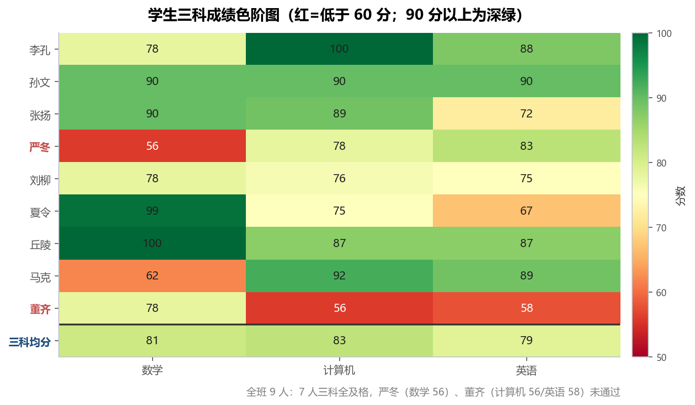
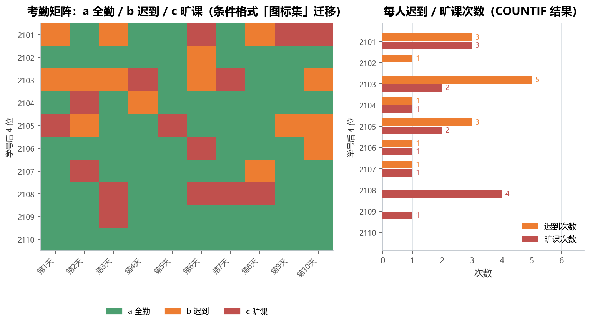
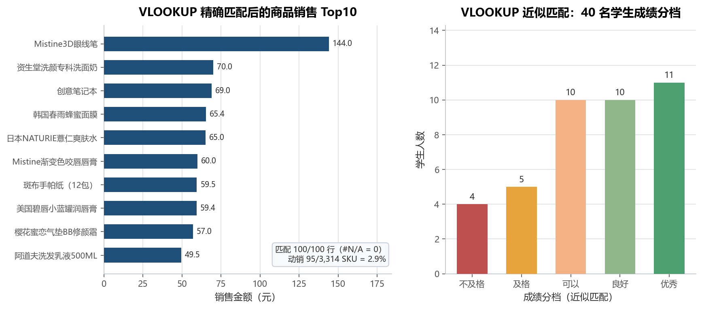
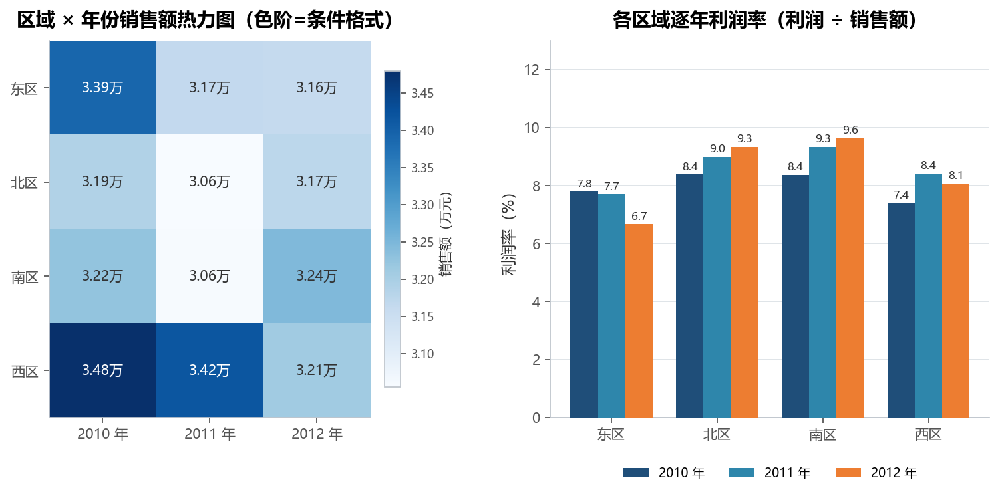
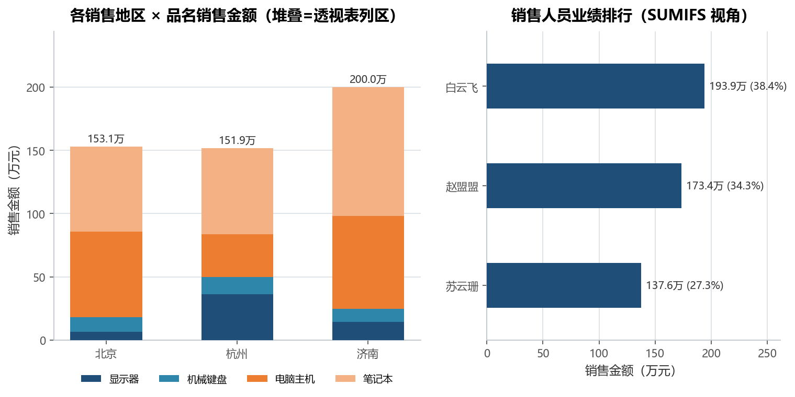

# 实验 01 · Excel 常用函数与数据透视表：公式思维 → 向量化 / 分组聚合

> **教材**：《CDA 一级认证教材：商业数据分析》第 2 章 数据分析方法 · WPS 电子表格「4、WPS电子表格的公式与函数」
> **原始素材**：`1EXCEL常用函数-讲解使用.xlsx`（4 个工作表）、`2透视表&条件格式&引用&查找练习.xlsx`（4 个工作表）、`sale.csv`（12 行 × 4 列，GBK 编码）
> **迁移方向**：Excel/WPS 的 `IF/AND/OR`、`COUNTIF/COUNTIFS/SUMIFS`、`VLOOKUP`、相对/绝对引用、数据透视表、条件格式 → **numpy 布尔运算 / `np.select`、pandas 布尔索引 / `merge` / `pivot_table`、matplotlib 热力图**
> **对应脚本**：[`lab01_excel_functions.py`](./lab01_excel_functions.py)

---

## 1. 教材在做什么（项目内涵）

这一节教材不是"讲一个案例"，而是把 Excel 做数据分析的**六个基本功**逐个练一遍，
每个工作表是一道独立的作业：

1. **逻辑判断**（`IF + AND + OR`）：学生成绩表里，判断"三门全及格"和"三门有一门及格"，
   分别对应 `AND` 与 `OR` —— 这是所有分档、打标、风控规则的起点；
2. **条件计数**（`COUNTIF / COUNTIFS`）：课堂考勤记录用 a/b/c 标记全勤/迟到/旷课，
   统计每人迟到几次、旷课几次，以及"第 1 天和第 2 天都迟到"的人数；
3. **精确查找**（`VLOOKUP`）：100 张订单只有商品编码，要从 3314 条商品档案里把
   **商品名称**回填进来 —— 这就是今天说的"多表关联 / join"；
4. **近似查找**（`VLOOKUP` 第 4 参数省略）：40 名学生的分数按 5 个分数段打等级，
   本质是"分箱（binning）"；
5. **单元格引用**（相对/绝对/混合引用）：用 1 个公式拖出九九乘法表，
   练的是"公式如何随位置变化"；
6. **数据透视表 + 条件格式**：3 个地区 × 3 名销售员 × 4 个品名的 36 行明细，
   按地区和品名汇总，并用数据条/色阶/图标集让数字"自己说话"。

**为什么值得迁移**：Excel 的六个基本功，在 pandas 里对应六种完全不同的写法，
但共同点是——**都是从"逐格处理"变成"整列处理"**。Excel 里 `=IF(AND(E2>=60,...))`
写在第 2 行再往下拖，公式被复制 100 次；pandas 里一次布尔运算就得到整列结果。
理解了这层对应关系，才能判断"这个分析该不该搬到代码里"：

| 场景 | 留在 Excel 更合适 | 该搬到 Python |
|---|---|---|
| 一次性、几十行、要给别人看格式 | ✅ | |
| 每月重复、数据量上万行、要留痕可复跑 | | ✅ |
| 多表关联、口径复杂、要做统计检验 | | ✅ |

本实验的数据量都很小（最多 3314 行商品档案），所以重点不在"跑得快"，
而在**把口径写成可复核的代码**：脚本里每个结论都和教材的答案列做了逐行核对
（成绩 9/9 一致、考勤 10/10 一致、'第 1、2 天都迟到' 1 人与教材一致）。

---

## 2. 数据说明

### 2.1 数据集清单

| 文件 | 工作表 | 规模 | 粒度 | 本实验用途 |
|---|---|---|---|---|
| `1EXCEL常用函数-讲解使用.xlsx` | `1、IF+AND+OR例子` | 9 行 × 9 列 | 一名学生一行 | IF/AND/OR 判定 |
| 同上 | `2、COUNTIF-统计` | 10 行 × 10 天 + 2 列结果 | 一名学生 × 一天一格 | COUNTIF/COUNTIFS |
| 同上 | `3、VLOOKUP精确查找` | 订单 100 行；商品档案 3314 行 | 一张订单 / 一个 SKU | VLOOKUP 精确匹配 |
| `2透视表&条件格式&引用&查找练习.xlsx` | `查找` | 40 行 + 5 档分数表 | 一名学生一行 | VLOOKUP 近似匹配 |
| 同上 | `数据透视表` | 36 行 × 6 列 | 地区 × 销售员 × 品名 | 数据透视表 |
| 同上 | `单元格引用` / `条件格式` | 9×9 / 演示区 | — | 引用与格式的讲解素材 |
| `sale.csv` | — | 12 行 × 4 列（GBK） | 市场 × 年份 | 透视 + 利润率 |

### 2.2 关键字段

**学生成绩表**（`1、IF+AND+OR例子`）

| 字段 | 含义 | 类型 | 备注 |
|---|---|---|---|
| 班级 / 学号 / 姓名 | 学生标识 | 整数 / 文本 | 3 个班共 9 人 |
| 性别 | 男 / 女 | 文本 | 男 5 人、女 4 人 |
| 数学 / 计算机 / 英语 | 三科成绩 | 整数 | 0–100，无缺失 |
| 评价（三门均通过为通过） | 教材用 `IF+AND` 算出的答案 | 文本 | 用作本脚本的核对基准 |
| 评价（三门之一通过为通过） | 教材用 `IF+OR` 算出的答案 | 文本 | 同上 |

**销售明细表**（`数据透视表`）

| 字段 | 含义 | 类型 | 备注 |
|---|---|---|---|
| 销售地区 | 北京 / 杭州 / 济南 | 文本 | 3 个地区 |
| 销售人员 | 白云飞 / 赵盟盟 / 苏云珊 | 文本 | 每人 12 行 |
| 品名 | 显示器 / 机械键盘 / 电脑主机 / 笔记本 | 文本 | 4 个品名 |
| 数量 / 单价 / 销售金额 | 件数、单价、金额 | 整数 / 整数 / 整数 | 勾稽：数量 × 单价 = 金额（误差 0.00） |

**sale.csv**（GBK 编码）

| 字段 | 含义 | 类型 | 备注 |
|---|---|---|---|
| `year` | 年份 | 整数 | 2010–2012 |
| `market` | 市场 | 文本 | 东 / 南 / 西 / 北 |
| `sale` | 销售额 | 整数 | 元 |
| `profit` | 利润 | 整数 | 元，利润率 = profit / sale |

### 2.3 质量检查

- 三张表的缺失值均为 0（商品档案只是"未被订单引用"，不是缺失）；
- `sale.csv` 是 **GBK 编码**，pandas 默认 UTF-8 会直接抛 `UnicodeDecodeError`，脚本显式写了 `encoding="gbk"`；
- 考勤表的表头是 Excel 日期序列号（37987–37996），脚本统一改写成"第 1 天…第 10 天"，避免序列号误读；
- 商品档案有 3314 条、订单只有 100 行 → 只有 95 个 SKU 有动销，这个"动销率"是后面一条重要结论；
- 成绩表里 `学号` 被 Excel 存成浮点（90201.0），脚本读入后统一转整数。

---

## 3. Excel 操作 ↔ pandas 对照

| 教材里的操作 | Excel / WPS 写法 | Python 实现 | 差异与注意点 |
|---|---|---|---|
| 三科**全部**及格 | `=IF(AND(E2>=60,F2>=60,G2>=60),"通过","未通过")` | `np.where((m>=60)&(c>=60)&(e>=60), "通过","未通过")` | pandas 用 `&` 连接条件，**每个条件都要加括号**；不能写 `and` |
| 三科**任一**及格 | `=IF(OR(E2>=60,F2>=60,G2>=60),...)` | `np.where((m>=60) \| (c>=60) \| (e>=60), ...)` | 用向量化的竖线运算符连接条件；写成 `or` 会报 `ValueError: truth value ambiguous` |
| 多分支分档 | `=IFS(...)` 或嵌套 `IF` | `np.select(conds, choices, default=...)` | `np.select` 等价于 IFS，条件从上到下**命中即止**，顺序不能乱 |
| 每人迟到次数 | `=COUNTIF(B2:K2,"b")` | `(codes=="b").sum(axis=1)` | 逐行计数时 `axis=1` 不能漏，否则得到整列合计 |
| 迟到 + 旷课两个条件 | `=COUNTIFS(B2:B11,"b",C2:C11,"b")` | `((codes["D1"]=="b") & (codes["D2"]=="b")).sum()` | 多条件计数 = 布尔列相乘再求和，不需要专门的函数 |
| 按销售员求和 | `=SUMIFS(F:F,B:B,"白云飞")` | `df.groupby("销售人员")["销售金额"].sum()` | 一次算出所有人，不用为每个名字写一行公式 |
| 商品名称回填 | `=VLOOKUP(A2,$G$2:$H$3315,2,FALSE)` | `orders.merge(lookup, how="left", left_on=..., right_on=...)` | 左连接保留全部订单；`$G$2:$H$3315` 的绝对引用对应"右表整体" |
| 匹配不到显示 #N/A | `=IFERROR(VLOOKUP(...),"未匹配")` | `merged["pname"].fillna("#N/A")` | 左连接后匹配不到自然是 `NaN`，等价于 #N/A；本次数据 0 行未匹配 |
| 分数段打等级 | `=VLOOKUP(F2,$F$2:$G$6,2,TRUE)`（近似匹配） | `pd.cut(x, bins=[-1,60,70,80,90,101], labels=..., right=False)` | 近似匹配取"≤查找值的最后一个分界点"；`pd.cut` 要显式指定 `right=False` 才能和 Excel 一致 |
| 九九乘法表 1 个公式拖 81 格 | `=$A2*B$1` + 混合引用 + `IF` 留空 | `n[:,None] * n[None,:]` + `np.tril` 掩码 | 没有"拖拽"这回事：行向量 × 列向量一次得到 9×9，掩码控制哪些格留空（45 个有效格） |
| 数据透视表 | 行=销售地区、列=品名、值=求和项:销售金额 | `df.pivot_table(index="销售地区", columns="品名", values="销售金额", aggfunc="sum", margins=True)` | `margins=True` = 透视表的"总计"行/列 |
| 透视表"值显示方式 → 行百分比" | 右键 → 值显示方式 → 行汇总的百分比 | `pd.crosstab(a, b, normalize="index")` | `normalize="index"` 按行、`"columns"` 按列、`"all"` 按总数 |
| 条件格式 → 色阶 | 开始 → 条件格式 → 色阶 | `ax.imshow(matrix, cmap="RdYlGn")` + 逐格 `text()` | 热力图 = 色阶 + 数值标签；配色要保证浅色格子用深色字 |
| 条件格式 → 数据条 | 开始 → 条件格式 → 数据条 | `ax.barh()` | 代码里更常见的做法是直接画条形图，可读性更好 |
| 条件格式 → 图标集 | 红/黄/绿图标 | `ListedColormap([GREEN, ORANGE, RED])` + `imshow` | 三色离散色阶 + 图例，比图标集更易读 |

---

## 4. 代码结构与关键点

```
lab01_excel_functions.py
├── if_and_or()            # ① IF/AND/OR + np.select → 成绩判定 + 色阶图
├── countif_attendance()   # ② COUNTIF/COUNTIFS → 考勤矩阵 + 迟到旷课排行
├── vlookup_products()     # ③ VLOOKUP 精确匹配 → 商品销售 Top10
│   └── load_scores()      #     VLOOKUP 近似匹配 → pd.cut 成绩分档
├── sale_region_year()     # ④ sale.csv（GBK）→ 区域×年份热力图 + 利润率
├── pivot_sales()          # ⑤ 数据透视表 → 地区×品名堆叠图 + 销售员排行
├── reference_demo()       # ⑥ 相对/绝对引用 → 广播 + np.tril
└── main()                 # 串起 6 个练习 + 打印业务结论
```

三个值得记住的写法：

1. **`merge(how="left")` 就是 VLOOKUP 的替身，`NaN` 就是 #N/A**：
   `orders.merge(lookup, how="left", on="code")` 保留全部左表行，右表没有的补 `NaN`；
   想显示成文字就 `.fillna("#N/A")`——`IFERROR` 的全部作用不过如此。
2. **条件计数不需要专门函数，布尔矩阵就是 COUNTIF**：
   `(codes == "b").sum(axis=1)` 是逐行 COUNTIF，`(A & B).sum()` 是 COUNTIFS。
   写的时候记住：`sum(axis=1)` 是"横着数"，`sum()` 是"竖着加"。
3. **`np.select` 是嵌套 `IF/IFS` 的正确打开方式**：
   `np.select([avg>=90, avg>=80, avg>=70], ["优秀","良好","中等"], default="待提升")`，
   条件列表、结果列表一一对应，比手写 `np.where` 嵌套三层可读得多。

---

## 5. 运行结果与解读

### 5.1 成绩判定：9 人里 7 人全科通过，瓶颈在单科



- 9 名学生里 **7 人三科全及格**，未通过的是严冬（数学 56）和董齐（计算机 56、英语 58）；
- 三科均分 数学 81 / 计算机 83 / 英语 79，三科各只有 1 人不及格，**不是某一科整体塌方**，
  而是个别学生的偏科；
- 脚本用 `np.where` 重算了教材两列"评价"，**AND 与 OR 的一致性都是 100%**，
  说明逻辑迁移没有走样；
- 但 `OR`（任一门及格即通过）口径下 **9 人全部通过**——这个口径没有任何区分度，
  教材把它和 `AND` 放在一起，正好说明"口径选择比公式写法更重要"。

### 5.2 考勤：10 人 100 条记录里，迟到和旷课各 15 次



- 10 名学生 × 10 天 = 100 条记录：全勤 70 次、迟到 15 次、旷课 15 次；
- **只有 1 人（2110）全勤 10 天**；迟到最多的是 2103（5 次）、旷课最多的是 2108（4 次），
  2103 的出勤率只有 30%；
- 脚本重算的迟到/旷课次数与教材 `COUNTIF` 结果 **10/10 人完全一致**；
- `COUNTIFS` 的答案也复现了：第 1、2 天都迟到的只有 **1 人**（与教材第 18 行一致），
  而"迟到 ≥3 次且旷课 ≥2 次"的有 **3 人**——这类多条件组合才是考勤管理真正要盯的名单。

### 5.3 VLOOKUP：100 张订单全部匹配，但只有 2.9% 的 SKU 动销



- 100 行订单从 3314 条商品档案回填名称，**匹配 100/100 行，#N/A = 0**，
  说明教材的档案表是完整的；脚本仍然保留了 `fillna("#N/A")` 的兜底逻辑，
  换成真实业务数据（档案缺 SKU 很常见）时不用改代码；
- 但 3314 个 SKU 里**只有 95 个有销售记录，动销率 2.9%**（3219 个零动销）——
  这才是这张表里最有价值的业务信息，Excel 的 VLOOKUP 不会主动告诉你；
- 100 张订单合计 176 件、2123.0 元；Top1 商品「Mistine3D眼线笔」144.0 元，
  占全部销售额的 **6.8%**，长尾极长；
- 右侧是近似匹配：40 名学生按 5 档划分 → 不及格 4、及格 5、可以 10、良好 10、优秀 11。
  近似匹配的分界点是"左闭右开"，`pd.cut(..., right=False)` 才能和 Excel 对齐，
  否则 60 分会掉进"不及格"档。

### 5.4 sale.csv：区域 × 年份的销售额几乎没有波动，利润率才是差异点



- 12 行 = 4 个市场 × 3 年，三年合计销售额 **387,696 元**，整体利润率 **8.33%**；
- 三年变化：东区 **-6.8%**、西区 **-7.7%** 在退，南区 +0.6%、北区 -0.4% 基本持平；
- 最高组合是西区 2010 年 34,792 元，最低 30,555 元，**极差只有 13.9%**——
  说明这份数据是"平稳盘"，用它练透视表合适，但它撑不起"增长故事"；
- 利润率从 6.7%（东区 2012）到 9.6%（南区 2012），**波动比销售额大得多**：
  销售额垫底的东区，利润率也是最低的，属于"量价双弱"，值得单独复盘。

### 5.5 数据透视表：笔记本一个品名撑起 47% 的销售额



- 36 行明细合计 **504.95 万元 / 2,774 件**，「数量 × 单价 = 金额」勾稽误差 0.00 元；
- 地区：济南 **200.0 万** > 北京 153.1 万 > 杭州 151.9 万；
- 品名：笔记本 **237.3 万（47.0%）**、电脑主机 175.0 万（34.7%）、显示器 57.0 万（11.3%）、
  机械键盘 35.6 万（7.1%），前两个品名合计超过 80%；
- 销售员：白云飞 193.9 万（38.4%）、赵盟盟 173.4 万（34.3%）、苏云珊 137.6 万（27.3%），
  **首尾差 40.9%**；但三个人在 4 个品名上的结构**完全一样（各 25%）**——
  这说明业绩差距纯粹来自"量"，不是"卖错东西"，所以管理动作应该是加目标/加支持，
  而不是调整产品结构。若只看总金额排名，是看不出这一层的。

---

## 6. 复现方式

```bash
cd 01_一级教材_第02章_Excel函数与透视表
python lab01_excel_functions.py
```

- 依赖：`pandas`、`numpy`、`matplotlib`、`openpyxl`（见仓库根 `requirements.txt`）；
- 输入：`data/` 下的 2 个 xlsx + `sale.csv`（均已复制进仓库，clone 后可直接运行）；
- 输出：`outputs/` 下 **5 张 PNG + 4 个 CSV**：
  - `fig01_学生成绩色阶与IF判定.png`、`fig02_考勤矩阵与COUNTIF统计.png`、
    `fig03_VLOOKUP精确匹配与近似分档.png`、`fig04_区域年份销售额与利润率.png`、
    `fig05_地区品名透视与销售员排行.png`；
  - `table01_学生成绩与IF判定.csv`、`table02_课堂考勤统计.csv`、
    `table03_VLOOKUP匹配与商品销售.csv`、`table04_地区品名销售透视.csv`。

---

## 7. 小结与思考

1. **公式思维是"逐格"，代码思维是"整列"**：`IF` 拖 100 行 = 100 次求值，`np.where` 一次算完整列；
   迁移时真正要改的不是语法，而是"从行视角切到列视角"。
2. **`merge` 是 VLOOKUP 的超集**：VLOOKUP 只能返回右边第 N 列、只能匹配一个键，
   `merge` 可以多键、可以保留未匹配行（`indicator=True` 还能直接标出匹配来源）。
3. **条件格式在代码里就是"把数值映射成颜色"**：色阶 = `imshow(cmap=...)`，
   图标集 = 离散 `ListedColormap`，数据条 = `barh`；
   区别是 Excel 里格式绑在单元格上、代码里颜色绑在数据上——**数据变了图自动变**。
4. **核对答案是最便宜的验证**：教材已经给了"评价"列、`COUNTIF` 结果和乘法表，
   脚本逐行比对（9/9、10/10、45 格）比"看着差不多"可靠得多。

> 思考题：如果把 `sale.csv` 换成"每月一份、文件名带日期"的 12 个文件，
> 怎样用同一个函数读进来并保持 `year × market` 的透视结果不变？
> 提示：`pd.concat([...], ignore_index=True)` 之后再透视；
> 注意 GBK 与 UTF-8 混用时要给每个文件单独指定 `encoding`。
