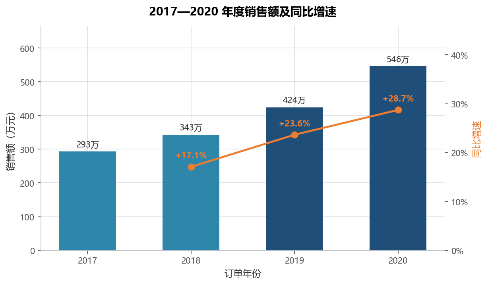
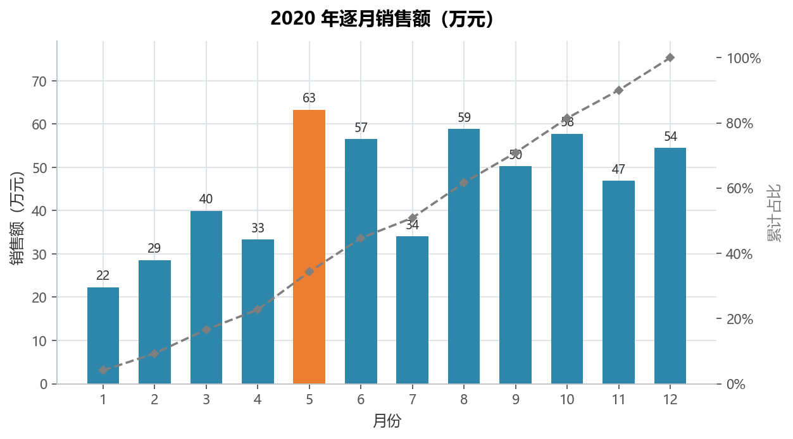
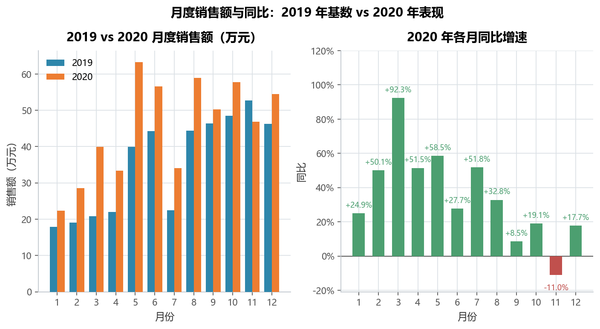
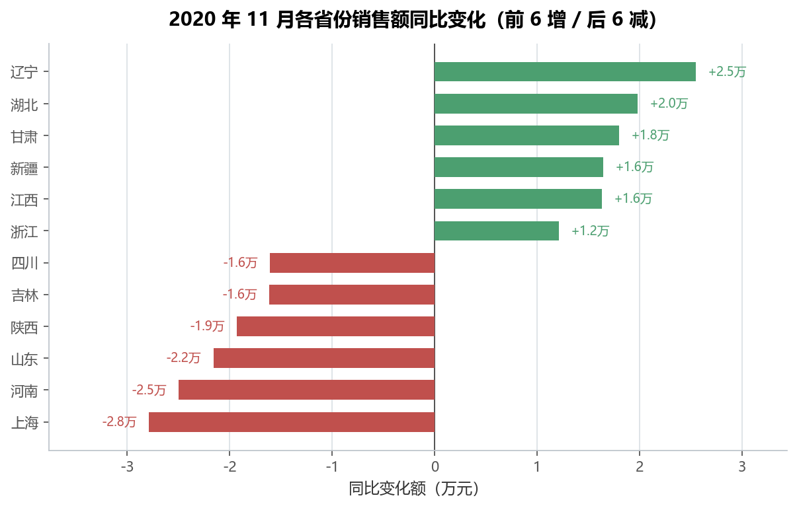
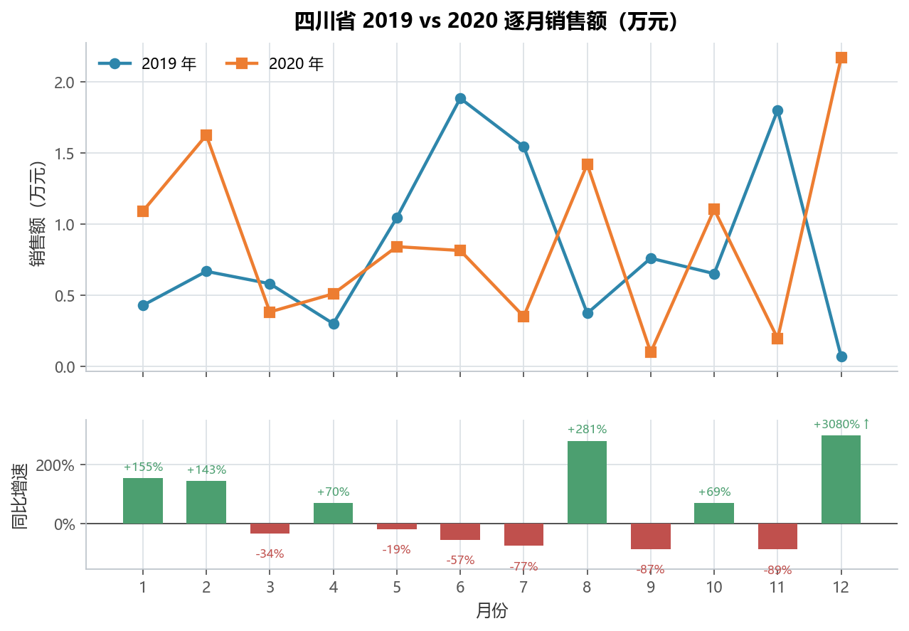

# 实验 02 · 收入趋势分析：Excel 多层透视下钻 → pandas

> **教材**：《CDA 一级认证教材：商业数据分析》第 3 章 商业数据分析框架 · 案例 1「收入趋势分析」
> **原始素材**：`案例1：收入趋势分析原始数据.xlsx`（1187 行 × 4 列）
> **迁移方向**：WPS/Excel 数据透视表 + 组合图 + 切片器 → **pandas + matplotlib**
> **对应脚本**：[`lab02_revenue_trend.py`](./lab02_revenue_trend.py)

---

## 1. 教材在做什么（项目内涵）

这个案例是商业分析里最标准的「**趋势 → 异常 → 下钻**」三段式：

1. **看大盘**：把 2017—2020 年的订单明细按年汇总，算同比，判断整体是增长还是衰退；
2. **看节奏**：锁定 2020 年，按月拆开，看销售是"前高后低"还是"年底冲量"；
3. **找异常**：把 2020 年各月与 2019 年同月对比（同比），发现 11 月是全年唯一负增长；
4. **定位责任**：把 11 月按省份拆开，找出拖累最大的省份；
5. **再下钻**：锁定四川，看它 12 个月的走势，判断是偶发还是持续。

教材用 Excel 数据透视表完成这 5 层：拖动字段到行/列/筛选区，加「差异百分比」计算项，
再套用组合图（柱形 + 折线）和切片器。**这套操作的本质，是"按维度分组 + 聚合 + 组间比较"**，
而这恰好是 `groupby` / `pivot_table` / `pct_change` 最擅长的三件事。

> 为什么值得迁移：Excel 透视表是"手工一次、结果静态"的，换一年数据就要重拖一遍；
> Python 写一次，明年换文件即可复跑，而且可以批量输出所有省份/月份的同比，
> 不必靠切片器一个一个点。

---

## 2. 数据说明

| 字段 | 含义 | 类型 | 备注 |
|---|---|---|---|
| `订单年份` | 订单所属年份 | 整数 | 2017—2020 |
| `订单月份` | 订单所属月份 | 整数 | 1—12 |
| `销售省份` | 客户所在省份 | 文本 | 31 个省级行政区 |
| `销售额` | 订单金额（元） | 浮点 | 无缺失、无负数 |

- 数据规模：1187 行，粒度是「年 × 月 × 省」的汇总值（不是单笔订单）；
- 质量检查：脚本里做了 `dropna` 与类型转换，并在控制台打印了时间跨度、省份数；
- 数据源：教材配套素材，仅用于课程实验，未做任何外网采集。

---

## 3. Excel 操作 ↔ pandas 对照

| 教材里的操作 | Excel / WPS 写法 | Python 实现 | 差异与注意点 |
|---|---|---|---|
| 按年汇总销售额 | 透视表：行=订单年份，值=求和项:销售额 | `df.groupby("year")["sales"].sum()` | 结果完全一致，可逐格核对 |
| 计算同比增速 | 透视表「值显示方式 → 差异百分比（年份）」 | `series.pct_change()` | Excel 首年显示空白，pandas 为 `NaN`，含义相同 |
| 筛选 2020 年再按月汇总 | 透视表筛选器 + 行=订单月份 | `df[df.year==2020].groupby("month")` | Python 用布尔索引代替筛选器 |
| 年 × 月交叉表 | 透视表行=月份、列=年份 | `pivot_table(index="month", columns="year")` | `pivot_table` 是透视表的直接对应 |
| 按省份做同比 | 行=省份、列=年份 + 差异百分比 | `pivot_table` 后列相除 | Python 可一次算完 31 个省，Excel 要一列列拖 |
| 切片器逐级下钻 | 切片器选「省份=四川」 | `df[df.province=="四川"]` | 代码下钻可写成循环，批量输出所有省 |
| 组合图（柱 + 线） | 插入组合图，设次坐标轴 | `ax.bar()` + `ax.twinx().plot()` | `twinx()` 即"次坐标轴" |
| 图表配色/标签 | 手动改主题、加数据标签 | `common/style.py` 统一风格 + `bar_labels()` | 一次配置，全部图统一 |

---

## 4. 代码结构与关键点

```
lab02_revenue_trend.py
├── load_data()            # 读取 + 字段规范 + 生成 period 月份轴
├── yearly_trend()         # 第 1 层：年度汇总 + 同比 + 组合图
├── monthly_2020()         # 第 2 层：2020 逐月 + 环比 + 累计占比
├── monthly_yoy()          # 第 3 层：2019 vs 2020 月度同比（双面板图）
├── province_yoy_nov()     # 第 4 层：11 月省份同比，排序找异常
├── sichuan_drilldown()    # 第 5 层：四川省 12 个月下钻
└── main()                 # 串起 5 层 + 打印业务结论
```

三个值得记住的写法：

1. **`pivot_table` 就是透视表**：`index`/`columns`/`values`/`aggfunc` 分别对应行区、列区、值区、汇总方式。
2. **同比用 `pct_change()`，环比也用 `pct_change()`**，区别只在于排序的维度是"年"还是"月"。
3. **下钻 = 多重布尔过滤 + groupby**：`df[df.month==11][df.year.isin([2019,2020])]` 就能替代切片器。

---

## 5. 运行结果与解读

### 5.1 年度趋势：四年翻近一倍，增速还在加快



- 销售额 293 万 → 343 万 → 424 万 → 546 万，**年均复合增速 23.1%**；
- 同比增速从 17.1% 抬升到 28.7%，说明增长在加速，不是靠基数低"躺赢"；
- 业务含义：如果 2021 年维持 25% 左右增速，全年目标可定在 680 万上下。

### 5.2 2020 年月度节奏：上半年偏弱、下半年发力



- 全年最高月是 **5 月（63.3 万，占 11.6%）**，最低月出现在 1 月（22.3 万）；
- 上半年只占 44.7%，下半年占 55.3%，**销售重心明显在后半年**；
- 累计占比到 10 月才过 80%，全年没有依赖单一大月，销售节奏相对健康。

### 5.3 月度同比：11 月是全年唯一的负增长



- 12 个月里只有 **11 月同比 -11.0%**，其余月份全部正增长；
- 3 月同比 +92.3% 为全年最高，与 2019 年 3 月基数偏低有关，看同比时要结合基数解读；
- 这正是教材要训练的判断：**先看同比异常，再问"为什么是这个月"**。

### 5.4 定位异常：缺口集中在少数省份



- 11 月总额从 52.7 万降到 46.9 万，同比 -11.0%；
- 拖累最大的是 **上海（-2.8 万，-74.3%）**，其次是河南（-2.5 万）、山东（-2.2 万）；
- 同时辽宁（+3.2 万）、湖北（+2.0 万）在增长，说明不是全国性需求问题，
  更像**区域性渠道或大客户问题**——这类结论直接决定复盘的方向。

### 5.5 下钻四川：单月暴跌但全年仍正增长



- 四川 2020 年全年 10.6 万，同比 **+4.9%**；
- 但 11 月从 1.8 万跌到 0.2 万（约 -89%），属于**单月偶发异常**，不是趋势性下滑；
- 12 月又从 682 元跳到 2.2 万（+3080%），图里做了**截断显示**——这正说明
  **省级小样本的同比会被低基数放大**，看同比必须回到绝对值和基数，不能只看百分比；
- 对应业务动作：先核对 11 月是否有退货冲销、渠道切换或录入口径变化，
  再决定是否需要给该省补资源，而不是直接砍预算。

---

## 6. 复现方式

```bash
cd 02_一级教材_第03章_收入趋势分析
python lab02_revenue_trend.py
```

- 依赖：`pandas`、`numpy`、`matplotlib`、`openpyxl`（见仓库根 `requirements.txt`）；
- 输入：`data/案例1：收入趋势分析原始数据.xlsx`；
- 输出：`outputs/` 下 5 张 PNG + 5 个 CSV（CSV 可直接与教材透视表逐格核对）。

---

## 7. 小结与思考

1. **透视表 = groupby + pivot_table**：教材里拖字段的动作，在代码里就是指定 `index/columns/values`；
2. **同比/环比只是排序维度不同**：按年排序算同比，按月排序算环比，公式是同一个 `pct_change()`；
3. **下钻的本质是"逐层加过滤条件"**：年 → 月 → 省，每层都可以写成一个函数，组合起来就是分析路径；
4. **异常分析要给"责任归属"**：只说"11 月掉了"没有价值，说到"上海掉了 2.8 万、四川是单月偶发"才有决策价值。

> 思考题：如果 2021 年 1 月数据到手，如何用同一套代码只改一个文件名就跑出新年度的
> 「趋势 → 异常 → 下钻」报告？提示：把年份参数化，把"异常月份"从写死的 11 月改成
> `yoy.idxmin()`。
