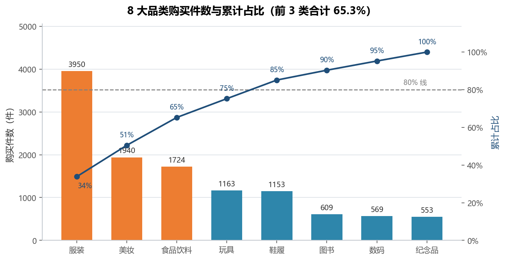
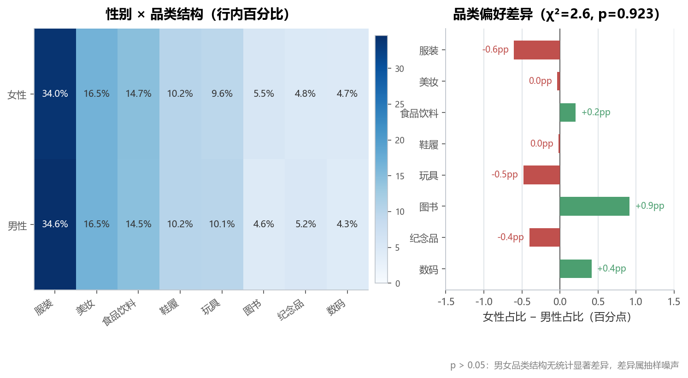
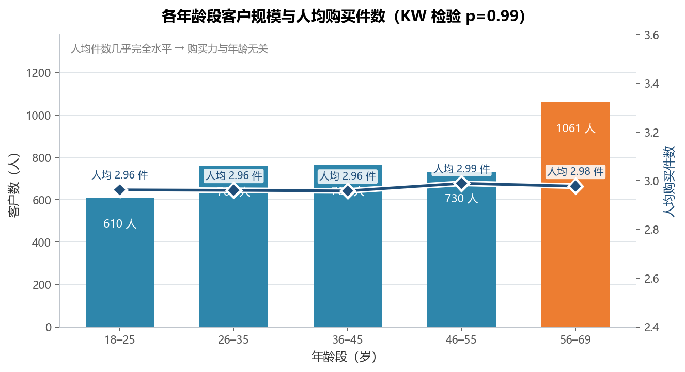
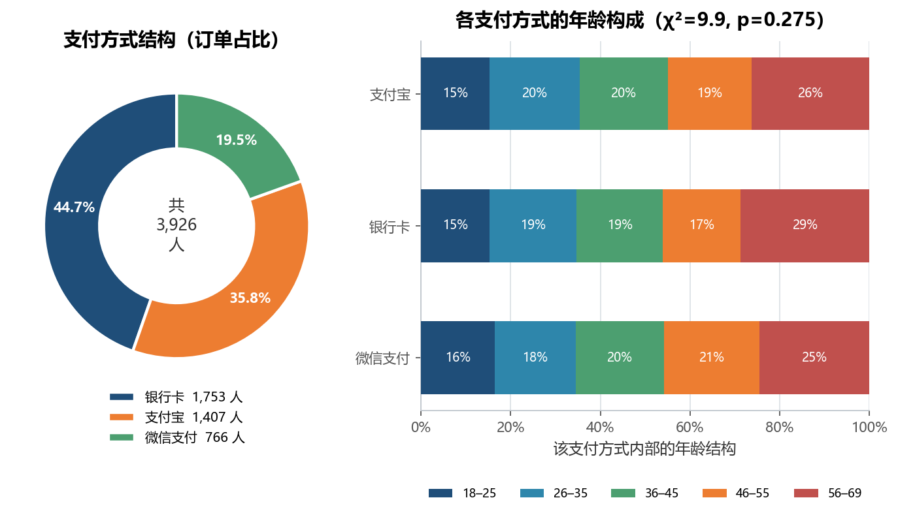
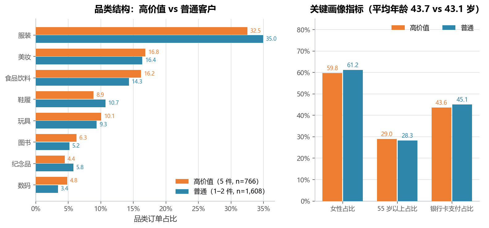

# 实验 03 · 电商精准营销：从 Excel 交叉表到"结构 + 假设检验"

> **教材**：《CDA 一级认证教材：商业数据分析》第 3 章 商业数据分析框架 · 案例 3「电商平台的精准营销」
> **原始素材**：`案例3：电商平台的精准营销-原始数据.xlsx`（3926 行 × 8 列）
> **迁移方向**：Excel/WPS 数据透视表 + 筛选 + 描述统计 → **pandas `groupby` / `crosstab` + matplotlib + scipy 卡方检验**
> **对应脚本**：[`lab03_ecommerce_marketing.py`](./lab03_ecommerce_marketing.py)

---

## 1. 教材在做什么（项目内涵）

教材把"精准营销"拆成一条标准链路：**先看人（性别、年龄）→ 再看货（品类）→
再看人和货的交叉（谁买什么）→ 最后按画像给营销动作**。这条链路在商业上回答三个问题：

1. **卖给谁**：我的客群是男性还是女性、哪个年龄段是主力？
2. **卖什么**：哪些品类贡献了大部分销量？是否符合帕累托？
3. **怎么卖**：不同人群的品类偏好、支付习惯有没有差异，能不能据此做差异化投放？

但这份数据有两个硬约束，必须在动手前说清楚，否则后面全是编造：

| 约束 | 数据事实 | 后果 |
|---|---|---|
| 没有金额字段 | 8 列里只有"数量"（1–5 件） | 算不了客单价、GMV、RFM 里的 M |
| 客户 ID 唯一、月份/年份只有单值 | 3926 人 3926 条记录，全部 2023 年 1 月 | 算不了复购率、留存、时间趋势 |

所以本实验把分析单位锁定为"**一个客户的一次购买件数**"，把"精准营销"落到
**结构分析（品类/人群/支付）+ 假设检验（差异是否显著）** 上，不做任何金额层面的推测。

**为什么值得迁移**：教材用透视表看交叉表，眼睛看到的"男女品类偏好不同"，
很可能只是抽样噪声。Python 里加一个 `scipy.stats.chi2_contingency` 就能给出 p 值，
把"看起来"变成"检验过"——这是从"做表"到"做分析"的关键一步，也是 Excel 最难补的一课。
另外，透视表是"手工一次、结果静态"的，脚本化后换一份数据（比如下个月的 4000 行）
只需重跑一次，卡方、分档、图全部自动更新。

---

## 2. 数据说明

| 字段 | 含义 | 类型 | 备注 |
|---|---|---|---|
| `客户ID` | 客户编号 | 文本 | `C` + 6 位数字；**3926 个全部唯一** |
| `性别` | 性别 | 文本 | Male / Female；女 2371 人（60.4%），男 1555 人（39.6%） |
| `年龄` | 年龄 | 整数 | 18–69 岁，均值 43.3，中位数 43 |
| `品类` | 购买品类 | 文本 | 8 类：Clothing / Cosmetics / Food & Beverage / Toys / Shoes / Books / Technology / Souvenir |
| `数量` | 购买件数 | 整数 | 1–5 件，均值 2.97 |
| `支付方式` | 支付渠道 | 文本 | Alipay / Card / WeChat Pay |
| `订单月份` | 订单月份 | 整数 | **全为 1** |
| `订单年份` | 订单年份 | 整数 | **全为 2023** |

- **数据规模**：3926 行 × 8 列；脚本派生 `age_group`（年龄段）与 `cat_cn`（品类中文名）两列；
- **质量检查**（脚本启动时打印）：
  - 缺失值 0 个，无重复客户 ID；
  - `订单月份` / `订单年份` 各只有 1 个取值 → 单时点截面，不能做趋势；
  - 件数分布接近均匀：1 件 787 人（20.0%）、2 件 821 人（20.9%）、3 件 806 人（20.5%）、
    4 件 746 人（19.0%）、5 件 766 人（19.5%）——这一点很关键，它意味着
    **"件数"更像一个随机分配的变量，而不是真实的价值分层**（后文第 5 节会验证）；
- **数据源**：教材配套素材，仅用于课程实验，未做任何外网采集。

---

## 3. Excel 操作 ↔ pandas 对照

| 教材里的操作 | Excel / WPS 写法 | Python 实现 | 差异与注意点 |
|---|---|---|---|
| 筛选女性客户 | 自动筛选 → 性别 = Female | `df[df["gender"] == "Female"]` | 布尔索引等价于筛选器，可写多个条件用 `&` |
| 性别 × 品类交叉计数 | 透视表：行=性别、列=品类、值=计数项:客户ID | `pd.crosstab(df["gender"], df["category"])` | `crosstab` 默认就是频数表，比 `pivot_table(aggfunc="size")` 更直接 |
| 交叉表看"行百分比" | 右键 → 值显示方式 → 行汇总的百分比 | `pd.crosstab(..., normalize="index")` | `"index"` 按行、`"columns"` 按列、`"all"` 按总数；教材这一步是手工算的 |
| 年龄分段（18–25 / 26–35 …） | `IF` 嵌套或 `VLOOKUP` 近似匹配分档 | `pd.cut(df["age"], bins=[17,25,35,45,55,69], labels=[...])` | `pd.cut` 默认左开右闭 `(17,25]`，即 25 岁归"18–25"档，与业务口径一致 |
| 品类销量排序 + 占比 | 透视表按值降序 + 再算百分比 | `groupby().agg()` + `.sort_values()` + `占比 = 件数 / 件数.sum()` | Python 可以一次算出订单数、件数、占比、累计占比 |
| 帕累托累计占比 | 手工加一列 `=SUM($C$2:C2)/SUM($C$2:$C$9)` | `series.cumsum() / series.sum()` | 累计占比直接向量化，不会因为插行而错位 |
| 判断男女偏好"是否真的不同" | 教材没有这一步（只能肉眼看） | `scipy.stats.chi2_contingency(交叉表)` | **迁移时补充**：p > 0.05 说明差异不显著，不能拿去做定向投放 |
| 比较各年龄段的购买力 | 透视表求平均 + 肉眼比大小 | `stats.kruskal(*groups)` | 件数是 1–5 的离散值，用秩检验比 ANOVA 稳妥 |
| 柱形图 + 折线图组合 | 插入组合图 + 次坐标轴 | `ax.bar()` + `ax.twinx().plot()` | `twinx()` 即"次坐标轴" |
| 环形图看支付结构 | 插入饼图 → 设置圆环 | `ax.pie(wedgeprops=dict(width=0.42))` | `width` 参数就是圆环宽度 |
| 数据条 / 百分比标签 | 条件格式 + 手动加标签 | `ax.barh()` + `annotate()` | 代码里标签和颜色都跟着数据走，改数据不用重画 |
| 图表配色 / 中文字体 | 手动改主题、改字体 | `common/style.py` 的 `apply_style()` | 一次配置，全仓库风格统一 |

---

## 4. 代码结构与关键点

```
lab03_ecommerce_marketing.py
├── load_data()              # 读表 + 换列名 + 派生年龄段/品类中文名 + 4 项可行性检查
├── category_structure()     # 品类件数、占比、累计占比 → 帕累托柱线组合图
├── gender_preference()      # 性别×品类行百分比热力图 + 卡方检验 + 差值图
├── age_structure()          # 年龄段规模 + 人均件数 + Kruskal-Wallis 检验
├── pay_structure()          # 支付方式环形图 + 各支付方式的年龄构成堆叠条
├── high_value_profile()     # 5 件 vs 1–2 件客户画像对比
└── main()                   # 串起 5 步 + 打印 4 条业务结论
```

三个值得记住的写法：

1. **先做可行性检查，再画图**：`df["cust_id"].is_unique`、`df["month"].nunique()==1`、
   "有没有金额列"这三问决定了后面能做什么。数据不支持的分析（客单价、RFM）
   要在报告里**明确写"不做"，而不是悄悄跳过**。
2. **`crosstab(normalize="index")` + `chi2_contingency` 是一对**：
   前者给出"结构差多少"，后者给出"这个差是不是噪声"。
   只报前者是描述统计，补上后者才是推断统计。
3. **`pd.cut` 的左开右闭是个坑**：`bins=[17,25,35,...]` 得到的是 `(17,25]`，
   25 岁落在"18–25"档；如果想"左闭右开"，要写 `right=False`——
   和 Excel 的近似匹配分档对齐时，这个参数一定要显式写出来。

---

## 5. 运行结果与解读

### 5.1 品类结构：服装一类占三分之一，前 3 类贡献 65.3%



- 件数：服装 **3,950 件（33.9%）**、美妆 1,940（16.6%）、食品饮料 1,724（14.8%）、
  玩具 1,163（10.0%）、鞋履 1,153（9.9%）、图书 609（5.2%）、数码 569（4.9%）、纪念品 553（4.7%）；
- 前 3 类合计 **65.3%**，但要累计到 80% 需要 **5 个品类**（前 4 类只有 75.3%）——
  这是"一超两强 + 长尾"，**不是典型的 20/80 帕累托**；
- 人均件数各品类都在 2.84–3.18 之间（数码 3.18 最高、纪念品 2.84 最低），
  说明品类之间只是"买的人多少"的差别，不是"买多买少"的差别；
- 业务含义：主推位、库存深度、直播坑位应该向服装/美妆/食品饮料集中，
  而不是把 8 个品类平均铺开。

### 5.2 性别 × 品类：看起来有差异，检验后没有差异（p = 0.923）



- 女性 2,371 人（60.4%）、男性 1,555 人（39.6%），女性是绝对主力；
- 但把两性的品类结构摊开看：服装 34.0% vs 34.6%、美妆 16.5% vs 16.5%、食品饮料 14.7% vs 14.5%……
  **最大差异只有 0.9 个百分点**（图书），并且方向并不符合"女性更爱美妆"的直觉；
- 卡方检验：**χ² = 2.55，df = 7，p = 0.923**（最小期望频数 70.9，满足检验前提），
  远大于 0.05 → **性别与品类在统计上独立**；
- 这条结论比"女性更爱买美妆"更有价值：它直接否掉了"按性别做品类定向"的方案，
  避免把预算花在一个不存在的差异上。

### 5.3 年龄段：56 岁以上人最多，但各年龄段人均都买 2.96 件



- 客群规模：18–25 岁 610 人（15.5%）、26–35 岁 761（19.4%）、36–45 岁 764（19.5%）、
  46–55 岁 730（18.6%）、**56–69 岁 1,061（27.0%）**；
- 但人均件数几乎是一条水平线：2.96 / 2.96 / 2.96 / 2.99 / 2.98，
  Kruskal-Wallis 检验 **H = 0.272，p = 0.992** → 年龄段之间没有差异；
- 也就是说，"56 岁以上人最多"是**人口结构**结论，不是"更会买"的结论；
  对他们做"提高客单"的动作，和其他年龄段不会有区别；
- 值得注意的口径提醒：56–69 岁占 27% 这个结构在真实电商里不常见，
  更像是合成数据的均匀抽样，写报告时应当标注数据来源。

### 5.4 支付方式：银行卡 44.7% 是第一大渠道，且与年龄无关



- 银行卡 **1,753 人（44.7%）** > 支付宝 1,407（35.8%）> 微信支付 766（19.5%）；
- 各支付方式内部的年龄构成也很接近（56–69 岁分别占 26% / 29% / 25%），
  卡方检验 **χ² = 9.86，df = 8，p = 0.275** → 年龄结构不影响支付方式；
- 三个人均件数也几乎一样（支付宝 2.972、银行卡 2.962、微信 2.986），
  说明支付渠道既不筛人、也不筛单；
- 业务含义：支付环节的抓手是"渠道覆盖率与费率"，而不是"给某类人推某种支付"；
  银行卡占比最高，联名卡/立减活动是唯一有规模效应的动作。

### 5.5 高价值客户：能识别出 19.5%，但画像和普通客户几乎一样



- 切法：件数只有 1–5，直接取 `quantile(0.8)` 会把 38.5% 的人划进来，
  所以取"买满 5 件"这一档 → **766 人（19.5%）**，才真正接近"前 20%"；
  对照组是 1–2 件的普通客户（1,608 人）；
- 画像对比：女性 59.8% vs 61.2%、平均年龄 43.7 vs 43.1 岁、55 岁以上 29.0% vs 28.3%、
  银行卡 43.6% vs 45.1%、服装品类 32.5% vs 35.0%——**每一项都只差 1–2 个百分点**；
- 品类结构也几乎重合（美妆 16.8% vs 16.4%、食品饮料 16.2% vs 14.3%），
  没有出现"高价值客户偏爱某类商品"的迹象；
- 结论：在这份数据里，"买得多"不能由性别、年龄、支付方式、品类解释，
  **高价值客户是一群"随机买满 5 件"的人**。对应的动作是普适的"满件数阶梯"
  （满 3 件包邮、满 5 件折上折），而不是"圈一批人做定向"。

---

## 6. 复现方式

```bash
cd 03_一级教材_第03章_电商精准营销
python lab03_ecommerce_marketing.py
```

- 依赖：`pandas`、`numpy`、`matplotlib`、`scipy`、`openpyxl`（见仓库根 `requirements.txt`）；
- 输入：`data/案例3：电商平台的精准营销-原始数据.xlsx`（已复制进仓库）；
- 输出：`outputs/` 下 **5 张 PNG + 4 个 CSV**：
  - `fig01_品类购买件数与帕累托.png`、`fig02_性别品类偏好热力图.png`、
    `fig03_年龄段客群与购买力.png`、`fig04_支付方式结构.png`、
    `fig05_高价值与普通客户对比.png`；
  - `table01_品类结构.csv`、`table02_性别品类偏好.csv`、
    `table03_支付方式结构.csv`、`table04_高价值客户对比.csv`；
- 脚本对数据只读不写，重复运行结果完全一致（无随机过程）。

---

## 7. 小结与思考

1. **数据决定方法边界**：没有金额就做不了客单价，客户 ID 唯一就做不了 RFM。
   把"不能做什么"写在报告开头，比硬凑一个"人均消费"更专业。
2. **描述统计要配推断统计**：交叉表的行百分比只能说明"差多少"，
   卡方检验才能说明"这个差是不是真的"；本例性别×品类 p = 0.923，
   直接否掉了一个看起来很合理的营销方案。
3. **"高价值客户画像"可能不存在**：当件数与所有人口属性都无关时，
   硬做人群分层只会得到一份"看起来很像"的对比表。识别不出来，
   就改用普适的激励规则——这也是结论，而且是有价值的结论。
4. **`pd.cut` / `crosstab` / `pivot_table` 是透视表的三件套**：
   分箱、交叉计数、多维汇总，分别对应教材里"分档、交叉表、透视表"三个操作。

> 思考题：如果平台补采了 `order_amount`（金额）和 `order_time`（下单时间），
> 你会怎样把这个脚本升级成 RFM 模型？提示：先按客户聚合（R = 距今天数、
> F = 订单数、M = 金额合计），再对三个指标做分位打分（1–5 分），
> 最后用 `R/F/M` 组合成 8 类客户；注意本数据的"一人一单"会让 F 全部等于 1，
> 升级前要先确认新数据的客户是否有多笔订单。
