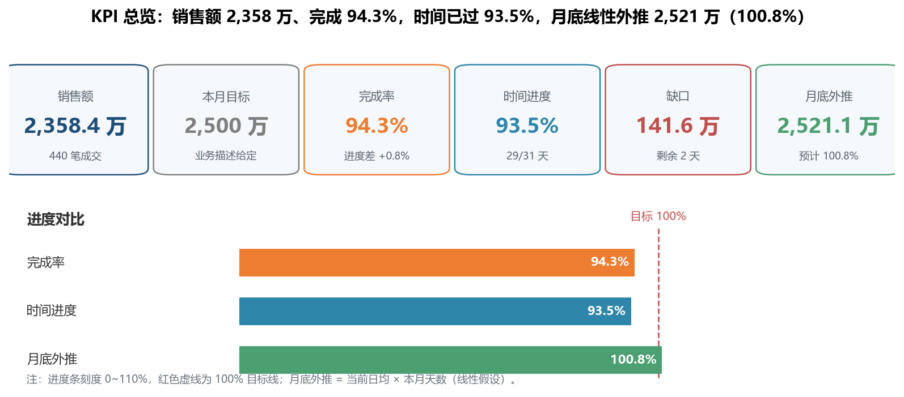
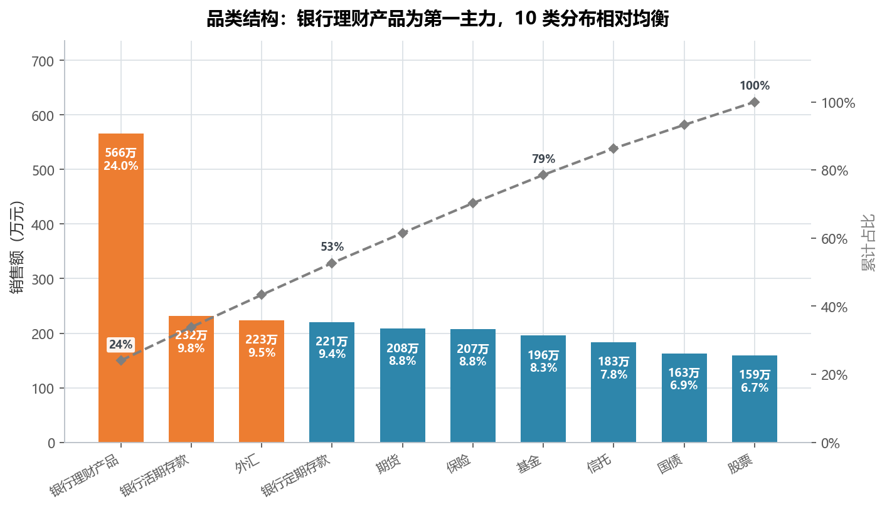
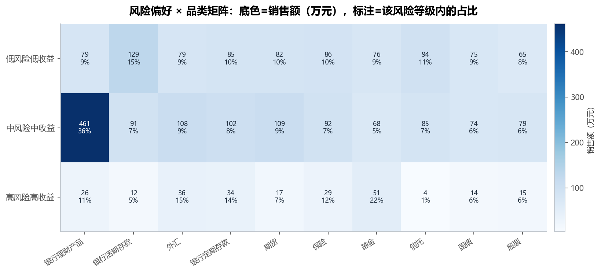
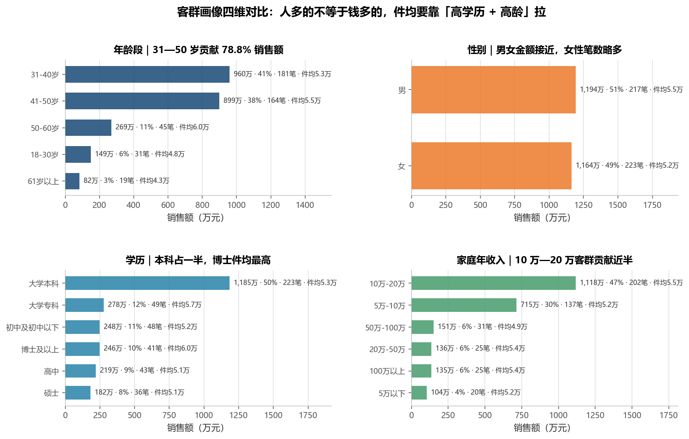
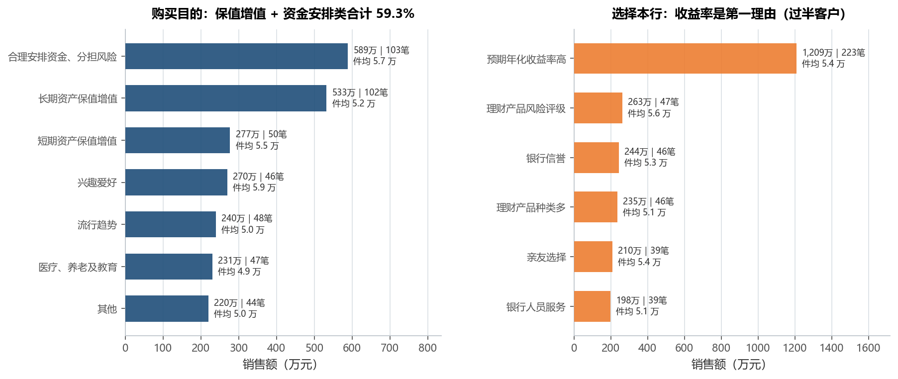
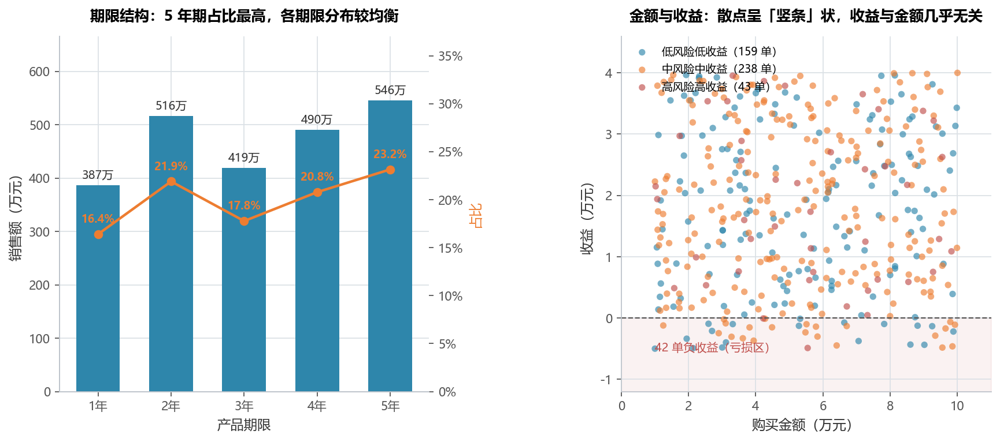
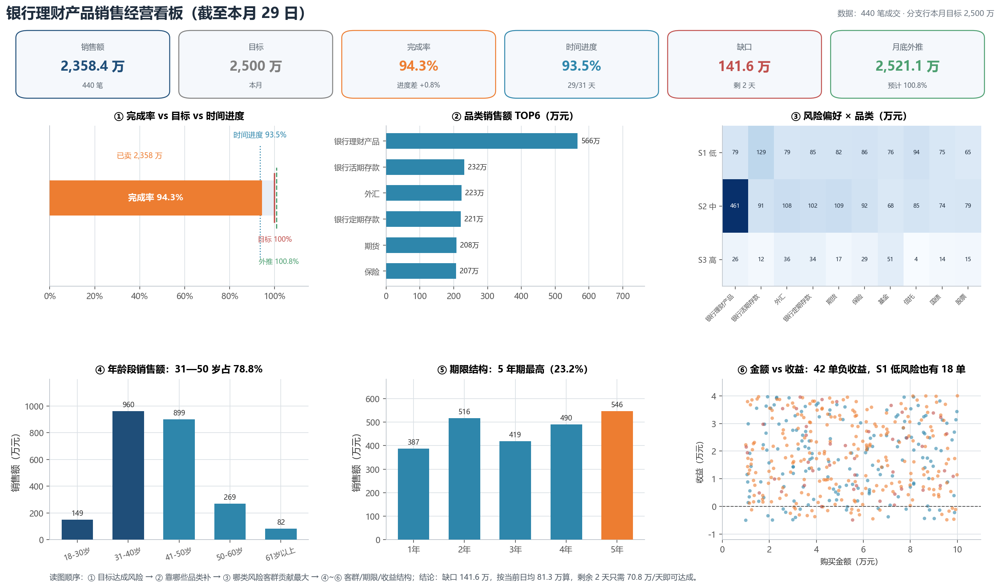

# 实验 04 · Power BI 银行理财产品经营看板：DAX 度量值与星型模型 → pandas

> **教材**：《CDA 一级认证教材：商业数据分析》第 5 章 业务数据分析 · Power BI 业务看板案例（银行案例）
> **原始素材**：`银行案例数据 - 学员用.xlsx`（销售数据 440 行 × 11 列 + 风险/品类/学历 3 张码表 + 业务描述）
> **迁移方向**：Power BI 星型模型 + DAX 度量值 + 切片器 + 卡片图/矩阵 → **pandas merge + 聚合函数 + matplotlib**
> **对应脚本**：[`lab04_powerbi_bank_dashboard.py`](./lab04_powerbi_bank_dashboard.py)

---

## 1. 教材在做什么（项目内涵）

这是全书唯一一个"完整 BI 看板"案例，业务背景写在 Excel 的「业务描述」工作表里：

> 某分支行本月理财产品的销售目标为 **2500 万**，本月共 **31 天**，当前数据是 **29 日**的时点数据，
> 机构负责人要在月底前判断"能不能完成、还差多少、靠哪些客群和品类补"。

教材要求学员用 Power BI 搭一页报表，回答四类问题：

1. **达成情况**：卖了多少钱？完成率多少？和"时间进度"比是快还是慢？月底能不能达成？
2. **结构在哪**：10 个品类里谁是主力？完成额靠哪几类撑起来？
3. **谁在买**：风险偏好 S1/S2/S3、年龄段、性别、学历、家庭年收入，哪一类客群贡献最大？
4. **为什么买**：购买目的、选择本行的原因，决定客户经理用什么话术去补缺口。

Power BI 里对应的是「建模 → 度量值 → 可视化 → 交互」四步：先把销售数据设为事实表、
三张说明表设为维度表并拖好关系，再写 `SUM` / `DIVIDE` / `CALCULATE` 度量值，
然后往画布上摆卡片图、簇状条形图、矩阵、切片器。**这套动作的本质是"维表映射 + 条件聚合 + 分组对比"**，
在 pandas 里就是 `merge` + `groupby`/`pivot_table` + matplotlib。

> 为什么值得迁移：Power BI 的 .pbix 文件打不开就没法复核，度量值藏在对话框里也难做代码评审；
> 换成 Python 后，每个 KPI 都是一个能单测的函数，换一个月的数据只改文件名即可复跑。

---

## 2. 数据说明

一个工作簿 5 张表，粒度是"一笔理财成交"，**没有日期字段**（只有 29 日这一个时点快照）：

| 工作表 | 规模 | 字段 / 用途 |
|---|---|---|
| `销售数据`（事实表） | 440 行 × 11 列 | 风险编号、购买目的、家庭年收入、品类编号、年龄、性别、选择本行的原因、学历编号、购买金额、期限、收益 |
| `风险偏好说明表`（维表） | 3 行 | S1 低风险低收益 / S2 中风险中收益 / S3 高风险高收益 |
| `品类说明表`（维表） | 10 行 | c01 银行理财产品 … c10 外汇 |
| `学历说明表`（维表） | 6 行 | g01 初中及初中以下 … g06 硕士 |
| `业务描述` | 1 段文字 | 目标 2500 万、本月 31 天、当前 29 日 —— 全部用正则从文字里提取，**不写死** |

数据质量检查（脚本运行时打印）：

- 重复行 0；购买金额 10,000 ~ 100,000 元，无缺失、无负数；
- **收益有 42 单为负**（9.5%），且分散在 S1/S2/S3 三个风险等级上（S1 18 单、S2 22 单、S3 2 单）；
  `收益` 是持有期绝对收益金额（不是年化收益率），S1「低风险」也出现亏损与业务定义矛盾，
  脚本保留数据但在图上明确提示，属于需要向数据源核实的口径问题；
- 编码映射后未匹配的编码 0 个（三张码表与事实表完全对得上）。

---

## 3. Power BI / DAX 操作 ↔ Python 对照

| 教材里的操作 | Power BI / DAX 写法 | Python 实现 | 差异与注意点 |
|---|---|---|---|
| 维度表建模、拖关系 | 模型视图：销售数据[风险编号] → 风险偏好说明表[风险编号]（1:*） | `df.merge(risk, on="风险编号", how="left")` | merge 就是"关系 + 相关"，中文名从码表取，不写死 |
| 销售额度量值 | `销售额 = SUM(销售数据[购买金额])` | `df["购买金额"].sum()` | 完全等价；注意 pandas 默认跳过 NaN，DAX 也是 |
| 安全除法 | `DIVIDE([销售额], [目标])` | `safe_div(分子, 分母)` | 分母为 0/空返回 0，不抛 `ZeroDivisionError` |
| 完成率 | `完成率 = DIVIDE([销售额],[目标])` | `safe_div(sales, target)` = 0.9434 | 保留 4 位小数核对 |
| 时间进度 | `DIVIDE(DAY(TODAY()), DAY(EOMONTH(TODAY(),0)))` | `current_day / days_in_month` = 29/31 | 本案例把"今天"固定为第 29 天 |
| 条件聚合 | `CALCULATE([销售额], 风险偏好="S2")` | `df[df.风险编号=="S2"]["购买金额"].sum()` | 布尔过滤 = 切片器 + CALCULATE |
| 缺口 / 日均 / 外推 | 三个度量值相减、相除 | `目标-销售额`、`销售额/29`、`日均*31` | 线性外推假设"后两天维持日均" |
| 切片器 | 画布上的 S1/S2/S3、年龄段切片器 | 函数参数 + 布尔过滤 | Python 版一次算完所有切片，不用手点 |
| 卡片图 | 卡片图视觉对象 | `FancyBboxPatch` + `ax.text` 画 KPI 卡 | 见 `_card()`，圆角框 + 三行文字 |
| 矩阵 / 交叉表 | 矩阵：行=风险偏好，列=品类 | `pivot_table(index=..., columns=..., aggfunc="sum")` | 再叠 `imshow` 就是热力图 |
| 累计 / 帕累托 | 折线图 + 次坐标轴 | `占比.cumsum()` + `ax.twinx()` | `twinx()` 即"次坐标轴" |
| 数据标签、主题 | 手动设置数据标签与主题色 | `common/style.py` + `bar_labels()` | 一次配置全部图统一 |

---

## 4. 代码结构与关键点

```
lab04_powerbi_bank_dashboard.py
├── load_workbook()          # 读 5 张表 + 正则提取目标/天数/时点 + 三张码表映射（= 建模）
├── safe_div()               # DAX DIVIDE 的 Python 版
├── kpi_metrics()            # 8 个度量值：销售额/目标/完成率/时间进度/缺口/日均/外推/进度差
├── kpi_overview()           # fig01 KPI 卡片区 + 三条进度条对比
├── category_structure()     # fig02 品类结构 + 帕累托累计线
├── risk_category_matrix()   # fig03 风险 × 品类矩阵热力图
├── customer_profile()       # fig04 年龄/性别/学历/收入四维画像
├── purpose_reason()         # fig05 购买目的 / 选择本行的原因排行
├── term_and_return()        # fig06 期限结构 + 金额 vs 收益散点
├── dashboard()              # fig07 2×3 经营看板大图（Power BI 报表页的等价物）
└── main()                   # 串起全流程 + 打印业务结论
```

四个值得记住的写法：

1. **维表映射不写死中文名**：`dict(zip(码表["编号"], 码表["名称"]))` 再 `map`，换一批编码也不用改代码；
2. **`safe_div` 是 DAX `DIVIDE` 的等价物**：报表里所有比率都过它，避免除零把整页报表打成 Error；
3. **KPI 卡用 figure/axes 相对坐标画**：`FancyBboxPatch` + `transform=ax.transAxes`，换画布尺寸不会错位；
4. **看板大图的版式靠 `subplots_adjust` 而不是 `tight_layout`**：顶部要留出 KPI 卡带，手动给 `top` 更可控。

---

## 5. 运行结果与解读

### 5.1 KPI 总览：完成率 94.3%，时间进度 93.5%，月底线性外推 100.8%



- 销售额 **23,584,352 元 = 2,358.4 万**，目标 2,500 万，**完成率 94.3%**；
- 时间进度 29/31 = **93.5%**，完成率比时间进度高 **0.8 个百分点**，说明"跑在时间前面一点点，但不宽裕"；
- 缺口 **141.6 万**；当前日均 81.3 万；剩余 2 天如果只按日均走，月底约 **2,521.1 万（100.8%）**，属于"险过"；
- 剩余 2 天实际只需要 **70.8 万/天**（低于当前日均 81.3 万），所以"达成"的概率大于"完不成"的概率；
- 真正的风险不是总量，而是**最后两天冲量时被迫降价/推荐不匹配的产品**，把客户体验和后续复购透支掉。

### 5.2 品类结构：银行理财是第一主力，但没有"一品独大"



- 第一主力是 **银行理财产品（566.3 万，占 24.0%，102 笔）**；
- 第 2—4 名咬得很紧：银行活期存款 231.7 万（9.8%）、外汇 223.5 万（9.5%）、银行定期存款 220.5 万（9.4%）；
- **前 3 类合计只占 43.3%**，10 个品类的件均金额都在 4.8—5.8 万之间——说明这家支行卖的是"均衡组合"，
  不存在某个爆款能单独救回 141.6 万缺口，补量必须多品类一起上；
- 业务动作：优先给**件均最高**的保险（5.76 万）、银行定期存款（5.65 万）加额度，用更少的笔数补同样的金额。

### 5.3 风险偏好 × 品类：S2 中风险客户贡献 53.8%



- **S2 中风险贡献 1,268.4 万（53.8% 金额、54.1% 笔数）**，是绝对主力；S1 低风险 851.0 万（36.1%）；S3 高风险仅 239.0 万（10.1%）；
- 每类风险的钱花在哪明显不同：
  - S1 低风险最爱 **银行活期存款（占本类 15.2%）**，求流动性；
  - S2 中风险 36.3% 的钱买了 **银行理财产品**，是"稳健 + 要收益"的主力需求；
  - S3 高风险 21.5% 买了 **基金**，愿意承担波动；
- 业务动作：补缺口的第一顺位是 S2 客群 × 银行理财产品（金额最大、转化路径最短）。

### 5.4 客群画像：31—50 岁贡献 78.8%，本科占一半



- **年龄**：31—40 岁 959.6 万（40.7%）、41—50 岁 899.0 万（38.1%），两段合计 **78.8%**；
  50—60 岁件均最高（6.0 万），说明"年纪越大、单笔越大"；
- **性别**：男 1,194.4 万（50.6%，217 笔）、女 1,164.1 万（49.4%，223 笔），金额几乎五五开，女性笔数略多、件均略低；
- **学历**：大学本科 1,184.9 万（50.2%，223 笔）占一半；**博士及以上件均最高（6.0 万，41 笔）**；
- **家庭年收入**：10 万—20 万贡献 1,117.9 万（47.4%，202 笔），5 万—10 万 714.6 万（30.3%）——
  这家支行的客群是"中等收入为主"，不是高净值客群；
- 一句话：**人多的不等于钱多的**，件均要靠"高学历 + 高龄"拉，营销名单应按"件均潜力"而不是"人数"排序。

### 5.5 购买目的与选择原因：收益率是唯一强理由



- 购买目的 TOP3：合理安排资金、分担风险 588.6 万（103 笔）、长期资产保值增值 532.6 万（102 笔）、
  短期资产保值增值 277.5 万（50 笔），三类"目标明确型"合计 **59.3%**；
- 选择本行的原因高度集中：**预期年化收益率高 1,209.3 万（223 笔，占 51.3%）**，
  其余五项（风险评级 262.8 万、银行信誉 243.8 万、种类多 235.0 万、亲友 209.5 万、人员服务 198.2 万）都只有它的 1/5；
- 业务含义：本月成交是"收益率驱动"的，一旦同业出更高收益率的产品，这批客户会立刻流失；
  补缺口时可以做"限时收益上浮"，但必须同步把"风险评级/服务"这类非价格理由讲透，否则只是透支未来。

### 5.6 期限结构与收益：5 年期占比最高，收益与金额几乎无关



- 期限 1—5 年占比：16.4%、21.9%、17.8%、20.8%、**23.2%**，5 年期最高但整体均衡；
- **42 单负收益（9.5%）**，件均亏损 2,354 元，且 S1「低风险」也有 18 单亏损——数据口径可疑，报表里必须打问号；
- 购买金额与收益的相关系数仅 **-0.002**：散点呈"竖条"，说明**买得多不等于赚得多**，
  收益取决于品类与风险等级，而不是金额；做客户沟通时不能拿"大额=高收益"当卖点。

### 5.7 经营看板大图：一页看完 6 个结论



这是 Power BI 报表页的直接对应物：顶部 6 张 KPI 卡（销售额/目标/完成率/时间进度/缺口/月底外推），
下方 2×3 面板依次是 ①完成率子弹图 ②品类 TOP6 ③风险×品类热力 ④年龄段 ⑤期限 ⑥金额 vs 收益。

- 读图顺序就是决策顺序：**先看 ① 达成风险 → 再看 ②③ 从哪补 → 最后用 ④⑤⑥ 选客群和产品**；
- 一页之内能回答"差 141.6 万、按日均只需 70.8 万/天、S2×理财是第一顺位、31—50 岁是主战场"；
- 这也正是教材强调的"看板不是图表堆砌，而是把决策链摆在一页上"。

---

## 6. 复现方式

```bash
cd 04_一级教材_第05章_PowerBI银行看板
python lab04_powerbi_bank_dashboard.py
```

- 依赖：`pandas`、`numpy`、`matplotlib`、`openpyxl`（见仓库根 `requirements.txt`）；
- 输入：`data/银行案例数据 - 学员用.xlsx`（5 张工作表，脚本按表名读取，不依赖列位置）；
- 输出：`outputs/` 下 **7 张 PNG + 7 个 CSV**：

| 输出 | 内容 | 对应教材对象 |
|---|---|---|
| `fig01_KPI经营总览.png` | 6 张 KPI 卡 + 3 条进度条 | 卡片图 + 仪表 |
| `fig02_品类结构与帕累托.png` | 10 品类金额 + 累计占比 | 簇状条形图 + 累计线 |
| `fig03_风险偏好品类矩阵.png` | 3×10 金额/占比矩阵 | 矩阵视觉对象 |
| `fig04_客群画像四维对比.png` | 年龄/性别/学历/收入 | 四个切片器面板 |
| `fig05_购买目的与选择原因.png` | 两个动机排行 | 排序条形图 |
| `fig06_期限结构与收益分布.png` | 期限结构 + 金额收益散点 | 组合图 + 散点图 |
| `fig07_银行经营看板大图.png` | 2×3 多面板看板 | 报表页 |
| `table01`—`table07` | KPI/品类/矩阵/画像/动机/期限 | 各视觉对象的"导出的数据" |

---

## 7. 小结与思考

1. **建模范式是通用的**：事实表 + 维表 + 关系 = `merge`，DAX 度量值 = 纯函数，切片器 = 布尔过滤，
   学会这套映射，Power BI / Tableau / SQL 看板都能用同一套 pandas 逻辑复现；
2. **KPI 要成对看**：只看完成率 94.3% 会误判"差一点"，配上时间进度 93.5% 才知道"其实略领先"，
   再配上线性外推 100.8% 才能给出"险过"的判断；
3. **结构分析要落到动作**：说"S2 占 53.8%"没用，说到"S2 × 银行理财产品是第一补量顺位、件均更高的保险可提额"才有决策价值；
4. **数据口径要先于图表**：42 单负收益跨了三个风险等级，如果直接画"平均收益"就会得出错误结论，
   报表里必须把异常标出来，而不是用平均值抹平。

> 思考题：业务描述只给了"29 日的时点数据"，没有日期维度，所以本案例只能做线性外推。
> 如果拿到 1—29 日的**每日**销售流水，你会怎样改造 `kpi_metrics()`——用 `cumsum` 画累计完成曲线、
> 用最近 7 天日均替代全月日均，并把"按当前节奏月底能否达成"做成一条预测带？
> 提示：`TOTALYTD` 对应 `groupby(月份).cumsum()`，预测带可以用最近 N 天的均值 ± 标准差。
