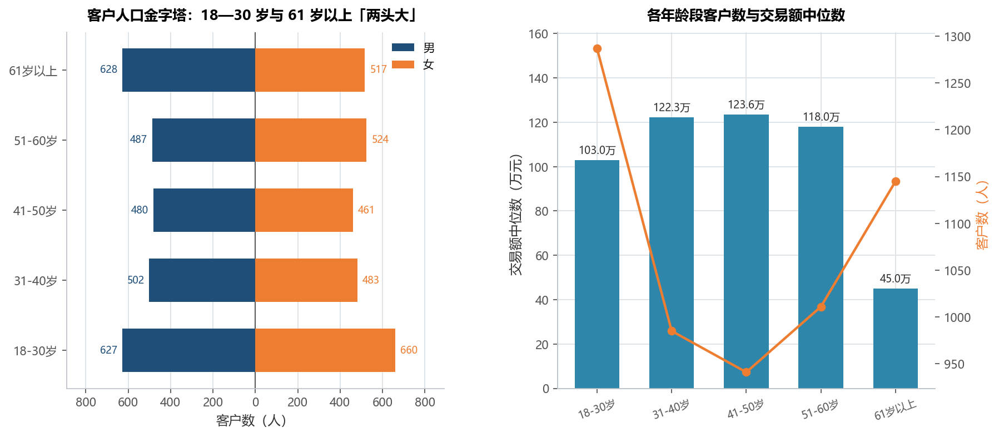
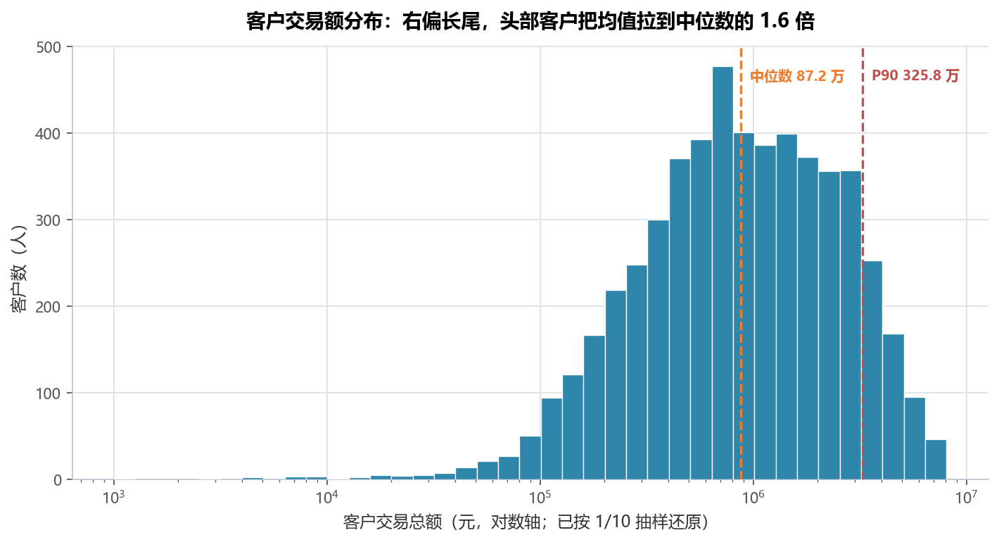
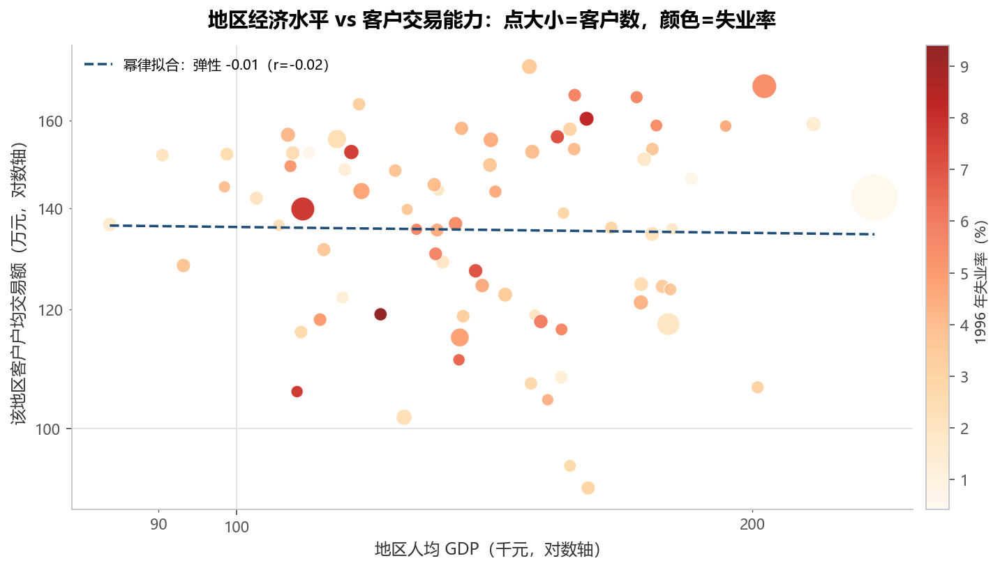
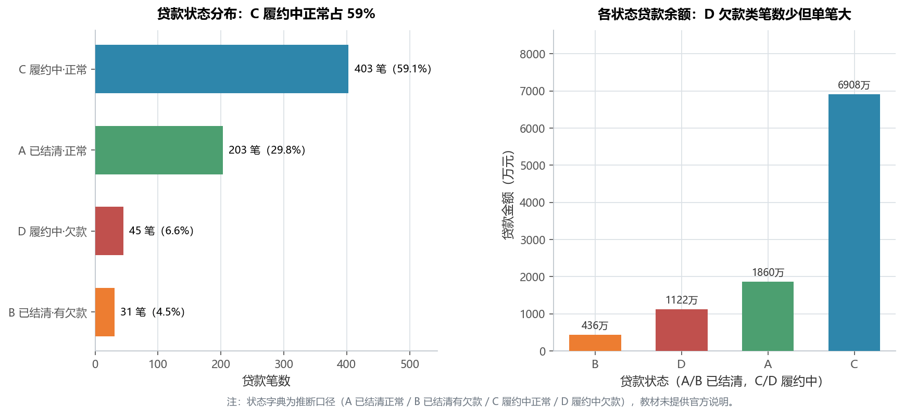
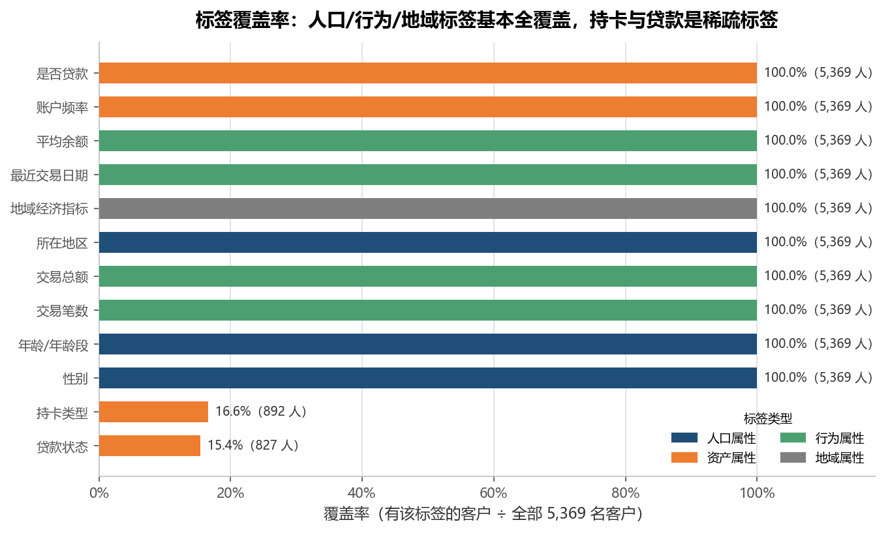

# 实验 05 · 用户画像标签体系：SQL 多表 join → pandas 客户宽表

> **教材**：《CDA 一级认证教材：商业数据分析》第 9 章 用户标签体系与用户画像专题
> **原始素材**：捷克某银行 1993—1998 年零售业务数据（8 张表，教材在 MySQL 中建库打标签）
> **迁移方向**：SQL 建表 + 多表 LEFT JOIN + CASE WHEN 分箱 + GROUP BY 打标签 → **pandas merge + groupby + pd.cut**
> **对应脚本**：[`lab05_user_profile_tags.py`](./lab05_user_profile_tags.py)

---

## 1. 教材在做什么（项目内涵）

教材这一章讲的是"**标签体系**"：把分散在客户表、账户表、交易表、贷款表里的原始字段，
加工成一张可以直接拿去做营销的「客户画像宽表」。它分四层：

1. **人口属性标签**：性别、年龄（由 `birth_date` 算出来再分箱）、所在地区；
2. **资产标签**：账户频率（月结/周结/实时）、持卡类型（普通卡/青年卡/金卡）、是否贷款、贷款状态；
3. **行为标签**：交易笔数、交易总额、平均余额、最近一次交易日期（recency）——RFM 里的 F 和 M；
4. **地域标签**：客户所在 district 的 GDP、人均 GDP、失业率、平均工资，用来解释"为什么这个地区的人更活跃"。

教材的做法是在 MySQL 里写一串 SQL：先 `CREATE TABLE` 建 8 张表，再写一个包含 7 个 `LEFT JOIN` 的宽表查询，
用 `CASE WHEN` 做年龄分箱、用子查询把账户级交易汇总回客户级，最后导出到 BI 工具出图。
**这套 SQL 的本质是"多表连接 + 分组聚合 + 派生字段"**，正好对应 `merge` + `groupby.agg` + `pd.cut`。

> 为什么值得迁移：SQL 宽表写完后是一段几百行的"黑箱"，改一个标签要改子查询；
> Python 版把每个标签层写成一个函数，可以单独跑、单独验证覆盖率，还能直接输出 CSV 给下游模型用。

---

## 2. 数据说明

8 张表全部是 **GBK 编码**（用 UTF-8 读会直接 `UnicodeDecodeError`），主外键关系是
`clients ← disp → accounts ← trans / loans / order`，`card` 挂在 `disp` 上，`district` 按地区码补进来：

| 表 | 规模 | 关键字段 | 说明 |
|---|---|---|---|
| `clients.csv` | 5,369 × 4 | client_id, sex, birth_date, district_id | 客户主表，每人一行 |
| `disp.csv` | 5,369 × 4 | disp_id, client_id, account_id, type | 客户-账户关系（所有者 4,500 / 用户 869） |
| `accounts.csv` | 4,500 × 4 | account_id, district_id, frequency, date | 账户表，`frequency` 即结算频率 |
| `card.csv` | 892 × 4 | card_id, disp_id, issued, type | 信用卡，892 张（普通卡/青年卡/金卡） |
| `loans.csv` | 682 × 7 | loan_id, account_id, date, amount, duration, payments, status | 贷款，status = A/B/C/D |
| `order.csv` | 6,471 × 6 | order_id, account_id, bank_to, account_to, amount, k_symbol | 汇款指令 |
| `district.csv` | 77 × 10 | A1, GDP, A4, A10, A11, A12, A13, A14, A15, a16 | 地区经济指标，列名是匿名编号 |
| `trans.csv` | **1,056,320 × 10** | trans_id, account_id, date, type, operation, amount, balance, … | 交易流水，59.6 MB |

### 2.1 交易表的抽样规则（为什么仓库里没有 `trans.csv`）

60 MB、105 万行的原始流水不适合进课程仓库（克隆慢、diff 不可读、也超出普通 Git 仓库的舒适区）。
仓库内放的是**确定性 1/10 抽样** `data/trans_sample.csv.gz`：

- **抽样规则**：`trans_id % 10 == 0`——按主键取模，**无随机种子、结果可复现**；
- **结果**：105,630 行，压缩后 1.73 MB；4,500 个账户**全部保留**，
  因此「有没有交易」这个覆盖率和全量完全一致，只是每户金额约为全量的 1/10；
- **还原**：脚本用常量 `SAMPLE_STEP = 10` 把金额乘回去（列名带 `_全量估算` 后缀），
  README 和图上所有"万"级金额都是**还原后**的口径；
- **切回全量**：把原始 `trans.csv` 放回 `data/`，脚本自动检测到并改用全量（`SAMPLE_STEP = 1`），无需改代码；
- 原文件在教材配套目录 `第9章 用户标签体系与用户画像专题/data/trans.csv`。

### 2.2 清洗与口径问题（脚本运行时打印）

- **金额带 `$` 和千分位**：`amount` / `balance` 是 `$1,000` 这样的字符串，
  用 `str.replace(r"[$,]", "")` 再 `to_numeric(errors="coerce")` 转成数值；本次抽样无法解析 0 行；
- **负余额 301 行**（全量 2,999 行）：属于账户透支，是真实业务，保留不删；
- **district 列名是匿名编号**，教材说明文档也没给字段字典。按数值分布反推：
  `A1`=地区码、`GDP`=地区 GDP、`A4`=人口、`A10`=城镇人口占比（33.9~100）、
  `A11`=平均工资（8,110~12,541）、`A12/A13`=1995/1996 年失业率（0.29~9.4）、
  `A14`=每千人创业者数、`A15/a16`=两年犯罪数。**单位原表未标注**，按量级推断 GDP 为百万克朗、
  工资为千克朗，因此 `人均 GDP = GDP / 人口 × 1000`（千元/人）；
- **共享账户**：869 个账户被 2 个以上客户共用（`disp` 里 4,500 个"所有者" + 869 个"用户"），
  把账户级交易汇总到客户级时，这部分金额会被**重复计入**。这是"客户-账户"一对多关系的固有口径问题，
  教材的 SQL 同样存在，做对公/家庭账户分析时要拆开看；
- **`loans.status` 无官方字典**：按该数据集通行口径标注为 A 已结清·正常 / B 已结清·有欠款 /
  C 履约中·正常 / D 履约中·欠款，图注中已声明是"推断口径"。

---

## 3. SQL 操作 ↔ pandas 对照

| 教材里的 SQL / 操作 | SQL 写法 | Python 实现 | 差异与注意点 |
|---|---|---|---|
| 多表左连接 | `clients c LEFT JOIN disp d ON c.client_id=d.client_id` | `df.merge(disp, on="client_id", how="left")` | `how="left"` 保证客户不丢；连接键类型要一致 |
| 账户级汇总回客户级 | 子查询 `GROUP BY account_id` 再 join | 先 `groupby("account_id").agg(...)` 再 `merge` | 先聚合再连接，避免"连接后行数爆炸再求和"的重复计数 |
| 年龄分箱 | `CASE WHEN age<=30 THEN '18-30岁' …` | `pd.cut(年龄, bins=[0,30,40,50,60,200], labels=...)` | `pd.cut` 一次定义所有区间，边界含义（左开右闭）要写清 |
| 交易笔数 / 总额 | `COUNT(*), SUM(amount)` | `agg(交易笔数=("trans_id","count"), 交易总额=("amount","sum"))` | 命名聚合让结果列直接是中文标签 |
| 最近交易日期 | `MAX(date)` | `agg(最近交易日期=("date","max"))` | 再与数据截止日相减得到 recency |
| 条件统计 | `SUM(CASE WHEN status IN ('B','D') THEN 1 ELSE 0 END)` | `loans["status"].isin(["B","D"]).sum()` | 布尔序列求和即计数 |
| 去重计数 | `COUNT(DISTINCT client_id)` | `series.nunique()` | 统计"有多少客户有某标签"时常用 |
| 标签宽表落库 | `CREATE TABLE client_tags AS SELECT …` | `wide[out_cols].to_csv(..., encoding="utf-8-sig")` | `utf-8-sig` 让 Excel 双击不乱码 |
| 覆盖率体检 | `COUNT(标签)/COUNT(*)` | `mask.mean()` | 每个标签一行，输出成表 |
| 按维度出报表 | `GROUP BY 年龄段` | `groupby("年龄段", observed=True).agg(...)` | 分类变量要 `observed=True`，否则会冒出空组合 |

---

## 4. 代码结构与关键点

```
lab05_user_profile_tags.py
├── _money()                 # 清洗 "$1,000" → 1000.0
├── load_tables()            # 读 8 张 GBK 表 + 自动选择全量/抽样 + 打印质量检查
├── build_wide_table()       # 7 层 merge：clients ← disp ← accounts ← trans/loans/order/card ← district
├── tag_coverage()           # fig05 标签覆盖率（12 个标签能覆盖多少客户）
├── demographic_profile()    # fig01 人口金字塔 + 各年龄段交易能力
├── transaction_distribution()  # fig02 交易额长尾分布（对数轴）
├── region_profile()         # fig03 地区经济水平 vs 户均交易额
├── loan_profile()           # fig04 贷款状态分布
└── main()                   # 输出宽表 + 5 张图 + 业务结论
```

四个值得记住的写法：

1. **先聚合再连接**：账户级指标（交易笔数/总额/平均余额）先 `groupby(account_id)` 汇总，
   再 `merge` 到客户级。若先连接再聚合，共享账户会被重复计数，金额直接翻倍；
2. **编码不写死**：`encoding="gbk"` 是这批数据的硬约束，抽样文件另存为 UTF-8 并在脚本里按文件类型切换；
3. **抽样要可复现**：`trans_id % 10 == 0` 比 `sample(frac=0.1)` 更好——不依赖随机种子，
   任何人任何机器跑出来都是同一份 105,630 行；
4. **宽表先落盘再出图**：`table01_客户标签宽表.csv` 是这一章的最终交付物，
   下游做 RFM、流失预测、交叉营销都直接读它，图只是它的"体检报告"。

---

## 5. 运行结果与解读

### 5.1 客户标签宽表：5,369 行 × 30 列

- 宽表已落盘为 `outputs/table01_客户标签宽表.csv`，一行一个客户，是这一章对下游（RFM、流失模型、交叉营销）的交付物；
- 30 列覆盖四层标签：`sex / 年龄 / 年龄段 / 所在地区`（人口）、`frequency / 持卡类型 / 是否贷款 / 贷款状态说明`（资产）、
  `交易笔数 / 交易总额 / 平均余额 / 最近交易距今天数`（行为）、`地区GDP / 人均GDP / 失业率1996`（地域），
  外加 `价值分层`（按交易额三分位打的高/中/低价值标签）；
- 覆盖率体检见 5.6：人口与行为标签几乎人人都有，但持卡、贷款只有 1/6 客户，这是后面所有结论的前提。

### 5.2 人口属性：年龄"两头大"，不是中年主力



- 5,369 名客户平均年龄 **45.3 岁**、中位 44.7 岁；
- 分布是明显的**双峰**：18—30 岁 1,287 人（**24.0%**）+ 61 岁以上 1,145 人（**21.3%**），合计 **45.3%**；
  31—50 岁反而只占 35.8%；
- 性别接近 1:1（男 2,724 : 女 2,645）；分年龄段看，18—30 岁与 51—60 岁是女性更多（660 : 627、524 : 487），
  61 岁以上则男性明显更多（628 : 517）；
- 交易能力上，**41—50 岁的交易额中位数最高（123.6 万）**，61 岁以上最低（45.0 万，只有峰值的 1/3）；
- 业务含义：这家支行的客群是"**年轻新客 + 退休老客**"双峰结构。对年轻人卖的是"第一张卡/第一笔理财"，
  对老年人卖的是"稳健 + 养老"，**不能再用"中年家庭主力"的单一画像做全量营销**。

### 5.3 行为标签：交易额极度长尾，前 1/3 客户贡献 70.5%



- 交易额分位数：P10 **20.3 万**、中位 **87.2 万**、P90 **325.8 万**、P99 **630.1 万**、最大 807.4 万；
- 均值 **138.3 万**，是中位数的 **1.6 倍**——典型的右偏长尾，**用平均数描述客户会被头部拉高**；
- **头部 10%（≥P90）贡献 32.8% 的交易额；按三分位划的"高价值"客户 1,790 人（33.3%）贡献 70.5%**；
- 对数轴下分布近似钟形（log-normal），说明"交易额"适合做**分位数分层**而不是等宽分箱；
- 业务含义：营销预算应该按"贡献"而不是"人数"分配；同时要注意，长尾客户不是没价值，
  18—30 岁客群交易额低但人数多，是未来的高价值客户池。

### 5.4 地域标签：地区经济水平解释不了交易活跃度



- 77 个地区的人均 GDP 从 **84 千元到 236 千元**（2.8 倍差距），户均交易额却只在 **91.3 万 ~ 173.8 万** 之间（1.9 倍）；
- `log(人均GDP)` 与 `log(户均交易额)` 的相关系数 **r = -0.019**，幂律拟合弹性 **-0.01**——
  **几乎没有关系**，富地区客户的户均交易额并不更高；
- 户均交易额最高的三个地区：地区 52（173.8 万，73 人）、地区 74（168.6 万，180 人）、地区 61（166.3 万，54 人），
  它们的失业率分别是 3.5%、5.4%、5.7%，落在样本中位附近——**经济指标和交易活跃度没有一致的方向**；
- 业务含义：**地域标签不能当业绩归因的主变量**，它更适合做"区域资源配置的辅助维度"；
  想做精准营销，行为标签（交易额/recency）比地域标签有用得多。

### 5.5 资产标签：C 类履约中正常占 59%，D 类笔数少但单笔最大



- **C 履约中·正常 403 笔（59.1%）**，金额 6,907.8 万，笔均 17.1 万，平均期限 43 个月——是贷款组合的主体；
- **A 已结清·正常 203 笔（29.8%）**，笔均 9.2 万、平均期限 22 个月，说明"小额短期限"更容易结清；
- **D 履约中·欠款 45 笔（6.6%）**，但笔均 **24.9 万**（全组最高）、平均期限 46 个月——**金额大、期限长、已欠款**，
  是风险最集中的一档；
- **B 已结清·有欠款 31 笔（4.5%）**，笔均 14.1 万；
- 问题贷款（B+D）合计 **76 笔、占 11.1%、涉及金额 1,558.0 万**；
- 业务含义：催收资源应该优先投给 **D 类 45 笔**（金额大、还在履约期内，追回概率高于已结清的 B 类）；
  同时"期限越长越容易出问题"（D 类平均 46 个月 vs A 类 22 个月），审批端应加强对 48 个月以上长标的复核。

### 5.6 标签覆盖率：持卡与贷款是稀疏标签，画像落地要先看覆盖率



- 12 个标签里有 **10 个覆盖 100% 客户**：性别、年龄、所在地区、账户频率、交易笔数、交易总额、
  平均余额、最近交易日期、地域经济指标、是否贷款；
- 两个稀疏标签：**持卡类型只覆盖 16.6%（892 人）**、**贷款状态只覆盖 15.4%（827 人）**；
- 业务含义很直接：想对"金卡客户"或"有逾期风险的客户"做定向营销，可触达人群只有全量的 1/6，
  做活动预算时不能按 5,369 人估规模；反过来，行为标签（交易额/recency）人人都有，是分层运营最稳的基础；
- 这也是标签体系的通用规律：**人口/行为标签靠系统自动积累，资产标签依赖具体产品（卡、贷）的持有情况**，
  覆盖率天然是"产品渗透率"的镜像。

---

## 6. 复现方式

```bash
cd 05_一级教材_第09章_用户画像标签体系
python lab05_user_profile_tags.py
```

- 依赖：`pandas`、`numpy`、`matplotlib`（见仓库根 `requirements.txt`）；
- 输入：`data/` 下 7 张 GBK 编码的 CSV + `trans_sample.csv.gz`（1/10 抽样，UTF-8）；
- 输出：`outputs/` 下 **5 张 PNG + 5 个 CSV**：

| 输出 | 内容 |
|---|---|
| `table01_客户标签宽表.csv` | 5,369 行 × 30 列，本章最终交付物 |
| `table02_标签覆盖率.csv` | 12 个标签的可用客户数与覆盖率 |
| `table03_年龄段画像.csv` | 各年龄段客户数、交易额中位数/均值 |
| `table04_地区画像.csv` | 77 个地区的客户数、户均交易额、人均 GDP、失业率 |
| `table05_贷款状态汇总.csv` | A/B/C/D 的笔数、金额、笔均、期限 |
| `fig01_年龄性别结构.png` | 人口金字塔 + 各年龄段交易能力 |
| `fig02_客户交易额分布.png` | 交易额长尾分布（对数轴） |
| `fig03_地区GDP与人均交易额.png` | 地区经济水平 vs 户均交易额 |
| `fig04_贷款状态分布.png` | 贷款状态笔数与金额 |
| `fig05_标签覆盖率.png` | 标签覆盖率条形图 |

---

## 7. 小结与思考

1. **多表 join 的关键是"先聚合再连接"**：账户级指标先 `groupby(account_id)`，再 `merge` 回客户级，
   否则共享账户会被重复计数——这是 SQL 和 pandas 都会踩的同一个坑；
2. **标签不是越多越好，覆盖率才是硬约束**：12 个标签里 10 个全覆盖，但持卡/贷款只有 1/6，
   画像能不能落地，先看目标客群是否落在"有标签"的那部分人里；
3. **分箱要服从业务**：年龄用 `pd.cut` 分 5 段后才发现客群是"两头大"，
   如果一开始按"中年主力"的假设只做 31—50 岁的分析，就会漏掉 45% 的客户；
4. **长尾分布要用分位数说话**：均值 138.3 万、中位 87.2 万，差 1.6 倍，
   直接汇报"人均交易额 138 万"会严重高估普通客户的贡献。

> 思考题：本实验的 `recency` 只算了"最近一次交易距今天数"，还没有算 RFM 里的 F（频次分层）和
> 货币化价值 M 的组合。如果要把 5,369 名客户分成"高价值高活跃 / 高价值低活跃 / 低价值高活跃 /
> 流失预警"四象限，你会用哪几个标签、阈值怎么定？提示：F 用 `交易笔数` 的分位数、M 用
> `交易总额_全量估算` 的分位数、R 用 `最近交易距今天数` 的中位数，两两交叉后用 `pivot_table` 出四象限矩阵。
