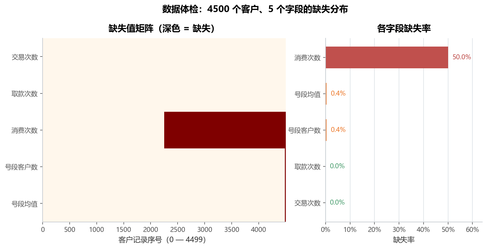
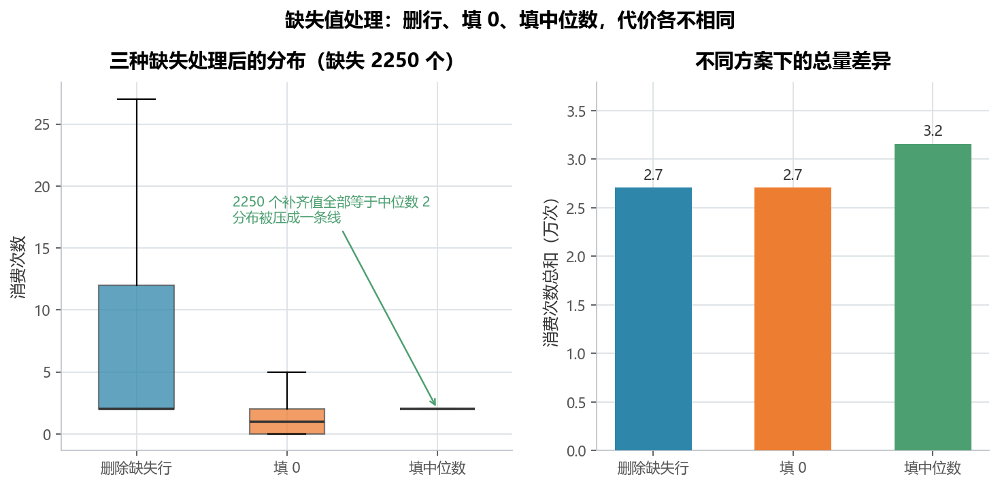
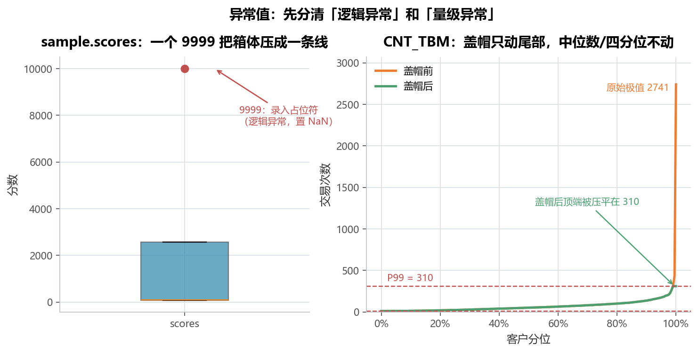
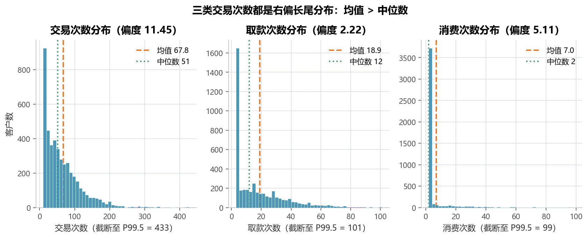
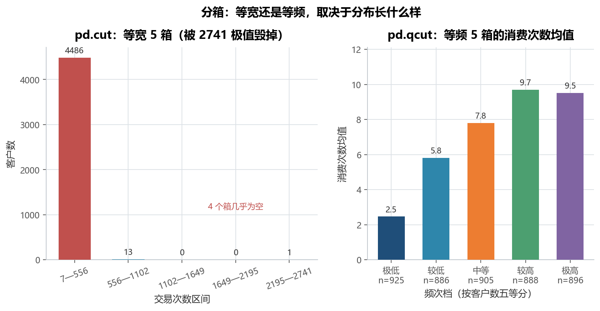

# 实验 06 · 数据整合与清洗：把 80 多个 notebook cell 重排成一条流水线

> **教材**：《CDA 二级认证教材：量化策略分析》第 4 章 数据处理（pandas）
> **原始素材**：`第4章  数据整合和数据清洗.ipynb` + `sample.csv`、`write.csv`、`data/big.csv`
> **迁移方向**：notebook 里「一个 API 一个 cell」的知识点罗列 → **按「读入 → 整合 → 体检 → 清洗 → 汇总」重排的可复跑流水线**
> **对应脚本**：[`lab06_pandas_cleaning.py`](./lab06_pandas_cleaning.py)

---

## 1. 教材在做什么（项目内涵）

第 4 章是整本教材的「工具篇」：用 80 多个 cell 把 pandas 的常用操作过了一遍——
`read_csv` 的参数、`loc/iloc` 取值、布尔索引、`merge` 的四种 `how`、`concat` 的横竖拼接、
去重、排序、`groupby` 聚合、`pivot_table`、`replace`、`apply`、`cut/qcut`、缺失值与异常值处理。

**它的问题不是内容少，而是没有"项目感"**：每个 cell 换一份新的 5 行玩具数据重来一次，
读者学完能背出 40 个 API，却答不出"真实项目里这些操作按什么顺序串起来、每一步为什么存在"。

本实验用一个统一的业务场景把这些知识点接起来——**运营商 4500 个客户的三类交易次数**：

1. **读入**：`big.csv` 有 4500 行，用 `chunksize=900` 分 5 块读再 `concat`；顺手处理客户号前导零
   （读成整数会把 `000041360` 变成 `41360`，后续按号段切分全部错位）；
2. **整合**：把一次导出拆成"两批文件"再拼回去，第二批**刻意少一列**（模拟系统升级漏导出），
   `concat` 按列名对齐后自然产生 2250 个缺失——**缺失不是数据脏，是整合造成的**；
3. **关联**：从明细里滚出一张号段维表（号段 = 客户号前 3 位），`merge` 回明细，
   用四种 `how` 的差异讲清"到底保留哪一侧的行"；
4. **体检**：算缺失率、画缺失矩阵，区分"整块缺失"和"零散缺失"两种机制；
5. **清洗**：缺失值三方案对比、异常值分两类处理（逻辑异常置 NaN / 量级异常盖帽）、去重；
6. **汇总**：`groupby.agg` + `pivot_table` 出号段画像，`cut/qcut` 对比两种分箱。

> 为什么值得重写：notebook 里的 80 个 cell 是"字典"，本脚本是一条"流水线"。
> 字典用来查，流水线用来交付——真实项目里没人会把 5 行玩具表跑 40 遍。

---

## 2. 数据说明

| 文件 | 规模 | 字段 | 在脚本里的角色 |
|---|---|---|---|
| `data/sample.csv` | 5 行 × 3 列 | `id`、`name`、`scores` | 教材原样的训练样本：1 个异常值 **9999** + 1 个空值 |
| `data/write.csv` | 5 行 × 3 列 | 同上 | 教材 `to_csv` 写出的文件，用来演示**编码陷阱** |
| `data/big.csv` | 4500 行 × 4 列 | `ID`、`CNT_TBM`、`CNT_ATM`、`CNT_POS` | 主数据：客户号 + 交易/取款/消费三类次数 |

- `ID` 是 9 位定长卡号（`000041360`），共 **41 个号段**、4500 个客户，无重复、无缺失；
- 三类次数都是**右偏计数**：交易次数均值 67.8、中位数 51、最大 2741，偏度 11.45；
- 编码：`sample.csv` / `big.csv` 为 UTF-8，`write.csv` 也是 UTF-8（用 GBK 打开会变成"灏忔槑"），
  所以脚本**显式写死编码**，不依赖默认值；
- 数据源为教材配套素材，仅用于课程实验。

> **两处教学用的人为设定**（脚本顶部常量，可关闭，都在 README 里说明，不假装是真实脏数据）：
> - `SIMULATE_DROP_COL = True`：让第二批 2250 行**少一列 `CNT_POS`**，用来复现"整合导致字段缺失"；
> - `SEG_MIN_CUST = 40`：号段维表只收客户数 ≥ 40 的号段（41 个里的 40 个），
>   剩下的 1 个长尾号段（18 个客户）在 `left join` 后自然取不到维表信息——**这是真实的未匹配，不是造出来的 NaN**。

---

## 3. notebook 步骤 ↔ 重构后函数对照表

| 原 notebook 里 cell 在干什么 | 用到的 pandas API | 重构后放在哪个函数 / 为什么这样重组 |
|---|---|---|
| cell 1—2：读 `sample.csv`，试 `usecols`、`nrows` | `read_csv` 参数 | `load_sample()`：把 5 个读参数串成一次「读→校验→写回→再读」闭环，并暴露 `na_values='99999'` 这个**无效写法**（数据里是 9999，少写一个 9 就什么也匹配不到） |
| cell 5—7：`na_values`、`encoding`、`to_csv` | `na_values`、`encoding`、`to_csv` | `load_sample()`：编码写成显式参数，并用 GBK 误读 `write.csv` 复现乱码；`to_csv → read_csv` 往返校验行数与姓名 |
| cell 3—4：`chunksize=900` 分块读再 `concat` | `read_csv(chunksize=)`、`concat` | `load_big_by_chunks()`：不仅拼回去，还对比"默认读法把 ID 读成 int、前导零丢失"的后果 |
| cell 33—40：`merge` 的 inner/left/right/outer | `merge(how=)` | `merge_segment_table()`：用真实数据滚出号段维表，**一对多**关联，四种 `how` 的行数差异（4482/4500/4482/4500）直接落到纸上 |
| cell 41—45：`concat(axis=1)` 与 `join`（按索引对齐） | `concat`、`join` | 并入 `merge_segment_table()` 的说明：按索引对齐在客户号重复时会"悄悄错位"，所以本脚本统一用显式 `on='seg'` 的连接键 |
| cell 47—53：纵向 `concat` + `drop_duplicates` + `rename` | `concat(axis=0)`、`drop_duplicates` | `assemble_batches()`：拼接两批导出，去重步骤保留并打印结果（本数据 0 重复），强调**清洗步骤要幂等** |
| cell 81—84：`duplicated` / `drop_duplicates('id')` | `duplicated`、`drop_duplicates(subset)` | `assemble_batches()`：按客户号去重，而不是整行去重——业务主键才是去重依据 |
| cell 86—91：`isnull` 比例、`fillna(mean/median)` | `isna`、`fillna` | `handle_missing()` + `profile_missing()`：先看缺失**分布形态**再决定填什么，并把三种方案的代价量化 |
| cell 73—76：`replace(999, NaN)`、字典替换 | `replace` | `cap_outliers()`：9999 这类录入占位符直接置 NaN，交回缺失流程 |
| cell 93—95：`cap()` 盖帽法 + `apply` | `quantile`、布尔赋值、`apply` | `cap_outliers()`：写成可复用函数 `cap(series, quantile)`，对三列计数统一盖帽，并新增 `*_capped` 列而不覆盖原值 |
| cell 59—67：`groupby.agg` 与多层列索引取值 | `groupby.agg`、`MultiIndex` | `segment_summary()`：用 `agg` 的命名聚合一次算出客户数/总量/均值，避开教材里 `df['math']['min']` 这种易错写法 |
| cell 69—71：`pivot_table(index, columns, values, aggfunc)` | `pivot_table` | `segment_summary()`：号段 × 三类次数的均值透视；**注意 `pivot_table` 会按列名字母序排**，必须显式重排否则改列名会张冠李戴 |
| cell 96—102：`pd.cut` / 分位点分箱 | `cut`、`qcut` | `binning_compare()`：同一列两种切法对比，用"4486/13/0/0/1"这组数字说明等宽分箱被极值毁掉 |
| cell 55—57：`sort_values`（含 `na_position`） | `sort_values` | 分散在 `segment_summary()` / `binning_compare()` 中：只在要出图/出榜时排序，避免中间态被无意义地排序 |
| —（教材没有） | — | `quality_table()`：把流水线每一站的行数/缺失/重复汇总成一张表，作为交付前的"体检报告" |

---

## 4. 代码结构与关键点

```
lab06_pandas_cleaning.py
├── load_sample()           # 0 读小样本：read_csv 参数、编码陷阱、to_csv 往返
├── load_big_by_chunks()    # 1 分块读大文件 + ID 前导零的 dtype 处理
├── assemble_batches()      # 2 两批导出纵向拼接 + 去重（幂等）
├── merge_segment_table()   # 3 号段维表 left/inner/right/outer 四种关联
├── profile_missing()       # 4 缺失率 + 缺失矩阵热力图（fig01）
├── handle_missing()        # 5 删行 / 填 0 / 填中位数三方案对比（fig02、表 2）
├── cap()                   #   教材的盖帽法，抽成可复用函数
├── cap_outliers()          # 6 逻辑异常 vs 量级异常（fig03）
├── plot_distributions()    # 7 三列分布形态（fig04）
├── binning_compare()       # 8 cut vs qcut（fig05）
├── segment_summary()       # 9 groupby + pivot_table 号段画像（表 3）
├── quality_table()         # 10 数据质量总表（表 1）
└── main()                  # 串起 0—10，最后打印 4 条结论
```

四个值得记住的写法：

1. **`dtype={'ID': str}` 比事后补零可靠**：`big.csv` 的卡号是 9 位定长字符串，`read_csv` 默认转 int，
   `000041360` 直接变成 `41360`；脚本读时指定 `dtype`、读完再 `str.zfill(9)` 双保险。
2. **`concat` 按列名对齐，字段少一列不会报错**：两批数据列不一致时，缺的那列自动变 `NaN`——
   这正是"整合制造缺失"的机制，也是必须做数据体检的原因。
3. **`merge` 的行数取决于关联键是否唯一**：号段维表是"一个号段对多个客户"，
   所以 `right join` 不是 40 行而是 4482 行（维表每个号段按客户展开）。
4. **`pivot_table` 的输出列顺序是字母序**：`values=['CNT_TBM','CNT_ATM','CNT_POS']`
   出来是 `CNT_ATM, CNT_POS, CNT_TBM`，直接按位置改列名会张冠李戴，必须显式重排。

---

## 5. 运行结果与解读

### 5.1 数据体检：4500 行原始数据是干净的，脏的是整合过程



- `big.csv` 本身 **0 缺失、0 重复**；拼完两批后缺失率跳到 12.5%（2250 个单元格）；
- 关联号段维表后又多出 36 个缺失（18 个长尾号段客户 × 2 个维表字段），合计 7.3%；
- 矩阵图看得很清楚：**消费次数是整块缺失**（后 2250 行全缺，属于流程性缺失 MAR），
  **号段维表字段是零散缺失**（结构性缺失，填充会引入偏差，更适合"保留 + 打标记"）。

### 5.2 缺失处理：没有标准答案，只有代价



| 方案 | 保留客户 | 消费次数均值 | 中位数 | 总量 |
|---|---|---|---|---|
| 删除缺失行 | 2250 | 12.04 | 2.0 | 27,085 |
| 填 0 | 4500 | 6.02 | 1.0 | 27,085 |
| 填中位数 | 4500 | 7.02 | 2.0 | 31,585 |

- **删行**：样本直接砍半，而且删掉的恰好是"后一半客户"，不是随机缺失，代表性被破坏；
- **填 0**：把"没采集到"当成"没消费"，总量少 14.2%，中位数从 2 掉到 1；
- **填中位数**：总量与中位数基本保持，是计数型字段的稳妥默认值；
- 但要注意副作用：**20 个号段（021—040）全部落在缺失区间**，填充后消费次数恒等于 2，
  分号段比较时会得出"这些号段消费能力一样"的假结论——所以脚本加了 `pos_filled` 标记列。

### 5.3 异常值：先分清"逻辑异常"和"量级异常"



- `sample.scores` 里的 **9999** 是录入占位符（5 条数据 4 个正常值全在 100 以内），
  一个点就把箱体压成一条线——这种值必须置 `NaN` 而不是"盖帽"；
- `CNT_TBM` 的最大值 **2741** 是真实客户，只是远期长尾：P1=10、P99=310，
  盖帽后压缩了 45 个值（1.0%），**均值 67.84 → 65.43，样本量不变**；
- 两类异常的处理方式不同，是本实验最想强调的一点：**"错值"删，"极值"压**。

### 5.4 分布形态：三列都是右偏长尾



| 字段 | 均值 | 中位数 | 偏度 | 峰度 | 最大值 |
|---|---|---|---|---|---|
| 交易次数 | 67.84 | 51 | 11.45 | 306.12 | 2741 |
| 取款次数 | 18.94 | 12 | 2.22 | 9.71 | 250 |
| 消费次数 | 7.02 | 2 | 5.11 | 34.55 | 207 |

- 三列都是 **均值 > 中位数**，右偏；交易次数偏度 11.45、峰度 306，属于极端长尾；
- 结论：这类计数指标**报表里应给中位数**，给均值会被少数重度客户带偏。

### 5.5 分箱：等宽被极值毁掉，等频才可用



- `pd.cut(CNT_TBM, 5)` 等宽分箱：**4486 / 13 / 0 / 0 / 1**——2741 这个极值把组距拉到 556，
  99.7% 的客户挤在第一箱，后两箱是空的；
- `pd.qcut(CNT_TBM, 5)` 等频分箱：每箱 886—925 人，消费次数均值
  **2.46 → 5.80 → 7.79 → 9.68 → 9.51**，梯度清晰（最高档略回落，说明重度交易不等于高消费）；
- 教材用标准正态随机数演示分箱，等宽切 5 组很均匀，容易让人误以为 `cut` 总是够用——
  换成真实业务数据就露馅了。

### 5.6 号段画像：groupby 与 pivot_table 的产出

表 3（`outputs/table03_号段交易汇总.csv`）给出 41 个号段的客户数、三类次数均值与消费占比：

- 消费次数最高的号段是 **007**（120 人，交易 75.5 次、消费 15.73 次，消费占比 17.0%）；
- 最低的 038/039/040 消费均值都是 2.00——就是 5.2 节提到的"整段落在缺失区间"的号段；
- 结论：**任何分群分析之前都要先看缺失标记**，否则会把填充值当成业务差异。

---

## 6. 复现方式

```bash
cd 06_二级教材_第04章_数据整合与清洗
python lab06_pandas_cleaning.py
```

- 依赖：`pandas`、`numpy`、`matplotlib`（见仓库根 `requirements.txt`）；
- 输入：`data/sample.csv`、`data/write.csv`、`data/big.csv`；
- 输出：`outputs/` 下 **5 张 PNG + 3 个 CSV**（另有一个 `_roundtrip_sample.csv`，
  是 `to_csv` 往返演示的中间产物，可忽略）；
- 想复现"没有缺失的版本"：把脚本顶部的 `SIMULATE_DROP_COL` 改成 `False`，
  `CNT_POS` 缺失会归零，后面的缺失分析会自动跳过 2250 这个量级。

---

## 7. 小结与思考

1. **缺失往往是整合的产物，而不是数据本身的属性**：本次 4500 行原始数据零缺失，
   但拼接一下、关联一下，缺失率就到了 12.5%——所以数据质量表要按"阶段"记，而不是只看最终结果。
2. **同一个 API 在不同分布下表现完全不同**：`pd.cut` 对正态数据很均匀，对长尾数据几乎不可用；
   `fillna(median)` 对 5% 缺失很稳妥，对 50% 缺失就是"制造数据"。
3. **清洗要留痕**：盖帽不覆盖原值（新增 `*_capped` 列）、填充打标记（`pos_filled`），
   下游才能区分"真实值"和"补出来的值"。
4. **顺序比工具重要**：读入 → 整合 → 体检 → 清洗 → 汇总，这个顺序反过来（先清洗再整合）
   就会把整合引入的缺失当成原始缺失处理，结论全错。

> 思考题：如果第二批数据不是"少一列"而是"多一列"（新增了一种交易类型），
> `concat` 之后会出现什么？此时的缺失该怎么定义、又该怎么填？
> 提示：多出来的列对第一批而言全是缺失，这属于"新指标上线"，应该填 0 还是填 NaN？
