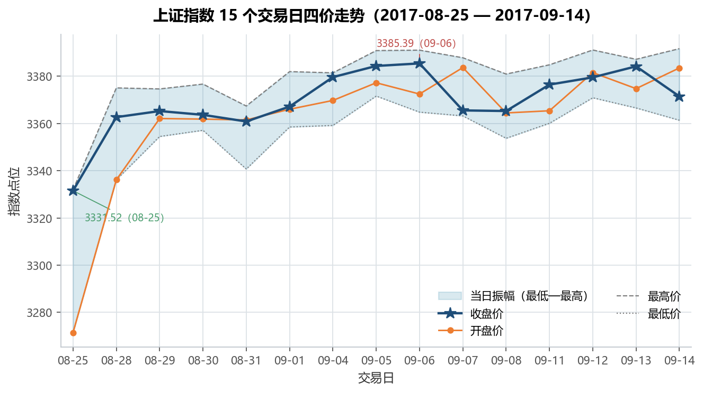
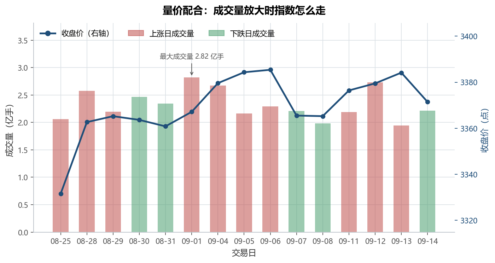
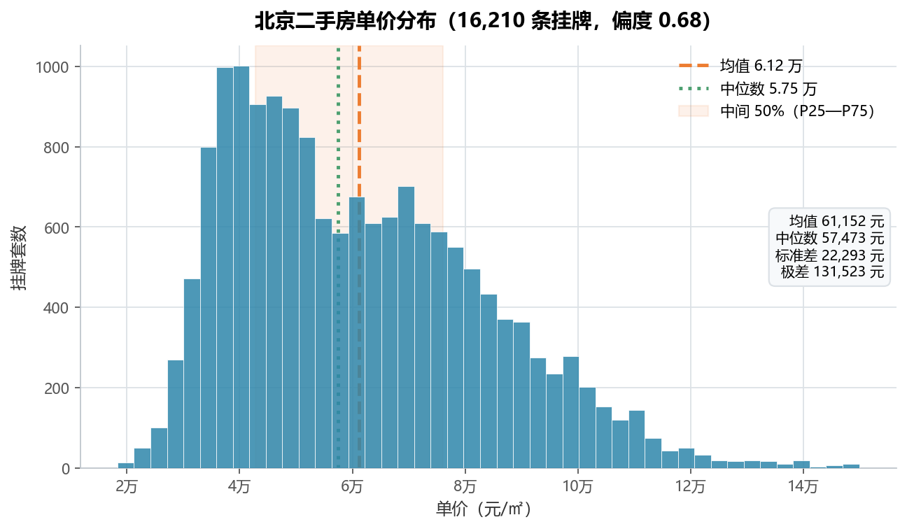
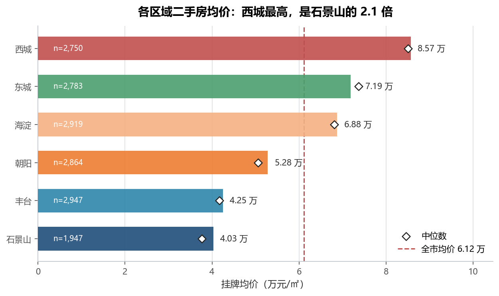
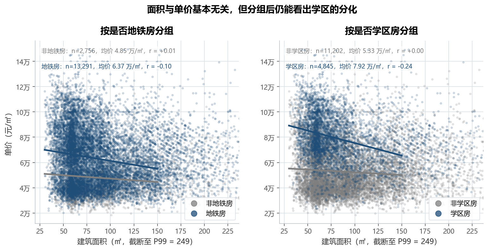
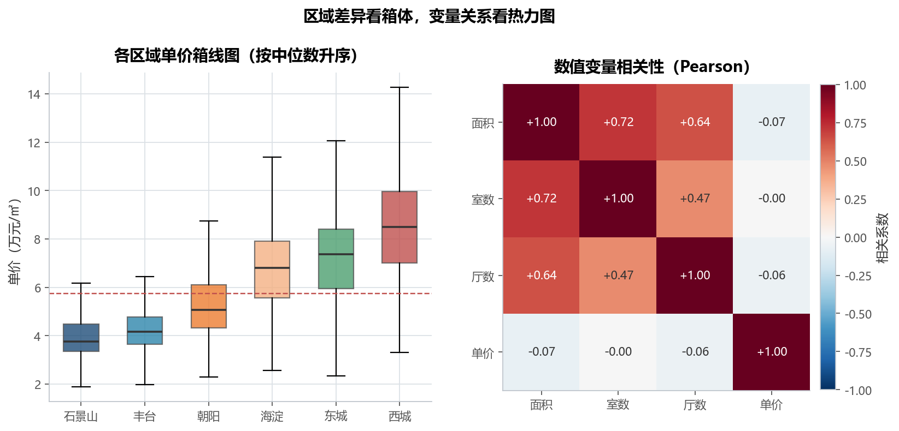

# 实验 07 · 数据可视化：从"一个图形一个 cell"到一套能讲故事的图

> **教材**：《CDA 二级认证教材：量化策略分析》第 5 章 数据可视化（含「描述性统计分析与绘图」）
> **原始素材**：`第5章 python数据可视化.ipynb`、`第5章 描述性统计分析与绘图.ipynb`
> **数据**：`2017股价.xlsx`（15 个交易日 × 8 列）、`sndHsPr.csv`（16,210 条北京二手房 × 8 列）
> **迁移方向**：用随机数演示图表函数 → **用真实数据回答 6 个业务问题**
> **对应脚本**：[`lab07_visualization.py`](./lab07_visualization.py)

---

## 1. 教材在做什么（项目内涵）

第 5 章的两个 notebook 覆盖了 matplotlib 的全部基础图形：折线、饼图、柱形、条形、直方图、
散点、箱线，以及 seaborn 的 `displot` / `jointplot` / `heatmap`，还顺带讲了描述性统计
（均值、中位数、标准差、方差、极差、偏度、峰度、三种相关系数）。

**问题很明显**：图表是孤立的。折线图用 `range(15)` 当横轴、柱状图用 `np.random.randint` 造的投票数、
直方图用 `np.random.normal(80, 20, 200)`、箱线图用三个随机科目——每个 cell 都在教"这个函数怎么调"，
但没有一张图回答了业务问题，也没有一张图能被放进报告。

本实验按「**这张图要回答什么问题**」重排成 6 张图：

| # | 业务问题 | 图形类型 | 教材对应 |
|---|---|---|---|
| 1 | 股价这 15 天怎么走的？ | 四价折线 + 振幅带 | cell 3 |
| 2 | 量价是否配合？ | 柱 + 线双轴组合图 | 教材只有价格，双轴是新加 |
| 3 | 房价是什么分布？贵不贵？ | 直方图 + 均值/中位数线 | 描述统计 notebook cell 2—14 |
| 4 | 哪个区域最贵？ | 排序条形图 + 中位数标记 | cell 8、9 |
| 5 | 面积越大越贵吗？地铁/学区值多少钱？ | 分组散点 + 拟合线 | cell 14、15 |
| 6 | 区域差异多大？变量之间什么关系？ | 箱线图 + 相关性热力图 | cell 17—18、29—30 |

> 迁移的重点不是"把 `plt.plot` 抄过来"，而是补上教材缺的三件事：
> **真实横轴（日期而不是 `range(15)`）、参考基准（均值线/全市均价线）、标注（把结论写在图上）**。

---

## 2. 数据说明

### 2.1 股价数据（`2017股价.xlsx`）

| 字段 | 含义 | 类型 | 备注 |
|---|---|---|---|
| `日期` | 交易日期 | datetime | 2017-08-25 — 2017-09-14，**原文件按日期倒序** |
| `开盘价` / `最高价` / `最低价` / `收盘价` | 指数点位 | float | 3331.52 — 3385.39 |
| `涨跌额` / `涨跌幅` | 当日涨跌 | float | 涨跌幅单位是 **%**（如 1.8343 = +1.83%） |
| `成交量` | 成交量 | int | 1.95 — 2.82 亿手 |

- 只有 **15 个交易日**（教材 notebook 里也写死了 `range(15)`），是一段短周期行情切片；
- 文件是**倒序**的，脚本先 `sort_values('日期')` 再画图，否则时间轴从右往左流、涨跌会被看反。

### 2.2 二手房数据（`sndHsPr.csv`）

| 字段 | 含义 | 类型 | 取值 |
|---|---|---|---|
| `dist` | 区域 | 文本 | 6 个：朝阳/海淀/丰台/东城/西城/石景山 |
| `roomnum` / `halls` | 室 / 厅 | 整数 | 1—5 室、0—3 厅 |
| `AREA` | 建筑面积（㎡） | 浮点 | 30.06 — 299.00，中位数 78.83 |
| `floor` | 楼层档 | 文本 | low / middle / high |
| `subway` / `school` | 是否地铁房 / 学区房 | 0-1 | 地铁房 13,419 套、学区房 4,913 套 |
| `price` | 挂牌单价（元/㎡） | 整数 | 18,348 — 149,871 |

- 16,210 条记录，**无缺失值**；区域样本量：丰台 2947、海淀 2919、朝阳 2864、东城 2783、西城 2750、石景山 1947；
- 脚本额外派生 4 个中文列（`区域`/`楼层`/`地铁`/`学区`）**只用于画图**，分析仍用原始列，
  避免图上出现"chaoyang / middle / 1"这种中英混杂的标签。

---

## 3. notebook 步骤 ↔ 重构后函数对照表

| 原 notebook 里 cell 在干什么 | 用到的 API | 重构后放在哪个函数 / 为什么这样重组 |
|---|---|---|
| 可视化 cell 1：`read_excel('2017股价.xlsx')` | `read_excel` | `load_stock()`：补上日期解析与**升序排序**，并生成 `MM-DD` 短标签——教材直接用倒序文件画图，时间方向是反的 |
| 可视化 cell 3：四条折线 + `xticks(range(15), df.日期, rotation=30)` | `plot`、`xticks`、`legend` | `plot_stock_lines()`：横轴改用真实日期标签，加 `fill_between` 画当日振幅带，并标注区间最高/最低收盘 |
| 可视化 cell 5—9：饼图、柱形图、条形图（随机投票数） | `pie`、`bar`、`barh` | 饼图**不迁移**（占比图不如条形图易读，且教材数据是随机的）；柱/条形的能力用在 `plot_dist_avg()` 上，换成真实的区域均价对比 |
| 可视化 cell 11—12：`hist`（正态随机数） | `hist`、`xticks` | `describe_price()` 的 fig03：真实房价直方图，叠加均值线、中位数线、中间 50% 区间 |
| 可视化 cell 14—15：`scatter`（7 个点的产量-降水） | `scatter` | `plot_area_price()`：16,210 个点必须调 `s=6, alpha=0.16`、截断 P99 面积、分组上色 + 分组拟合线，否则糊成一团 |
| 可视化 cell 17—18：`boxplot`（三科随机成绩） | `boxplot` | `plot_box_and_corr()`：分区域箱线（按中位数升序），叠加全市中位数线 |
| 可视化 cell 20—27：seaborn `displot`、`jointplot`、`relplot`、`kde` | `seaborn` | **不迁移**：这 4 个图都在演示同一个"分布 + 关系"能力，用一张直方图 + 一张分组散点已覆盖；seaborn 与 matplotlib 风格混用还会破坏统一配色 |
| 可视化 cell 29—30：`sns.heatmap(7×7 随机矩阵)` | `seaborn.heatmap` | `plot_box_and_corr()` 的右半面板改用 `imshow` + 手写数值标注：不引入 seaborn 依赖，配色与 `common/style.py` 一致 |
| 描述统计 cell 1：`read_csv('sndHsPr.csv')` | `read_csv` | `load_housing()`：派生中文标签列，为后续所有图服务 |
| 描述统计 cell 2—3：`agg(['mean','median','std'])`、`quantile` | `agg`、`quantile` | `describe_price()`：把 12 个指标（含偏度/峰度/极差/P25/P75）汇总成表 1 |
| 描述统计 cell 4：`data.price.hist(bins=20)` | `hist` | `describe_price()`：bins 从 20 提到 45，并加参考线——20 个箱太粗，看不出右偏的形态 |
| 描述统计 cell 6—8：`max-min`、`var()`、`std()` | 极差 / 方差 / 标准差 | `describe_price()`：并入表 1，同时进图上的指标框 |
| 描述统计 cell 11—13：`skew()`、`kurtosis()`（用随机数） | `skew`、`kurtosis` | `describe_price()`：改算真实房价的偏度 0.68、峰度 -0.02，并写进图标题 |
| 描述统计 cell 14—16：`corr('pearson'/'spearman'/'kendall')` | `corr` | `describe_price()` 里打印三种相关系数；`plot_box_and_corr()` 把 4 个数值变量做成热力图 |
| —（教材没有） | `twinx` | `plot_price_volume()`：收盘价 + 成交量双轴组合图，教材只画了价格没画量 |

---

## 4. 代码结构与关键点

```
lab07_visualization.py
├── load_stock()            # 0 读股价：日期解析 + 升序 + 短标签
├── load_housing()          # 0 读房价：派生区域/楼层/地铁/学区中文列
├── plot_stock_lines()      # 1 四价折线 + 振幅带（fig01）
├── plot_price_volume()     # 2 收盘价 + 成交量双轴（fig02）
├── describe_price()        # 3 描述统计表 + 房价直方图（fig03、表 1）
├── plot_dist_avg()         # 4 区域均价条形图 + 中位数 + 样本量（fig04、表 2）
├── plot_area_price()       # 5 面积-单价分组散点 + 拟合线（fig05）
├── plot_box_and_corr()     # 6 区域箱线 + 相关性热力图（fig06）
└── main()                  # 串起 6 张图 + 打印 4 条结论
```

四个值得记住的写法：

1. **横轴要用真实时间**：`range(15)` 会让休市日（8/26—8/27、9/2—9/3）看起来也在连续交易，
   真实日期标签才能看出"跳空"。
2. **双轴图的关键是"两个 y 轴都要标清楚"**：`ax.bar` 画成交量（左轴）、`ax.twinx().plot` 画收盘价（右轴），
   并且 `ax2.grid(False)`，否则两套网格会叠在一起。
3. **散点超过一千个点就要改画法**：`s=6, alpha=0.16` 让密度说话；再按分组上色 + 分组拟合线，
   才能回答"地铁/学区值多少钱"。
4. **图要有基准线**：均值线、中位数线、全市均价线、P99 截断说明——没有基准的图只能看形状，不能下结论。

---

## 5. 运行结果与解读

### 5.1 股价：15 个交易日只涨了 1.2%，但日内振幅不小



- 收盘价区间 **3331.52 — 3385.39**，区间振幅 53.87 点（**1.62%**）；
- 最低点在 08-25（3331.52），最高点在 09-06（3385.39），整体是"先扬后震荡"；
- 浅蓝振幅带显示：08-25 当天最低 3271.46、最高 3331.91，日内振幅 60 点，是 15 天里最剧烈的一天——
  这一天开盘 3271.46、收盘 3331.52，**涨了 1.83%**，属于"低开高走"。

### 5.2 量价关系：成交量放大并不对应上涨



- 15 天里 **10 天上涨、5 天下跌**；成交量 1.95 — 2.82 亿手，最大量在 09-01（2.82 亿手）；
- 成交量与涨跌幅的相关系数 **-0.010**——几乎无关，说明这段行情里"放量"既不代表上涨也不代表下跌；
- 红涨绿跌（A 股习惯，与仓库 `POS/NEG` 的通用语义相反，图例里已注明）。

### 5.3 房价分布：右偏，均值比中位数高 6.4%



- 均值 **61,152 元/㎡**、中位数 **57,473 元/㎡**（均值高 6.4%）、标准差 22,293、极差 131,523；
- 偏度 **0.68**、峰度 **-0.02**：右偏但有长尾，不是尖峰；
- P25—P75 为 42,812 — 76,100 元/㎡，中间 50% 的房源集中在 4.3—7.6 万；
- 面积与单价的相关性：Pearson **-0.074**、Spearman -0.115、Kendall -0.075——
  **三种方法都说明"面积和单价基本无关"**，这是后面 fig05 要解释的重点。

### 5.4 区域：西城是石景山的 2.1 倍



| 区域 | 均价（元/㎡） | 中位数 | 样本量 | 较全市 |
|---|---|---|---|---|
| 西城 | 85,675 | 85,034 | 2,750 | +40.1% |
| 东城 | 71,884 | 73,645 | 2,783 | +17.5% |
| 海淀 | 68,758 | 68,105 | 2,919 | +12.4% |
| 朝阳 | 52,801 | 50,592 | 2,864 | -13.7% |
| 丰台 | 42,501 | 41,673 | 2,947 | -30.5% |
| 石景山 | 40,287 | 37,626 | 1,947 | -34.1% |

- 全市均价 61,152 元/㎡；西城 / 石景山 = **2.13 倍**；
- 东城的中位数（73,645）高于均值（71,884），说明它的高价房源反而少，分布比西城更"整齐"；
- 样本量最少的是石景山（1,947 套），做区域结论时要提醒这一点。

### 5.5 面积 vs 单价：整体无关，但学区房的负斜率最明显



- 四组拟合线都接近水平（r 在 -0.24 — +0.01 之间），证实"面积越大单价越低"只是弱趋势；
- 但**价位分层极其清楚**：非地铁房 4.85 万 / 地铁房 6.37 万（**+31.0%**），
  非学区房 5.33 万 / 学区房 **7.92 万（+48.4%）**——学区比地铁的溢价更高；
- 学区房组 r = **-0.24**，是四组里负相关最强的：学区房内部，"小面积 + 顶级学区"把单价推到 10 万以上；
- 图上 n 值（2,756 / 13,291 / 11,202 / 4,845）比全量少，是因为散点截断了面积 P99（249㎡）以上的 1% 极端房源。

### 5.6 区域差异看箱体，变量关系看热力图



- 箱线图里西城的中位数 8.50 万、四分位距 **2.95 万**（内部价差最大），
  石景山中位数 3.76 万、四分位距 **1.13 万**（最同质）；丰台的箱体也窄（1.12 万），
  说明"便宜的区"内部差异小，"贵的区"内部差异大；
- 相关性热力图：面积-室数 **+0.72**、面积-厅数 **+0.64**（户型与面积强相关，建模时要注意共线），
  而面积-单价 **-0.07**、室数-单价 **-0.00**、厅数-单价 **-0.06**——
  **价格几乎不被户型解释，真正的价差来自位置与配套**（回到 fig04、fig05 的结论）。

---

## 6. 复现方式

```bash
cd 07_二级教材_第05章_数据可视化
python lab07_visualization.py
```

- 依赖：`pandas`、`numpy`、`matplotlib`、`openpyxl`（读 `.xlsx`）；
- 输入：`data/2017股价.xlsx`、`data/sndHsPr.csv`；
- 输出：`outputs/` 下 **6 张 PNG + 2 个 CSV**（表 1 描述统计、表 2 分区域汇总）；
- 换数据即可复跑：把新的 `.xlsx` / `.csv` 放进 `data/`，改 `load_stock()` / `load_housing()` 里的文件名，
  6 张图和 2 张表会按同一风格重新生成。

---

## 7. 小结与思考

1. **图的价值在于"回答问题"，不在于"用了什么函数"**：同样一个 `hist`，用随机数画只是语法演示，
   用真实房价画才能看出右偏、才能决定"报表该给中位数"。
2. **横轴、参考线、标注是三个最容易被忽略、也最能提升可读性的元素**：
   真实日期、均值/中位数/全市均价线、极值标注，这三样加上去，图就能直接进报告。
3. **数据量大时画法要变**：16,210 个点直接 `scatter` 是一团黑，降透明度 + 截断极端值 + 分组拟合线
   才能看出结构；这也解释了为什么"面积和单价无关"这种反直觉结论必须用图来支撑。
4. **相关性不等于因果，但能排除错误假设**：户型与面积强相关（0.72）提醒建模要防共线；
   户型与单价几乎无关（-0.07）则直接否掉了"大房子单价高"的直觉。

> 思考题：如果要把 fig05 的"学区 / 地铁溢价"做成一个可解释的结论，
> 还需要控制哪些变量？提示：区域（西城全是学区房）、面积、楼层——
> 这正是下一门课"多元回归 / 特征重要性"要解决的问题。
