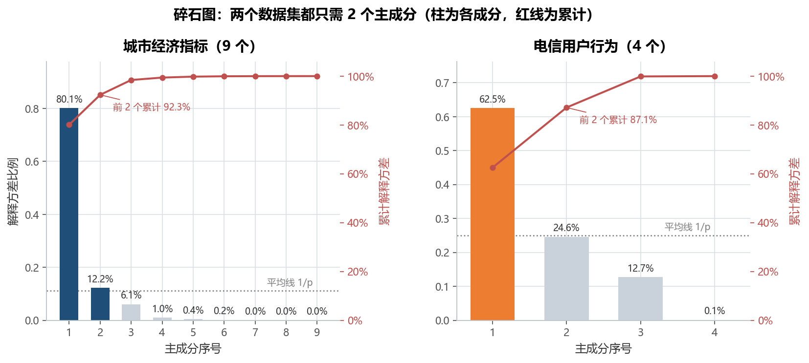
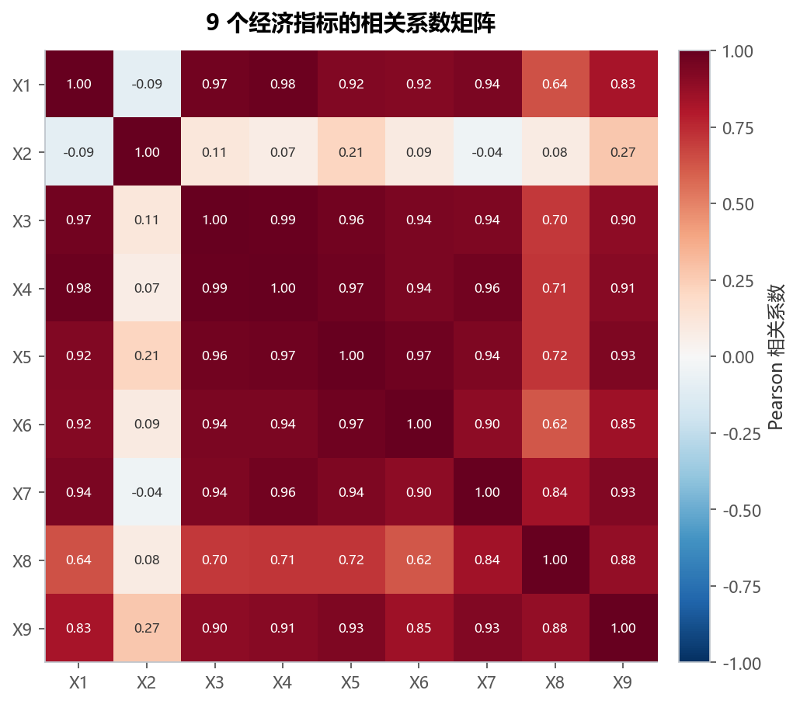
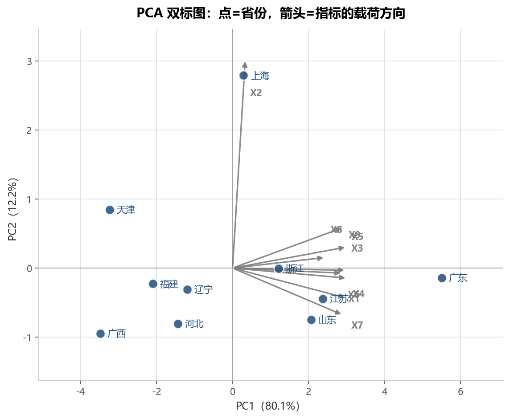
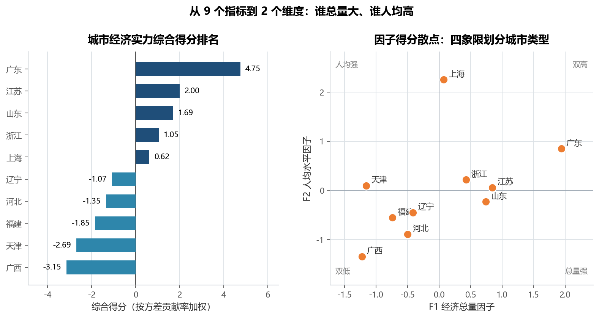
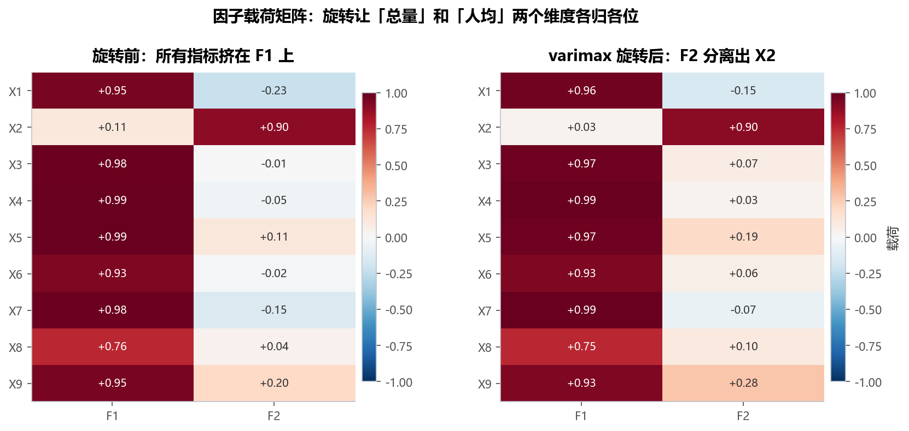

# 实验 08 · 主成分与因子分析：9 个经济指标怎么压缩成 2 个"城市实力"维度

> **教材**：《CDA 二级认证教材：量化策略分析》第 7 章 特征降维方法
> **原始素材**：`在 Python 中实现主成分分析.ipynb`、`在 Python 中实现因子分析.ipynb`
> **数据**：`cities_10.csv`（10 个省份 × 9 个经济指标，**GBK 编码**）、`profile_telecom.csv`（600 用户 × 4 类行为）
> **迁移方向**：notebook 里"调一个包、打印一个矩阵" → **一套可解释的降维流程 + 可视化 + 排名**
> **对应脚本**：[`lab08_pca_factor.py`](./lab08_pca_factor.py)

---

## 1. 教材在做什么（项目内涵）

教材第 7 章用两个 notebook 分别演示 PCA 和因子分析，核心不是 API，而是**三个判断**：

1. **要不要降维？** 9 个经济指标两两高度相关（平均相关系数 0.706，17 组 |r| > 0.9），
   直接放进回归会严重共线；
2. **保留几个成分？** 教材注释写着"标准化数据下单个主成分的特征值应大于 1"，
   这就是 **Kaiser 准则**，配合碎石图看"肘部"；
3. **怎么解释成分？** 看载荷矩阵，给每个成分起一个业务名字（教材里叫 `Gross` 和 `Avg`）。

**notebook 的问题**：这三步都只有一行代码。`pca.explained_variance_ratio_` 打印一串数字，
`fa.comps["rot"]` 打印一个 9×2 矩阵，读者看到的是数值，看不到"为什么保留 2 个""这两个因子到底是什么"。

本实验把整个流程重排成 8 步，每一步都落到图和表上：

```
读入(GBK) → 标准化 → PCA 全部分(碎石图) → 共线性检查(热力图) → 双标图(解释 PC1/PC2)
          → 综合得分排名 → 因子分析(KMO/Bartlett → 主轴因子 → varimax) → 因子得分与四象限
          → 换一个数据集(电信用户)验证流程可复用
```

> **关于工具的重要说明**：教材因子分析用的是 `fa_kit` 包，本环境**没有安装**，且该项目已停止维护。
> 脚本改用 `statsmodels.multivariate.factor.Factor`：
> - `Factor(Xs, n_factor=2, method='pa').fit()` 做主轴因子法提取；
> - `statsmodels.multivariate.factor.rotate_factors(L, 'varimax')` 做方差最大化旋转。
>
> **注意**：statsmodels 0.14.4 的 `Factor` 只支持 `method='pa'` 和 `'ml'`，
> **不接受** `method='principal'`，也**没有** `rotation=` 参数——网上很多写法在这版会直接报
> `TypeError`。旋转必须单独调用 `rotate_factors`，这是本实验踩过的坑，也在脚本注释里标了出来。

---

## 2. 数据说明

### 2.1 城市经济指标（`cities_10.csv`，GBK）

| 字段 | 含义 | 说明 |
|---|---|---|
| `AREA` | 省份名称 | 辽宁、山东、河北、天津、江苏、上海、浙江、福建、广东、广西 |
| `X1` — `X9` | 9 个经济指标 | 教材未给出中文名，保留原编号（从量级看：X1/X3—X7 是总量类、X2 是人均类、X8/X9 是较小的分项） |

- 10 行 × 10 列，无缺失；**编码是 GBK**（中文 Windows 下 Excel 另存），用默认 UTF-8 读会直接抛
  `UnicodeDecodeError`，脚本里专门做了对比打印；
- 量纲差异极大：标准化前各列标准差从 **312.6 到 9713.8**（相差 31 倍），不标准化 PCA 会被 X1 独占。

### 2.2 电信用户行为（`profile_telecom.csv`）

| 字段 | 含义 |
|---|---|
| `ID` | 用户编号（不参与建模） |
| `cnt_call` / `cnt_msg` / `cnt_wei` / `cnt_web` | 通话 / 短信 / 微信 / 上网 次数 |

- 600 行 × 5 列；这是**教材 PCA notebook 的原始案例**，本实验用它做交叉验证：
  同一套 `StandardScaler + PCA + 载荷` 流程换数据也能跑。

---

## 3. notebook 步骤 ↔ 重构后函数对照表

| 原 notebook 里 cell 在干什么 | 用到的 API | 重构后放在哪个函数 / 为什么这样重组 |
|---|---|---|
| 因子 notebook cell 4：`read_csv("cities_10.csv", encoding='gbk')` | `read_csv` | `load_cities()`：把"为什么必须写 GBK"变成一次对比实验（UTF-8 读会抛 `UnicodeDecodeError`），并拆出指标列与名称列 |
| 因子 notebook cell 5：`model_data.loc[:, 'X1':]` 切片取指标 | `loc` 切片 | `load_cities()`：显式返回 `cols` 列表，避免 `'X1':` 这种"依赖列顺序"的隐式写法 |
| 因子 notebook cell 7：`preprocessing.scale(data)` | `preprocessing.scale` | `build_matrix()`：换成等价的 `StandardScaler`（可入 Pipeline、参数可保存），并打印标准化前后标准差证明必要性 |
| PCA notebook cell 4：`data.corr("pearson")` | `corr` | `plot_correlation()`：把相关矩阵画成热力图，量化"平均 0.706、17 组 \|r\|>0.9"，回答"为什么要降维" |
| 因子 notebook cell 12—13：`PCA(n_components=9)` + `explained_variance_` / `ratio_` | `PCA`、`explained_variance_` | `pca_overview()`：一次 fit 全部 9 个成分，用**特征值 > 1** 自动判定保留 2 个，输出表 1 |
| 因子 notebook cell 15—16：再 `PCA(n_components=2)` 看特征值 | `PCA` | `pca_overview()`：同一模型取前 2 列即可，不必二次 fit（教材分两次 fit 只是为了对照） |
| PCA notebook cell 5—6：`PCA(2, whiten=True)` + `components_` | `components_` | `pca_overview()`：载荷改成**指标与主成分的相关系数**（`np.corrcoef`），避免 `eigenvector×sqrt(λ)` 因 ddof 口径不一致导致共同度 > 1 |
| PCA notebook cell 7：`pca.transform(data_scaled)` | `transform` | `composite_score()`：得分矩阵合成为"综合得分"并排名——业务方要的是一个分数，不是 9×2 矩阵 |
| 因子 notebook cell 21—23：`fa_kit.FactorAnalysis.load_data_samples` + `extract_components` | `fa_kit`（不可用） | `factor_analysis()`：改用 `statsmodels.multivariate.factor.Factor(method='pa')`，等价的主轴因子法 |
| 因子 notebook cell 24：`find_comps_to_retain(method='top_n', num_keep=2)` | `fa_kit` | `factor_analysis()`：保留个数由 PCA 特征值 > 1 决定（与教材 top_n=2 结论一致），不再依赖 fa_kit 的专用方法 |
| 因子 notebook cell 26：`rotate_components(method='varimax')` + `fa.comps["rot"]` | `fa_kit` | `factor_analysis()`：`rotate_factors(loadings, 'varimax')` 返回**旋转后载荷 + 旋转矩阵 T**，两者都打印 |
| 因子 notebook cell 28—33：`np.dot(data, fas)` 算因子得分 | `np.dot` | `factor_analysis()`：保留教材的"标准化数据 × 旋转载荷"写法，但**再做一次标准化**，否则 F1 会到 ±15，没法和其他变量放一张图 |
| 因子 notebook cell 34：`rename(columns={0:"Gross", 1:"Avg"})` | `rename` | `plot_scores()`：因子命名落到图上（F1 经济总量 / F2 人均水平）和表 3 |
| 因子 notebook cell 36—37：`scatter(Gross, Avg)` + `text` 标省份 | `scatter`、`text` | `plot_scores()` 右半面板：加象限线（F1=0 / F2=0），把省份分成"双高 / 总量强 / 人均强 / 双低" |
| PCA notebook cell 3：读 `profile_telecom.csv` | `read_csv` | `telecom_case()`：作为交叉验证数据集，给出"流量型 vs 语音型"两个成分，并进碎石图右半面板 |
| —（教材没有） | `scipy.stats.chi2` | `kmo_bartlett()`：教材用 `factor_analyzer` 的现成函数，本环境没有该包，按公式**手算 KMO 与 Bartlett**（并注明 10 个样本下检验仅供参看） |
| —（教材没有） | `imshow` | `plot_scree()` / `plot_biplot()` / 载荷热力图：教材只打印矩阵，本实验把"保留几个""载荷指向哪"画出来 |

---

## 4. 代码结构与关键点

```
lab08_pca_factor.py
├── load_cities()        # 0 读 GBK 数据，拆指标列/名称列
├── build_matrix()       # 1 StandardScaler 中心标准化
├── pca_overview()       # 2 PCA 全部 9 个成分 + Kaiser 判定 + 相关载荷（表 1）
├── composite_score()    # 5 按方差贡献率加权算综合得分并排名
├── plot_scree()         #   碎石图：城市 9 指标 + 电信 4 指标并排（fig01）
├── plot_correlation()   # 3 9×9 相关系数热力图（fig02）
├── plot_biplot()        # 4 得分 + 载荷的双标图（fig03）
├── kmo_bartlett()       #   手算 KMO / Bartlett（无 factor_analyzer）
├── factor_analysis()    # 6 主轴因子 + varimax 旋转 + 因子命名（fig04、表 2）
├── plot_scores()        # 7 综合排名 + 因子四象限（fig05、表 3）
├── telecom_case()       # 8 电信用户交叉验证（供碎石图 + 末节汇报）
└── main()               # 串起全流程 + 4 条结论
```

四个值得记住的写法：

1. **载荷用相关系数算，别用 `eigenvector × sqrt(λ)`**：数据用 `StandardScaler`（ddof=0）、
   PCA 的 `explained_variance_` 也是 ddof=0，两者口径不一致时手算的共同度会超过 1
   （本数据 X1 会算出 1.06）。直接取 `np.corrcoef(X, scores)` 就永远不会错。
2. **保留几个成分要有依据**：碎石图肘部 + 特征值 > 1（Kaiser）+ 累计解释方差，
   三条证据指向同一个答案（2 个），比"教材选了 2 个所以选 2 个"可靠。
3. **varimax 旋转要靠 `rotate_factors`**：statsmodels 的 `Factor` 没有 `rotation` 参数，
   旋转是独立的一步，返回的 `T` 矩阵还能顺带说明"旋转只是坐标变换，共同度不变"。
4. **因子得分要标准化后再画图**：教材的 `data @ 载荷` 会让得分随指标个数放大（F1 到 ±15），
   标准化后 F1/F2 才能放进同一张散点图，且不影响排序。

---

## 5. 运行结果与解读

### 5.1 碎石图：2 个主成分解释 92.3%



- 9 个主成分的特征值：**8.011、1.221**、0.608、0.099、0.039、0.015、0.005、0.001、0.0004；
- 前 2 个解释 **80.1% + 12.2% = 92.3%**，前 3 个 98.4%——第三个之后的边际贡献已经很小；
- Kaiser 准则（特征值 > 1）正好判定保留 **2 个**，与教材 `num_keep=2` 一致；
- 右图是电信用户（4 个行为指标）：前 2 个解释 **62.5% + 24.6% = 87.1%**，同样是 2 个够用。

### 5.2 为什么要降维：9 个指标其实是"一件事的 9 个侧面"



- 非对角相关系数平均 **0.706**、最高 **0.985**、最低 -0.094，|r| > 0.9 的指标对多达 **17 组**；
- X3—X7 之间几乎完全共线（0.90—0.99），X8 与其它指标相关稍弱（0.62—0.88）；
- 唯一的"异类"是 **X2**：它与所有指标的相关都在 0.27 以下（甚至 -0.09）——
  这正是第二个主成分的来源，也是后面"人均 vs 总量"分野的伏笔。

### 5.3 双标图：PC1 是"总量"，PC2 是"人均"



- PC1 载荷：X4 **+0.99**、X5 +0.98、X7 +0.98、X3 +0.98、X1 +0.95、X9 +0.95、X6 +0.95、X8 +0.80
  —— 9 个指标几乎全部同向且接近 1，所以 **PC1 = 经济总量**；
- PC2 载荷：X2 **+0.99**，其余都在 ±0.22 以内 —— **PC2 = 人均水平**；
- 图上广东在最右（PC1 = 5.50），上海在正上方（PC2 = 2.79），两个方向的含义一目了然；
- 共同度：X2 0.99、X4/X5/X7 0.98、X8 0.64——**只有 X8 有 36% 的方差没被前两个成分解释**，
  这是 2 维方案的主要损失点。

### 5.4 综合得分排名：广东第一，但人均并不领先



| 排名 | 省份 | 综合得分 | PC1（总量） | PC2（人均） |
|---|---|---|---|---|
| 1 | 广东 | **4.75** | 5.50 | -0.14 |
| 2 | 江苏 | 2.00 | 2.37 | -0.45 |
| 3 | 山东 | 1.69 | 2.06 | -0.75 |
| 4 | 浙江 | 1.05 | 1.21 | -0.01 |
| 5 | 上海 | 0.62 | 0.29 | **2.79** |
| 6 | 辽宁 | -1.07 | -1.19 | -0.31 |
| 7 | 河北 | -1.35 | -1.44 | -0.81 |
| 8 | 福建 | -1.85 | -2.10 | -0.23 |
| 9 | 天津 | -2.69 | -3.23 | 0.84 |
| 10 | 广西 | -3.15 | -3.48 | -0.95 |

- 权重：PC1 **0.868** / PC2 **0.132**（按方差贡献率归一化）；
- 广东综合分 4.75，是第二名江苏的 2.4 倍，但它的 PC2 只有 **-0.14**（人均低于平均）；
- 上海是典型反例：总量排第 5（0.29），人均却是**全场最高 2.79**——
  **"总量大"和"人均高"是两件事**，这正是二维分析（而不是只看一个综合分）的价值。

### 5.5 载荷矩阵：旋转让两个维度"各归各位"



- 旋转前：F1 上 9 个指标载荷都在 0.76—0.99，F2 只有 X2 突出（0.90），
  但 X1、X9 在 F2 上还有 -0.23 / +0.20 的"拖尾"，解释起来不够干净；
- varimax 旋转矩阵 `T = [[0.997, 0.079], [-0.079, 0.997]]`，接近单位阵——
  说明这两个因子本来就近似正交，旋转只是把 X1、X9 的拖尾清掉；
- 旋转后：**F1 解释方差 7.09（78.8%）**，载荷 X4 +0.99、X7 +0.99、X3 +0.97、X5 +0.97 → 「经济总量因子」；
  **F2 解释方差 0.97（10.8%）**，载荷 X2 **+0.90**、X9 +0.28 → 「人均水平因子」；
- 共同度在旋转前后完全一致（X4 0.983、X8 0.573……），印证"旋转只是坐标变换，不改变解释力"。

**适用性检验（脚本手算）**：

- **KMO = 0.696**（> 0.6 可接受，> 0.8 良好）——样本相关结构适合做因子分析；
- **Bartlett 球形检验：χ² = 148.13，df = 36，p = 1.5e-15**——拒绝"相关矩阵为单位阵"，变量间存在共同因子；
- **但要诚实标注**：本数据只有 10 个样本、9 个指标，远低于"样本数 ≥ 10 × 指标数（90）"的经验要求，
  两个检验都**只能参看**，因子得分也不宜用于外推。教材的这份数据本身更适合当"教学示例"。

### 5.6 因子得分：四象限里的城市类型

- 标准化后的因子得分（表 3）：广东 F1 **1.94** / F2 0.85（双高偏总量）、
  上海 F1 0.07 / F2 **2.25**（人均强）、天津 F1 -1.15 / F2 0.10（总量弱但人均不差）、
  广西 F1 -1.22 / F2 -1.34（双低）；
- 象限划分：**双高**（广东、江苏、浙江、上海部分特征）、**总量强/人均弱**（山东）、
  **人均强/总量弱**（上海、天津）、**双低**（广西、河北、辽宁、福建）；
- 这张图和 fig05 左图配合，能直接回答"某省该补总量还是补人均"这类业务问题。

### 5.7 交叉验证：电信用户 4 个指标 → "流量型"与"语音型"

| 指标 | PC1 载荷 | PC2 载荷 |
|---|---|---|
| `cnt_call`（通话） | +0.175 | **+0.983** |
| `cnt_msg`（短信） | +0.806 | -0.126 |
| `cnt_wei`（微信） | +0.916 | -0.019 |
| `cnt_web`（上网） | **+0.991** | -0.054 |

- 解释方差 62.5% / 24.6% / 12.7% / 0.1%，前 2 个累计 **87.1%**；
- PC1 是"流量型"（上网、微信、短信一起高），PC2 是"语音型"（只跟通话相关）；
- 关键细节：`cnt_call` 与 `cnt_web` 的相关系数只有 0.11，所以**第一主成分概括不了"话务"**——
  这正是为什么降维之后**必须看载荷、给成分命名**，只看解释方差会误以为"一个成分就够了"。

---

## 6. 复现方式

```bash
cd 08_二级教材_第07章_主成分与因子分析
python lab08_pca_factor.py
```

- 依赖：`numpy`、`pandas`、`scikit-learn`、`statsmodels`、`scipy`、`matplotlib`（**不需要 `factor_analyzer` / `fa_kit`**）；
- 输入：`data/cities_10.csv`（GBK）、`data/profile_telecom.csv`；
- 输出：`outputs/` 下 **5 张 PNG + 3 个 CSV**
  （表 1 方差解释、表 2 载荷矩阵、表 3 综合得分与因子得分）；
- 换数据：把新的指标表放进 `data/`，改 `load_cities()` 的编码与文件名即可；
  指标数变化时 `N_KEEP` 会由 Kaiser 准则自动核对（脚本会打印实际判定结果）。

---

## 7. 小结与思考

1. **降维的第一步是"证明需要降维"**：不是所有 9 个指标都值得进模型，先算相关矩阵
   （平均 0.706、17 组 |r|>0.9），降维才有依据，而不是"因为教材这么写"。
2. **保留几个成分要有三条证据**：碎石图肘部、特征值 > 1、累计解释方差，三者一致才敢定 2 个；
   只看 `n_components=2` 是拍脑袋。
3. **成分必须命名，否则没有业务价值**：PC1「经济总量」、PC2「人均水平」、电信的「流量型/语音型」——
   名字来自载荷，不来自解释方差。广东总量第一但人均为负、上海反之，这个反差就是命名的价值。
4. **工具可以换，统计量不能含糊**：`fa_kit` 不可用就换 `statsmodels`；`factor_analyzer` 没有就手写 KMO 和 Bartlett。
   但换工具时要交代清楚差异（主轴因子 vs 主成分法、旋转是独立一步），并用共同度、旋转矩阵这些不变量做校验。
5. **小样本要写在结论里**：10 个样本做 9 维因子分析，KMO 和 Bartlett 都会"显著"，
   但它们证明不了任何东西——这恰恰是数据素养的一部分：**能算 ≠ 该信**。

> 思考题：如果再加 20 个省份（样本量 30），KMO 和因子载荷会怎么变？
> 如果某个省的 X8（共同度只有 0.64）特别高，它对 F1 的影响会被低估吗？
> 提示：换 `n_factor=3` 看第三个因子是否专门承载 X8，再比较共同度的变化。
