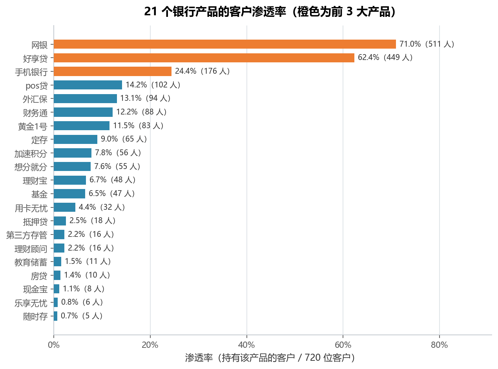
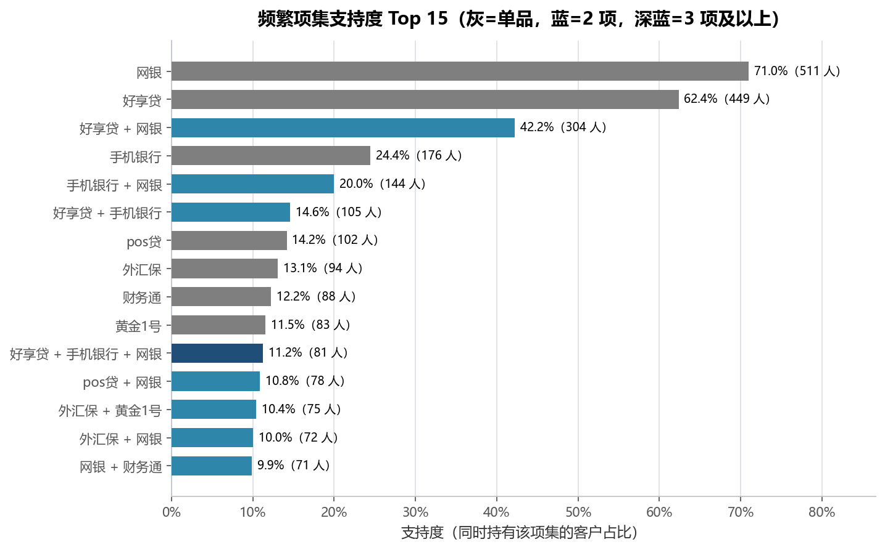
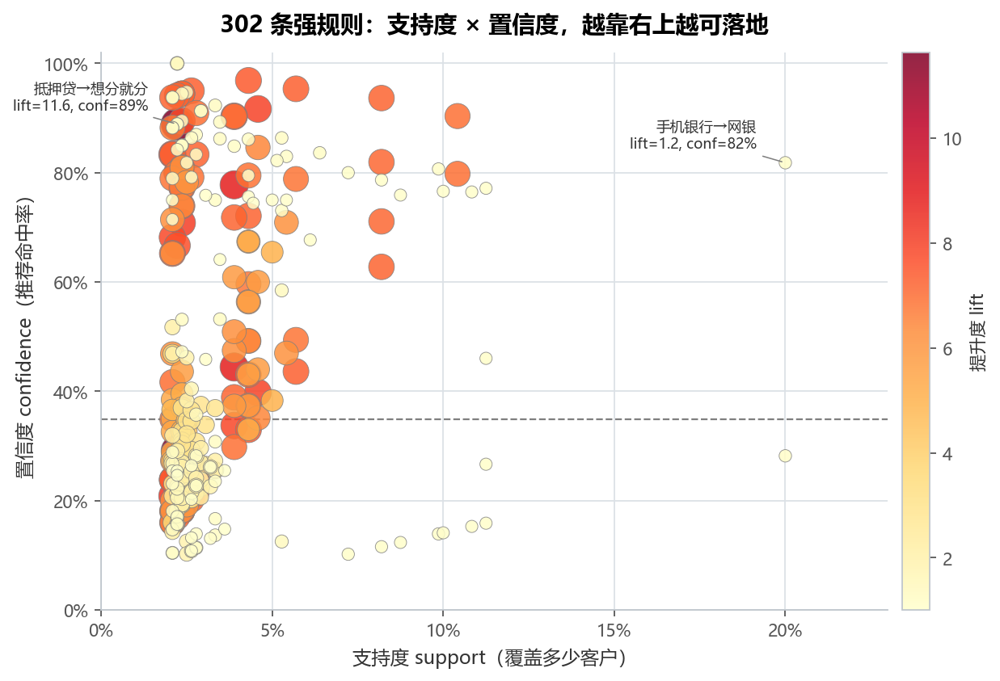
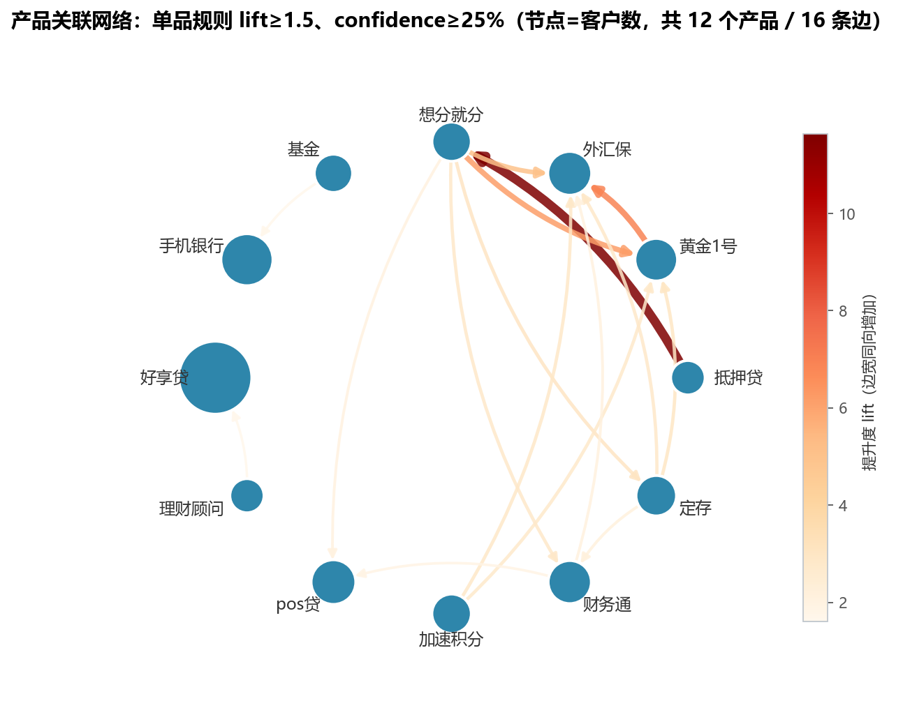
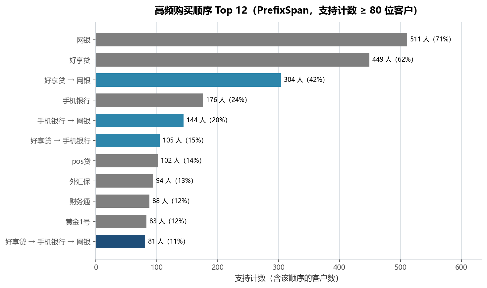

# 实验 09 · 关联规则与序列模式：银行产品交叉销售分析

> **教材**：《CDA 三级认证教材：敏捷数据挖掘》第 2.4 节 交叉销售（关联规则与序列模式）
> **原始素材**：`bank_prod_order.csv`（1914 行 × 3 列，GBK 编码；1907 张订单 / 720 位客户 / 21 个产品）
> **迁移方向**：教材自写 `myscript/apriori.py` + Orange3 `associate` + `myscript/prefixspan.py` → **mlxtend + 纯 Python PrefixSpan + networkx**
> **对应脚本**：[`lab09_association_rules.py`](./lab09_association_rules.py)

---

## 1. 教材在做什么（项目内涵）

教材用银行零售业务的「客户买过哪些产品」回答一个典型的交叉销售问题：**买了 A 的人，还会买 B 吗？**

它分两条线：

1. **2.4.1 关联规则**：把每个客户的产品聚成一个"购物篮"，用 Apriori 找出支持度 ≥ 2% 的频繁项集，
   再生成规则并计算 support / confidence / lift，最后筛出「lift > 1 且 confidence > 10%」的规则；
2. **2.4.2 序列模式**：把粒度换成"一个客户的多张订单"，用 PrefixSpan 挖「先买 A、后买 B」的顺序，
   阈值用绝对客户数（`threshold=100`）。

教材的代码是"工具演示式"的：自写 apriori 一份、Orange3 一份、PrefixSpan 一份，三套实现并列，
但**没有解释为什么这样选事务粒度、也没有把 support/lift 的权衡讲透**。本实验把两条线重排成一条流水线：

> 事务化（选粒度）→ 频繁项集 → 关联规则（读三个指标）→ 关系网络 → 序列模式（看先后顺序）

关键在于：**关联规则的上限由"事务怎么定义"决定**。这一步做错，后面所有指标都是错的。

---

## 2. 数据说明

| 字段 | 含义 | 类型 | 备注 |
|---|---|---|---|
| `OrderNumber` | 订单编号 | 整数 | 1907 个取值，99.6% 的订单只含 1 个产品 |
| `CSR_ID` | 客户编号 | 整数 | 720 位客户，同一订单只归属一个客户 |
| `PROD` | 产品名称 | 文本（GBK） | 21 种产品，中文字段需 `encoding="gbk"` 读取 |

- 数据规模：1914 行明细，去重后 1896 条"客户 × 产品"持有记录；
- 质量检查：无整行重复、无缺失，`OrderNumber` 有 7 张订单包含 2 个产品（都是"网银 + 想分就分"）；
- 数据源：教材配套素材，仅用于课程实验。

### 事务粒度怎么选（本实验最关键的一步）

| 粒度 | 事务数 | 平均项数/事务 | 多产品事务 | 结果 |
|---|---|---|---|---|
| 订单（`OrderNumber`） | 1907 | 1.00 | 7 | **几乎挖不出规则**：99.6% 的事务只有 1 项 |
| 客户（`CSR_ID`） | 720 | 2.63 | 544 | 可挖出 112 个频繁项集、302 条强规则 |

教材 2.4.1 用的是**客户粒度**，2.4.2 用的是**客户内的订单序列**，两者都合理：

- 关联规则问的是"同一个人的产品组合"，分母必须是"人数"，所以按客户聚合；
- 序列模式问的是"先买什么后买什么"，必须保留订单之间的先后，所以按客户 + 订单排序。

脚本里两种粒度都算了一遍并打印对比（见控制台「1. 事务粒度对比」），这也是本实验相对教材多出来的一层校验。

---

## 3. notebook 步骤 ↔ 重构后函数对照表

| 教材 notebook 的 cell | 教材在做什么 | 本脚本的函数 | 差异与改进 |
|---|---|---|---|
| 2.4.1 cell 1 | `read_csv(encoding='gbk')` + `head()` | `load_data()` | 增加订单/客户/产品计数、单订单产品数、订单是否跨客户校验 |
| 2.4.1 cell 2 | `groupby('CSR_ID').apply(list)` | `build_baskets()` | 用 `sorted(set(...))` 去重排序；同时产出订单级事务做粒度对比 |
| （教材无） | —— | `product_penetration()` | 新增：单产品渗透率作为解读 lift 的基准 |
| 2.4.1 cell 3 | `arules(baskets, min_support=0.02)`（自写 Apriori） | `mine_itemsets()` | 换成 `TransactionEncoder + mlxtend.apriori`，加 `max_len=4` |
| 2.4.1 cell 5 | `conf = rules[(confidence>0.1) & (lift>1)]` | `mine_rules()` | 同一阈值，另外把 lift 降序与 support 降序分开看 |
| 2.4.1 cell 7 | `conf.plot.scatter(x="lift", y="support", c="confidence")` | `mine_rules()` 内 fig03 | 改为 x=support、y=confidence、点大小与颜色=lift，并标注 3 条代表规则 |
| 2.4.1 cell 9/10 | Orange3 `fpgrowth` + `association_rules` | `mine_rules()` | 不再需要整数映射，直接保留产品名，可读性更好 |
| （教材无） | —— | `draw_rule_network()` | 新增：networkx 圆周布局的关系网络，边宽/颜色 = lift |
| 2.4.2 cell 1/2 | 按 `['OrderNumber','CSR_ID']` 分组再按客户聚成列表 | `build_sequences()` | 用 `groupby(sort=False) + frozenset`，同一订单的多产品保留为集合 |
| 2.4.2 cell 3 | `aprioriAll(baskets, min_support=0.1)` | （未保留，见下） | 教材的 aprioriAll 与 PrefixSpan 结论高度重叠，只保留 PrefixSpan |
| 2.4.2 cell 5 | `prefixSpan(SquencePattern([],1e4), baskets, threshold=100)` | `prefix_span()` + `mine_sequences()` | 纯 Python 重写（约 40 行），另加 100/80/60/40 阈值敏感性对比 |

> 为什么没保留 `aprioriAll`：它是"序列上的 Apriori"，挖出的模式与 PrefixSpan 高度重合，
> 但实现更绕（要枚举候选序列）。教材把它和 PrefixSpan 并列，本实验只在 README 里说明这层关系，
> 代码里留一条主线，避免读者在两种算法间来回对照。

---

## 4. 代码结构与关键点

```
lab09_association_rules.py
├── load_data()               # 读 GBK 数据 + 订单/客户/产品体检
├── build_baskets()           # 事务化：客户粒度 vs 订单粒度对比
├── product_penetration()     # 单产品渗透率（解读 lift 的基准）→ fig01
├── mine_itemsets()           # one-hot + Apriori → fig02 + table01
├── mine_rules()              # 生成规则、筛强规则 → fig03 + table02
│   └── draw_rule_network()   # 单品规则网络图 → fig04
├── build_sequences()         # 客户内按订单号排序，构造产品序列
├── prefix_span()             # 纯 Python PrefixSpan（序列扩展）
├── mine_sequences()          # 阈值敏感性 + 高频顺序 → fig05 + table03
└── main()                    # 串起流程 + 打印业务结论
```

三个值得记住的写法：

1. **`TransactionEncoder` 就是 one-hot**：把 720 条变长的事务列表转成 720 × 21 的 0/1 矩阵，
   这正是 Apriori 需要的输入格式；`apriori(...)` 返回的 `itemsets` 是 frozenset，需要 `apply(len)` 才能按长度分组。
2. **三个指标必须一起读**：support 决定"覆盖多少人"，confidence 决定"推荐准不准"，
   lift 决定"比瞎推强多少"。只看 lift 会被长尾产品的分母效应骗到（见 5.3 的 11.6 倍规则）。
3. **PrefixSpan 的核心是"前缀投影 + 剪枝"**：`prefix_span()` 用「对全库重扫 + 最早匹配」
   代替维护投影数据库，代码短、结论一致；`grow()` 里 `if cnt < min_count: continue` 就是
   Apriori 的向下封闭性——支持度不够的前缀，往后长也不会够，直接剪掉。

---

## 5. 运行结果与解读

### 5.1 单品渗透率：两个"底仓产品" + 一条长尾



- 网银渗透率 **71.0%**（511 人）、好享贷 **62.4%**（449 人），第三名手机银行只有 24.4%（176 人）；
- 21 个产品里有 **5 个渗透率低于 2%**：教育储蓄 1.5%、房贷 1.4%、现金宝 1.1%、乐享无忧 0.8%、随时存 0.7%；
- 这张图是后面所有解读的"标尺"：**任何涉及网银的规则，lift 都会被 71% 的高基数压到 1.1 附近**，
  不管规则本身多有道理。

### 5.2 频繁项集：组合集中在"渠道 + 消费贷"



- 支持度 ≥ 2%（15 位客户）的项集共 **112 个**：1 项 16 个、2 项 50 个、3 项 38 个、4 项 8 个；
- 组合类项集里最高的是 **好享贷 + 网银（42.2%，304 人）**，其次是手机银行 + 网银（20.0%，144 人）、
  好享贷 + 手机银行（14.6%，105 人）；
- 三阶组合 **好享贷 + 手机银行 + 网银（11.2%，81 人）** 说明存在稳定的"消费贷 + 手机端 + 网银"产品包，
  这正是教材想找的交叉销售客群。

### 5.3 关联规则：11.6 倍 lift 的规则只有 16 个人



- `lift > 1` 的候选规则 358 条，叠加 `confidence > 10%` 后剩 **302 条强规则**；
- **lift 最高 11.64**：`抵押贷 → 想分就分`（support 2.2%，仅 16 人，confidence 88.9%），
  反向 `想分就分 → 抵押贷` 的 confidence 只有 29.1%。**16 个人的样本撑不起 11 倍的 lift**，
  这类规则适合做"待验证假设"，不适合直接上推荐位；
- **最可落地的强规则**是 `手机银行 → 网银`：144 人、confidence 81.8%、lift 1.15 —— lift 不高，
  但因为网银渗透率本身就有 71%，lift 1.15 已经意味着"手机银行客户的网银开通率比大盘高 15%"；
- 中段最"干净"的组合是 `黄金1号 → 外汇保`：75 人、confidence **90.4%**、lift **6.92**，
  样本量和提升度都够，是本次分析里最值得做交叉销售的一对产品。

### 5.4 关系网络：产品分成两簇，网银是"基础设施"而不是"标的"



- 图中保留 12 个产品、16 条边（单品规则 lift ≥ 1.5 且 confidence ≥ 25%）；
- **主簇**是"黄金1号 / 外汇保 / 想分就分 / 定存 / 财务通 / 加速积分 / 抵押贷 / pos贷"，
  本质是一组"高净值理财 + 消费信贷"产品，客户一旦进入这个圈子就会连带购买；
- **孤立簇**是"理财顾问 → 好享贷"（16 人，lift 1.60）和"基金 → 手机银行"（19 人，lift 1.65），
  说明这两组是独立的销售场景；
- **网银没有进图**：它与各单品的 lift 都落在 1.06—1.32 之间（最高的第三方存管也只有 1.32），
  画进来会变成一张蜘蛛网。
  这不是网银不重要，而是它已经**人人都有**——它是渠道基础设施，不是交叉销售的目标，
  对网银的正确动作是"默认开通 + 激活使用"，而不是"推荐购买"。

### 5.5 序列模式：先买好享贷、再开网银，是一条 304 人的主路径



- 阈值敏感性：`threshold=100` 只剩 7 条（5 条是单品）、80 得 11 条、60 得 17 条、40 得 29 条；
  主结果取 **80（11.1%）**，与教材的 100 相差不大，但能多看到一条三阶模式；
- 最强的多阶模式是 **好享贷 → 网银（304 人，42.2%）**，其次是手机银行 → 网银（144 人，20.0%）、
  好享贷 → 手机银行（105 人，14.6%），三阶 **好享贷 → 手机银行 → 网银（81 人，11.2%）**；
- 注意方向性：`好享贷 → 网银` 覆盖 42.2%，但**反方向 `网银 → 好享贷` 并不在结果里**——
  因为 304/511 = 59.5% 低于好享贷 62.4% 的基础渗透率（lift < 1）。
  也就是说，**网银客户并不比普通人更可能买好享贷**，顺序信息只在"好享贷在前"时成立。

> 口径提醒：数据没有时间戳，序列的"先后"是按 `OrderNumber` 升序假定的。
> 若订单号并非严格按时间生成，5.5 的结论应降级为"订单编号顺序上的共现"，需要业务方确认后再用于触达。

---

## 6. 复现方式

```powershell
cd 09_三级教材_第2.4节_关联规则与序列模式
# mlxtend 不在默认环境时，把它所在的目录加入 PYTHONPATH（脚本内不写死路径，此处按本机实际替换）
$env:PYTHONPATH = "D:\deepseek\work place\_env\site"
$env:PYTHONIOENCODING = "utf-8"          # Windows 控制台输出中文不乱码
python lab09_association_rules.py
```

- 依赖：`pandas`、`numpy`、`matplotlib`、`mlxtend`、`networkx`（见仓库根 `requirements.txt`）；
- 输入：`data/bank_prod_order.csv`（GBK 编码）；
- 输出：`outputs/` 下 5 张 PNG + 3 张 CSV：
  - `table01_频繁项集.csv`（112 行：组合、项数、support、客户数）
  - `table02_强关联规则.csv`（302 行：前件、后件、support、confidence、lift、客户数）
  - `table03_序列模式.csv`（11 行：序列模式、阶数、支持计数、支持度）

---

## 7. 小结与思考

1. **事务粒度先于算法**：同一份数据，按订单聚合只能得到 1.00 项/事务，Apriori 无从下手；
   按客户聚合得到 2.63 项/事务，规则才可能出现。教材一句 `groupby` 背后是这个选择。
2. **lift 高 ≠ 有价值**：`抵押贷 → 想分就分` 的 lift 是 11.6，但只有 16 个人；
   `手机银行 → 网银` 的 lift 只有 1.15，却覆盖 144 人。**先看 support 够不够，再看 lift 高不高**，
   这是教材没有明说、但实战中最容易踩的坑。
3. **共现与顺序是两件事**：关联规则说"这两个产品总一起出现"，序列模式说"先 A 后 B"。
   本数据里 好享贷/网银 共现很强（304 人），但顺序只在"好享贷 → 网银"方向成立，
   这直接决定触达时机（先推好享贷，再引导开网银）。

> 思考题：
> 1. 如果把 `min_support` 从 0.02 降到 0.01，规则数量会怎么变？为什么 lift 最高的那批规则反而更不可信？
> 2. 序列模式如果要加"时间间隔"（例如 30 天内），现有 PrefixSpan 实现需要改哪里？
>    提示：把 `frozenset` 换成 `(产品, 订单日期)`，在 `suffix_start()` 里加时间窗判断。
