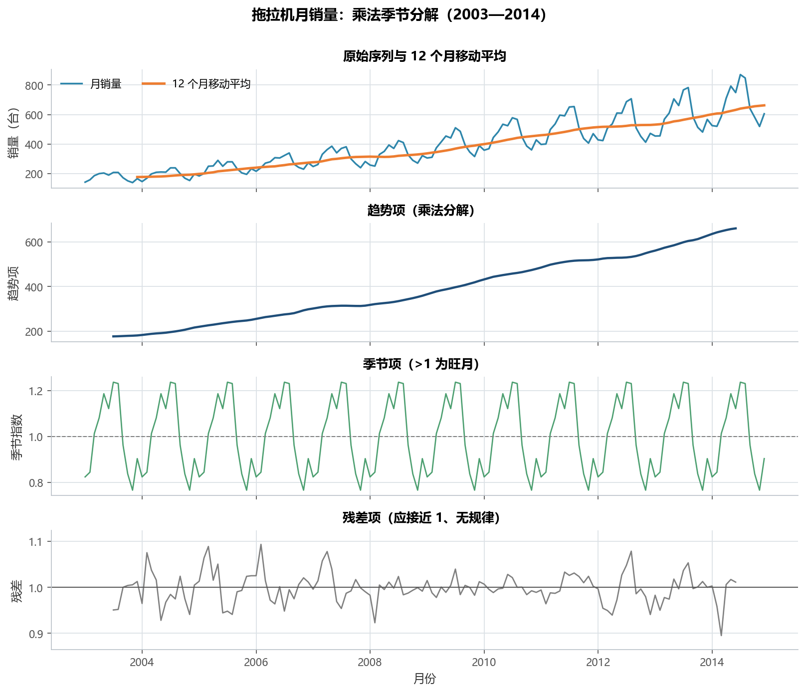
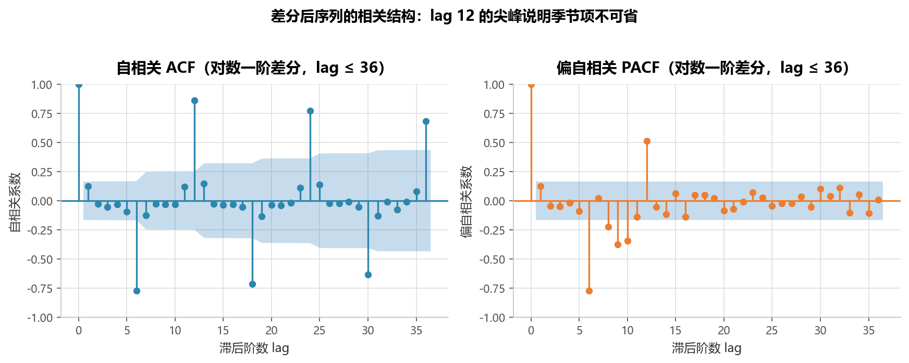
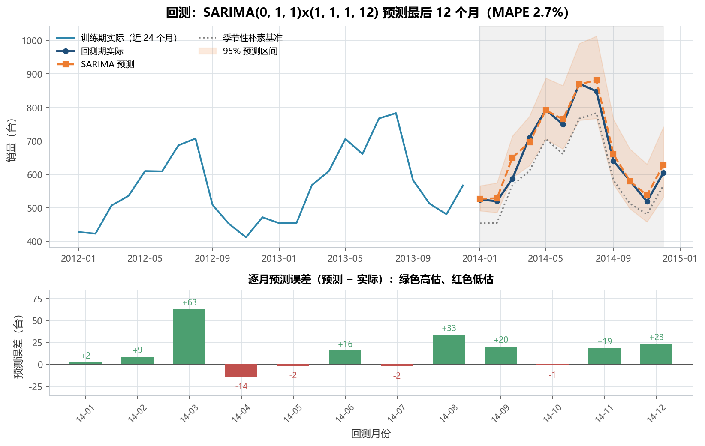
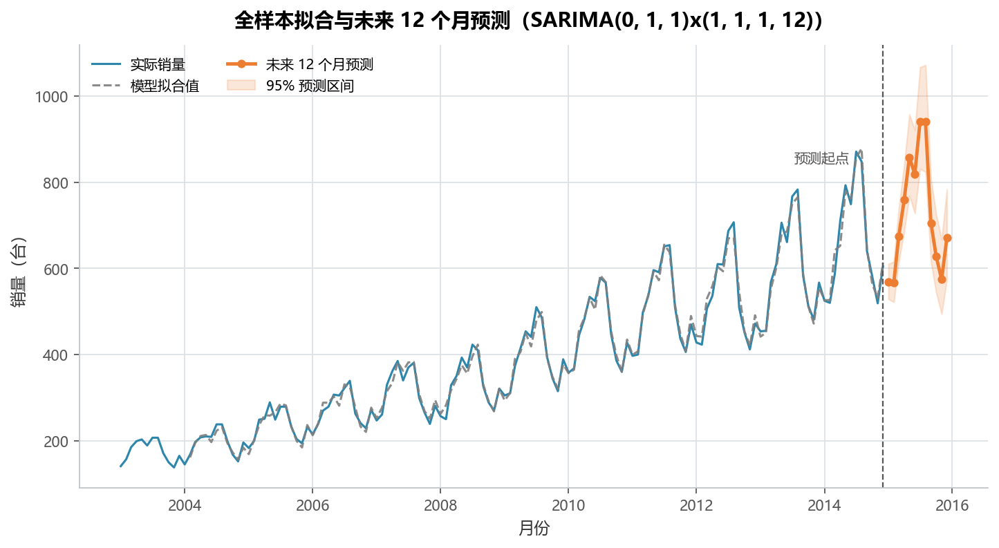
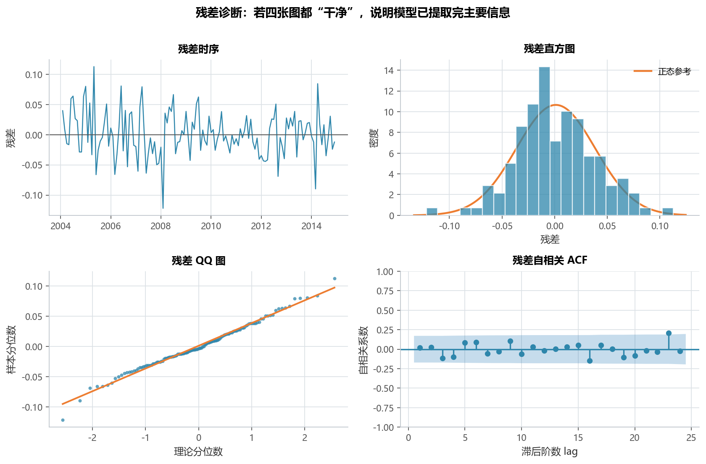

# 实验 10 · 时间序列预测：季节分解 + SARIMA 定阶与回测

> **教材**：《CDA 三级认证教材：敏捷数据挖掘》第 4.1 节 时间序列预测（4.1.2 销售数据预测 SARIMA）
> **原始素材**：`tractor_sales.csv`（144 行 × 2 列，2003-01 ~ 2014-12 拖拉机月销量）
> **迁移方向**：教材的「取对数 → 差分 → 网格搜 AIC → 直接预测 36 期」→ **解析 → 分解 → 平稳性/定阶 → 留出回测 → 预测**
> **对应脚本**：[`lab10_time_series.py`](./lab10_time_series.py)

---

## 1. 教材在做什么（项目内涵）

拖拉机的月销量有两个明显特征：**长期上升**（12 年翻了近 4 倍）和**强季节**（农忙前后是旺季）。
教材用 SARIMA 回答一个制造业最实际的问题：**下一年每个月大概能卖多少台，上下浮动多大？**

教材的步骤是：

1. 把 `Year_Month`（`2003-Jan`）解析成时间索引，画原始序列；
2. 用 `seasonal_decompose(model='multiplicative')` 拆出趋势 / 季节 / 残差；
3. 取对数 + 一阶差分，画 ACF/PACF 看相关结构；
4. 用 `p,d,q ∈ range(0,2)` 与季节项 `(P,D,Q,12)` 做双重循环，挑 AIC 最小的参数；
5. 用最优参数拟合全样本，`plot_diagnostics()` 看残差，再向后预测 36 期并画 95% 区间。

这套流程本身是对的，但缺了工程上最关键的一环：**模型到底准不准**。
AIC 只衡量"拟合 + 复杂度"，不保证样本外预测好；教材直接从 AIC 最优跳到"预测 36 期"，
中间没有留出验证。本实验补上回测，并把教材 64 组的网格压到 18 组（可复现、跑得快）。

---

## 2. 数据说明

| 字段 | 含义 | 类型 | 备注 |
|---|---|---|---|
| `Year_Month` | 年月字符串，如 `2003-Jan` | 文本 | 用 `format="%Y-%b"` 解析 |
| `Number_of_Sold` | 当月拖拉机销量（台） | 整数 | 138 ~ 871，无缺失、无负值 |

- 数据规模：144 个月，正好 12 年，**无缺月**（脚本用 `asfreq("MS")` 校验）；
- 统计特征：均值 389.7 台、中位数 369 台，首年合计 2112 台、末年 7948 台（**+276%**）；
- 数据源：教材配套素材，仅用于课程实验。

三个建模前必须确认的点，脚本都会打印：

1. **有没有缺月**：缺一个月会让季节项整体错位，SARIMA 默认等间隔；
2. **是不是乘法季节**：销量随趋势抬升时，季节波动的绝对幅度也在变大（2003 年峰谷差几十台，
   2013 年差几百台），这是"季节按比例作用"的特征，所以用乘法模型；
3. **要不要取对数**：乘法模型 + 对数变换后，季节与趋势变成加法关系，方差更稳定。

---

## 3. notebook 步骤 ↔ 重构后函数对照表

| 教材 notebook 的 cell | 教材在做什么 | 本脚本的函数 | 差异与改进 |
|---|---|---|---|
| cell 2 | `read_csv('tractor_sales.csv')` + `head(5)` | `load_series()` | 加 `asfreq("MS")` 缺月校验、均值/中位数/年度合计 |
| cell 3 | `to_datetime(format="%Y-%b")` + 设索引 + `plot` | `load_series()` / `decompose_series()` | 索引对齐到月初；原始序列与 12 月移动平均画在分解图第一栏 |
| cell 5 | `seasonal_decompose(model='multiplicative').plot()` | `decompose_series()` | 手工重画中文四联图，并输出各月季节指数、峰谷比 |
| cell 8 | `log` → `diff(1)` → `plot_acf/plot_pacf(lags=30)` | `stationarity_tests()` + `plot_acf_pacf()` | **新增 ADF 检验**（原始/对数/对数差分三行），ACF/PACF 改中文标签、lag 36 |
| cell 10 | 三重 `itertools.product` 套季节三重积（最多 64 组） | `grid_search()` | 固定 `d=D=1`，搜 p,q∈{0,1,2}、(P,Q)∈{(0,0),(1,1)}，共 **18 组**；每组 AIC/BIC 落盘 |
| cell 11 | 用最优参数拟合 + `summary()` | `grid_search()` / `backtest()` | 只打印关键指标，完整参数表存 `table02` |
| cell 13 | `plot_diagnostics(lags=30, figsize=(8,8))` | `residual_diagnostics()` | 拆成四联中文图，并补 **Ljung-Box 检验** |
| cell 15 | `get_forecast(steps=36, alpha=0.05)` + `exp` 还原 | `forecast_future()` | 改为预测 12 个月（与回测口径一致），区间逐点还原 |
| cell 16 | 实际值 + 预测值 + `fill_between` | `forecast_future()` fig04 | 叠加全样本拟合值、标注预测起点 |
| （教材无） | —— | `backtest()` | **新增**：留出最后 12 个月，报 MAPE / RMSE，并与季节性朴素法对比 |
| （教材无） | —— | `main()` 的业务结论 | 新增：把统计输出翻译成排产/库存建议 |

> 教材同目录下的 `4.1.1`（趋势分解法）用"趋势 × 季节"手工外推，`4.1.3` 用 LSTM，
> 都不属于本实验范围；本实验只迁移 4.1.2 的 SARIMA 主线。

---

## 4. 代码结构与关键点

```
lab10_time_series.py
├── load_series()             # 解析月份索引 + 缺月校验 + 描述统计
├── decompose_series()        # 乘法季节分解 → fig01（原始/趋势/季节/残差）
├── stationarity_tests()      # ADF 三行对比 → table01
├── plot_acf_pacf()           # 对数差分后的 ACF/PACF → fig02
├── grid_search()             # 18 组 (p,d,q)×(P,D,Q,12) 搜 AIC → table02
├── backtest()                # 留出 12 个月回测 + 朴素基准 → fig03
├── forecast_future()         # 全样本重拟合 + 未来 12 个月 + 95% 区间 → fig04
├── residual_diagnostics()    # 残差四联图 + Ljung-Box → fig05
└── main()                    # 串联 + 拼装 table03 + 业务结论
```

三个容易踩的坑，脚本里都做了处理：

1. **`d` 和 `D` 不是搜出来的，是检验出来的**：ADF 决定 `d=1`，季节周期决定 `D=1`；
   把 `d` 也放进网格会让 18 组变成 54 组，而且 `d=0` 的组合几乎必然不收敛。
2. **对数模型的区间要 `exp` 还原**：`get_forecast(alpha=0.05)` 给的是对数尺度上的对称区间，
   `exp` 之后变成右偏区间（上限拉得比下限远），这正是"销量不可能为负"的体现。
3. **`fittedvalues` 前 13 期是初始化产物**：`d=1` + `D=1` 时前 13 个拟合值在对数尺度上接近 0，
   `exp` 回来约等于 1 台，直接画会拖出一条假深坑，脚本把它们置为缺失。

---

## 5. 运行结果与解读

### 5.1 趋势 + 季节：12 年涨 2.75 倍，7 月最旺、11 月最淡



- 趋势项从 2003-07 的 **176 台**升到 2014-06 的 **661 台**（+275.1%），12 年几乎单边上涨；
- 季节指数 **7 月 1.236 最高、11 月 0.766 最低，峰谷比 1.61 倍**；
  各月指数：1 月 0.82、2 月 0.84、3 月 1.01、4 月 1.08、5 月 1.19、6 月 1.12、7 月 1.24、
  8 月 1.23、9 月 0.96、10 月 0.84、11 月 0.77、12 月 0.90；
- 季节形态是"春耕启动（3—5 月）→ 盛夏高位（6—8 月）→ 秋收后回落（9—11 月）"，
  与农机销售的作业季完全吻合；残差项长期在 1.0 附近、无趋势，说明乘法分解是合适的。

### 5.2 平稳性：原序列不平稳，一阶差分在 10% 水平上平稳

| 序列 | ADF 统计量 | p 值 | 结论 |
|---|---|---|---|
| 原始销量 | 1.109 | 0.9953 | 不平稳（明显趋势） |
| 对数销量 | −1.732 | 0.4145 | 不平稳（趋势还在） |
| 对数一阶差分 | −2.680 | 0.0775 | 边缘平稳（10% 水平显著） |

对数差分后的 p=0.0775 属于"5% 边缘、10% 显著"。这在真实数据里很常见，处理方式是：
**不要因为 5% 不显著就无限差分**（过差分会引入 MA 结构、放大噪声），
结合"趋势已被消掉 + 残差图无明显趋势"取 `d=1`，再用 AIC 与残差诊断交叉验证——
最终 Ljung-Box 的 p=0.776 证明这个选择是对的。



- ACF 在 lag 12、24 处仍有尖峰 → 季节项必须保留（`D=1` 且带季节 AR/MA）；
- ACF 与 PACF 都呈拖尾，没有干净的截尾 → 单看图形定不了阶，必须靠 AIC 网格搜索。

### 5.3 定阶：18 组里 AIC 最优的是 (0,1,1)×(1,1,1,12)

| 排名 | 参数组 | AIC | BIC |
|---|---|---|---|
| 1 | **(0,1,1)×(1,1,1,12)** | **−440.10** | −428.99 |
| 2 | (1,1,0)×(1,1,1,12) | −439.72 | −428.61 |
| 3 | (0,1,2)×(1,1,1,12) | −438.12 | −424.23 |
| 最差 | (2,1,1)×(0,0,1,12) | −255.15 | — |

- 前三名的 AIC 只差 2 以内，属于"统计上难分伯仲"，选 (0,1,1)×(1,1,1,12) 除了 AIC 最低，
  还因为它参数最少（1 个 MA + 1 个季节 AR + 1 个季节 MA），外推更稳；
- 最差的一组是**没有季节差分**（`D=0`）的，AIC 差了近 185，再次说明季节项不能省。

### 5.4 回测：MAPE 2.68%，比"去年同月"基准好 7.3 个百分点



- 用前 132 个月训练，预测 2014 全年 12 个月：
  **MAPE 2.68%、RMSE 24.0 台**；
- 同期**季节性朴素法**（直接拿 2013 年同月当预测）是 MAPE 9.99%、RMSE 71.1 台，
  SARIMA 把误差压到约 1/4，说明模型确实学到了趋势而不只是复制去年；
- 95% 预测区间覆盖 **11/12** 个月（理论应约 11.4 个），区间校准正常；
- 误差最大的月份是 2014-03（高估 63 台），其次是 2014-08（高估 33 台）——都是旺季拐点，
  说明模型对"拐点"的反应略滞后，这是 ARIMA 类模型的通病。

### 5.5 预测：2015 年约 8704 台，越远越不确定



- 未来 12 个月合计 **8704 台**、月均 725 台，较 2014 年实际 7948 台 **+9.5%**；
- 2015 年 1 月 568 台（95% 区间 529—610）、2 月 567 台（522—616）、3 月 674 台（614—739）；
- 区间宽度从第 1 个月的 **81 台**扩散到第 12 个月的 **210 台**——这正是"预测越远越不可信"的量化表达。
  实务上排产按**区间上沿**备料、按**中位预测**排主计划，才能兼顾缺货与压库。

### 5.6 残差诊断：像白噪声，模型可用



- 残差均值 +0.0010、标准差 0.0375（对数尺度，约等于 ±3.8% 的波动）；
- 直方图与 QQ 图基本贴合正态，只有左尾略厚（个别月份跌得比模型预期狠）；
- 残差 ACF 全部落在置信带内：**Ljung-Box lag=12 统计量 8.12（p=0.776）、
  lag=24 统计量 22.55（p=0.547）**，不能拒绝"无自相关"，说明模型已提取完主要信息。

---

## 6. 复现方式

```bash
cd 10_三级教材_第4.1节_时间序列预测
python lab10_time_series.py
```

- 依赖：`pandas`、`numpy`、`matplotlib`、`statsmodels`、`scipy`（见仓库根 `requirements.txt`）；
- 运行时间：18 组网格搜索 + 3 次拟合，普通笔记本约 20—40 秒；
- 输入：`data/tractor_sales.csv`；
- 输出：`outputs/` 下 5 张 PNG + 3 张 CSV：
  - `table01_序列特征与ADF检验.csv`（3 行：原始/对数/对数差分）
  - `table02_模型定阶AIC.csv`（18 行：全部参数组及 AIC/BIC/对数似然）
  - `table03_回测与未来预测.csv`（24 行：12 个月回测明细 + 12 个月未来预测）

---

## 7. 小结与思考

1. **分解先行，模型后置**：先把序列拆成趋势 + 季节 + 残差，能立刻看出"要不要季节项、要不要对数"，
   比一上来就调参高效得多。
2. **定阶靠证据，不靠感觉**：ADF 定 `d`、季节周期定 `D`、ACF/PACF 只用来缩小搜索空间，
   最终参数由 AIC 在这 18 组里选，并保留完整搜索表以便复核。
3. **没有回测的预测不算预测**：AIC 最优的模型在样本外可能输给"去年同月"这种土办法；
   本实验的 2.68% vs 9.99% 才是"这个模型值得上线"的证据。
4. **区间和点预测一样重要**：排产、备料、库存都要按区间做决策，只报一个点预测等于隐藏风险。

> 思考题：
> 1. 如果把 `HOLDOUT` 从 12 改成 24（回测两年），MAPE 会变好还是变差？为什么？
> 2. 2015 年的预测比 2014 年只高 9.5%，但趋势项 12 年涨了 2.75 倍——是模型低估了增长，
>    还是增长本身在放缓？提示：把趋势项单独画出来看 2012—2014 的斜率变化。
> 3. 如果要做"周销量"预测，`SEASON` 应该设成多少？季节差分还够用吗？
