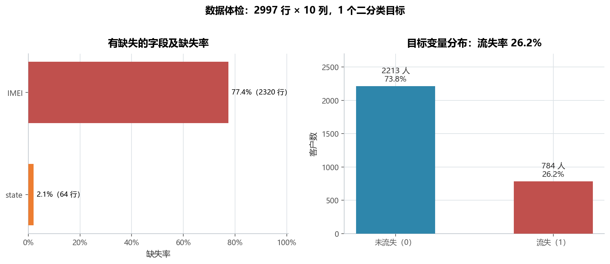
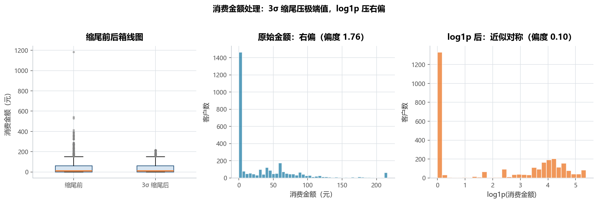
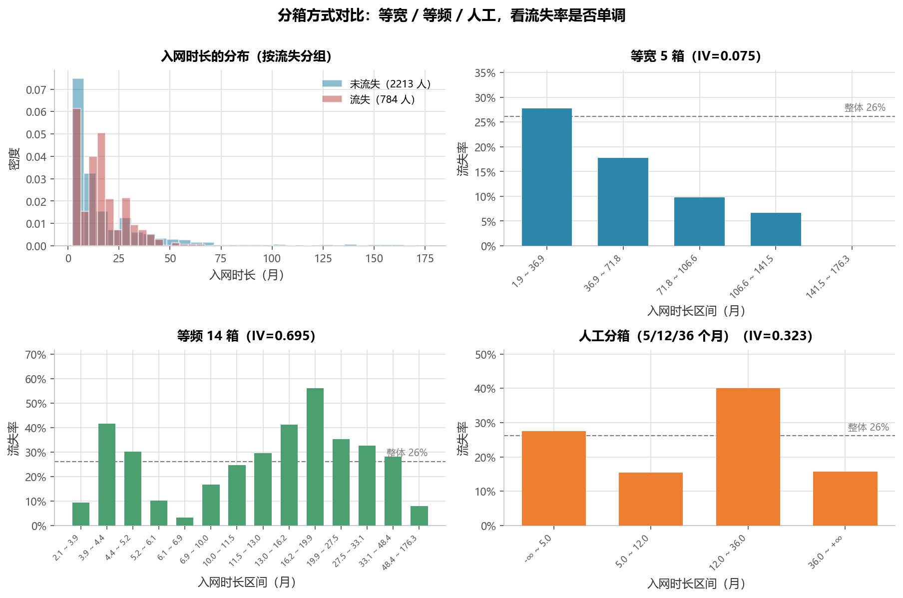
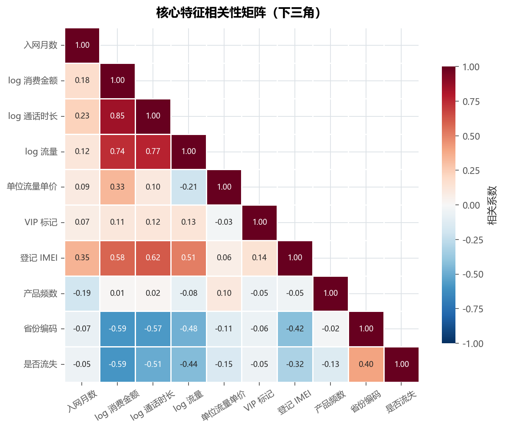
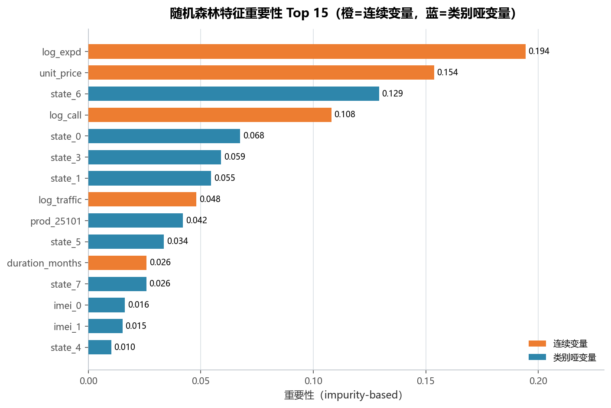

# 实验 11 · 特征工程：从原始账单到可入模的特征矩阵

> **教材**：《CDA 三级认证教材：敏捷数据挖掘》第 6 章 特征工程
> **原始素材**：`telecom_bill.csv`（3000 行 × 10 列，运营商客户账单 + 流失标记）
> **迁移方向**：教材 60 余个"每招一个 cell"的工具演示 → **体检 → 清洗 → 派生 → 编码 → 分箱/WOE → 筛选 的完整流水线**
> **对应脚本**：[`lab11_feature_engineering.py`](./lab11_feature_engineering.py)

---

## 1. 教材在做什么（项目内涵）

教材这一章不解决某个具体业务问题，而是回答一个建模前的问题：**一张脏表，怎么变成能进模型的特征矩阵？**

它把特征工程拆成一串技巧，每个技巧配一个 cell：

- **清洗**：剔除流量异常样本、缺失值统计与填补、3σ 缩尾、log 变换；
- **派生**：入网时长、单位流量单价、IMEI 前 6 位（TAC）、Binarizer 生成"是否登记 IMEI"；
- **编码**：`pd.cut` / `pd.qcut` 分箱、`get_dummies` / `OneHotEncoder` 独热、`StandardScaler` / `MinMaxScaler` 标准化；
- **降维**：PCA、LDA；
- **筛选**：`VarianceThreshold` 方差过滤、卡方 / ANOVA / F 回归、RFE、随机森林与 GBDT 的特征重要性。

问题在于：**教材给的是"菜谱"，不是"做菜的顺序"**。同一张表，先填补还是先分箱、
先标准化还是先筛选，结果完全不同。本实验按真实建模顺序重排，并补了两块教材没讲的内容：

1. **WOE / IV**：分箱之后怎么用**一个数字**判断"这个变量到底有没有区分度"，
   而不是盯着柱状图凭感觉；
2. **信息泄露排查**：本数据里 `state` 与 `churn` 几乎完全共线（IV = 7.79），
   这是教材不会遇到、但实战中必须先发现的问题。

---

## 2. 数据说明

| 字段 | 含义 | 类型 | 缺失 | 处理方式 |
|---|---|---|---|---|
| `ID` | 客户编号 | 整数 | 0 | 仅作主键，不入模 |
| `churn` | 是否流失 | 0/1 | 0 | **目标变量**，流失率 26.2% |
| `join_time` | 入网日期 | 文本 `2014/8/19` | 0 | 解析后派生入网天数/月数/年份/月份 |
| `vip` | 是否 VIP | 0/1 | 0 | 直接入模（方差仅 0.008，会被方差过滤筛掉） |
| `product` | 产品编号 | 整数 | 0 | 91 个取值 → 频数编码 + top8 one-hot |
| `expenditure` | 月消费金额（元） | 浮点 | 0 | 3σ 缩尾 → `log1p` |
| `call` | 通话时长（分钟） | 浮点 | 0 | `log1p` |
| `traffic` | 流量（MB） | 浮点 | 0 | 先剔除 ≥ 5000 的 3 行异常，再 `log1p` |
| `state` | 省份编码 | 浮点 | 64（2.1%） | 众数填补 + `state_missing` 标记 |
| `IMEI` | 手机串号 | 浮点 | 2320（77.4%） | **不填 0**，只保留"是否登记"二值特征 |

- 数据规模：原始 3000 行，剔除 3 行流量异常后 **2997 行**，流失 784 人（26.2%）；
- 入网时间跨度：2000-07-09 ~ 2014-10-31（以 2015-01-01 为"当前时点"算时长）；
- 数据源：教材配套素材，仅用于课程实验。

---

## 3. notebook 步骤 ↔ 重构后函数对照表

| 教材 notebook 的 cell | 教材在做什么 | 本脚本的函数 | 差异与改进 |
|---|---|---|---|
| cell 2 | `read_csv` + `head()` | `load_data()` | 加日期解析与解析失败检查 |
| cell 4 / 5 | 看 `traffic ≥ 5000` 的 3 行并剔除 | `load_data()` | 同一逻辑，打印剔除行数与前后样本量 |
| cell 6 / 7 | 按 state 计数 + 饼图 | `data_health()` + `encode_features()` | 饼图改为"缺失率 + 目标分布"双面板；state 分布放到编码后按流失率看 |
| cell 10 / 11 | `boxplot` + 3σ 截断 | `treat_numeric()` | 保留 `mu ± 3σ`，打印截断行数与上下界 |
| cell 12 / 13 | `hist` + `log1p` 直方图 | `treat_numeric()` fig02 | 三联图：箱线图 + 原始直方图 + log 直方图 |
| cell 14 | `FunctionTransformer(np.log1p)` 批量处理 call/traffic | `treat_numeric()` | 直接 `np.log1p`，少一层包装（效果相同） |
| cell 16—20 | `count()` / `isnull()` / `dropna(thresh=1)` / `fillna(mode)` | `data_health()` + `encode_features()` | 按字段性质分别处理，不用"一律填 0" |
| cell 21 | `SimpleImputer(strategy='most_frequent')` | `encode_features()` | 等价实现，同时保留缺失标记位 |
| cell 23 / 24 | `Binarizer` + `pd.cut` 生成 has_IMEI | `encode_features()` | `(IMEI.fillna(0) > 0)` 直接得到 0/1，更直白 |
| cell 27 | 入网时长 = `(2015-01-01 − join_time).days / 30` | `build_date_features()` | 另加 `duration_days` / `join_year` / `join_month` |
| cell 28—32 | `pd.cut(5)` / `pd.qcut(14)` + 分组 `agg(['count','mean'])` + 柱状图 | `binning_analysis()` | 三种分箱并列四联图，**新增 WOE/IV** |
| cell 34 | 人工分箱 `[-inf,5,12,36,inf]` | `binning_analysis()` | 保留，并给出每箱 WOE |
| cell 36 / 37 | `get_dummies` / `OneHotEncoder` | `encode_features()` | state 8 档 + product top8 + vip + has_IMEI，共 21 个哑变量 |
| cell 39—43 | `StandardScaler` / `MinMaxScaler` / `Normalizer` | （未保留，见下） | 仅用于线性模型，本实验的主角是树模型 |
| cell 45 | `unit_price`、`TAC` 派生 | `treat_numeric()` / `encode_features()` | 保留 `unit_price`；`TAC` 属串号解析，本数据缺失 77%，不入模 |
| cell 48—57 | PCA / LDA 降维与投影 | （未保留，见下） | 降维是为线性模型服务，与"筛选"主题重复，本实验只做筛选 |
| cell 61 / 62 | `VarianceThreshold(0.09)` | `select_features()` | 保留阈值，输出被筛掉的字段名单 |
| cell 64—71 | 卡方 / ANOVA + `SelectKBest` | `select_features()` | 不设 k，改为输出全部 26 个特征的统计量与 p 值 |
| cell 73—78 | `f_regression` + RFE | （未保留，见下） | 目标是二分类，`f_regression` 口径不符；RFE 与随机森林重要性结论重复 |
| cell 80—82 | 随机森林 / GBDT 特征重要性 | `select_features()` | 用 `class_weight='balanced'` 抵消 26%/74% 不平衡，输出 Top 15 |

> 没保留标准化与降维的原因：本实验的落点是"筛选出该保留的特征"，用树模型即可完成；
> 标准化对树模型无影响，PCA/LDA 会把特征变成不可解释的主成分，反而破坏"哪个业务字段重要"的结论。
> 教材把它们放在同一章是为了讲全工具箱，工程上应按模型类型取舍。

---

## 4. 代码结构与关键点

```
lab11_feature_engineering.py
├── load_data()             # 读表 + 剔除 traffic≥5000 + 解析 join_time
├── data_health()           # 缺失率 / 目标分布 / 偏度 → fig01 + table01
├── treat_numeric()         # 3σ 缩尾 + log1p + unit_price → fig02
├── build_date_features()   # 入网天数/月数/年份/月份
├── binning_analysis()      # 等宽/等频/人工分箱 + WOE/IV + state IV → fig03 + table02
├── encode_features()       # 缺失填补 + 频数编码 + one-hot + 可疑特征排查
├── correlation_heatmap()   # 核心特征相关矩阵 → fig04
├── select_features()       # 方差 / 卡方·ANOVA / 随机森林 → fig05 + table03
└── main()                  # 串联 + 业务结论
```

四个值得记住的写法：

1. **缺失值按"字段性质"处理，不搞一刀切**：`state` 缺 2.1% 可以补众数，
   `IMEI` 缺 77.4% 补任何值都是造假，正确做法是降级成"有没有登记"的二值特征。
2. **WOE 把"看图"变成"看数"**：`IV = Σ(流失占比 − 未流失占比) × WOE`，
   一个标量就能横向比较"入网时长"和"省份"谁更有区分度（0.323 vs 7.79）。
3. **方差过滤会误杀稀有但重要的特征**：`state_3` 方差只有 0.071（低于 0.09 阈值），
   但它在随机森林里排第 6。所以脚本给出的是三档建议（保留 / 观察 / 剔除），而不是二元判断。
4. **`class_weight='balanced'` 不能省**：26% 的正例比例下，不设权重的随机森林会偏向多数类，
   重要性排序会被"预测得准的那一类"带偏。

---

## 5. 运行结果与解读

### 5.1 体检：一个 77% 缺失的字段 + 26.2% 的流失率



- 只有两个字段有缺失：**IMEI 77.4%（2320 行）**、**state 2.1%（64 行）**，其余字段完整；
- 流失 784 人 / 2997 人 = **26.2%**，属于"中度不平衡"，树模型需要加权，但还不至于上采样；
- 三个金额/用量字段全部右偏：expenditure 偏度 **4.65**、call **3.31**、traffic **6.72**，
  直接标准化会被极端值带偏，必须先压偏态。

### 5.2 数值处理：缩尾压极端值，log1p 压右偏



- expenditure 均值 37.08、标准差 59.65，3σ 上界 **216.03**（下界 −141.87，实际不截断）；
  上侧截断 **58 行（1.9%）**，最大值从 1183 元压到 216 元；
- 偏度从 **1.76 → 0.10**（缩尾后 log1p），traffic 从 **6.72 → 0.83**，分布基本对称；
- 注意 log 直方图在 0 处仍有一个高峰：**43.2% 的客户当月消费为 0**（1294 人）。
  这不是异常，而是"未出账/未使用"的真实状态，所以后面保留了 `expenditure` 的 0 值信息
  （没有把 0 当缺失），它对流失的指示性极强（见 5.4）。

### 5.3 分箱：等宽分箱会把信号抹平，IV 差 9 倍



| 分箱方式 | 箱数 | IV | 判断 |
|---|---|---|---|
| 等宽 5 箱 | 5 | **0.075** | 弱区分度（箱边界被长尾拉歪，前 4 箱挤在 0—37 个月） |
| 等频 14 箱 | 14 | **0.695** | 强区分度（每箱人数相同，曲线最平滑） |
| 人工分箱（5/12/36 个月） | 4 | **0.323** | 强区分度，且业务可解释 |

人工分箱的四档给出清晰的业务故事：

| 区间（月） | 人数 | 流失率 | WOE | 解读 |
|---|---|---|---|---|
| (−∞, 5] | 578 | 27.5% | +0.07 | 新入网，尚未稳定 |
| (5, 12] | 1018 | 15.4% | −0.66 | 合约期内，最稳定 |
| (12, 36] | 1020 | **40.0%** | **+0.63** | **续约期，风险最高** |
| (36, +∞) | 381 | 15.7% | −0.63 | 老客户，忠诚度高 |

**流失不是"越早越危险"，而是集中在入网 1—3 年的续约窗口**——这条结论直接决定运营动作：
把资源从"新客首月关怀"挪到"入网 12 个月起的续约提醒"。

### 5.4 编码后排查：三个"过于好用"的特征，指向信息泄露

脚本在编码后打印了三组对比，它们比任何模型指标都值得先看一眼：

| 特征 | 取值 | 流失率 |
|---|---|---|
| `state` | state=6（471 人） | **100%** |
| | state=4（23 人） | 91% |
| | state=0（1380 人，含 64 行缺失填补） | 21% |
| | state=1/2/3/5/7（1123 人） | **0%** |
| `expenditure` | = 0（1294 人） | **58.0%** |
| | > 0（1703 人） | 2.0% |
| `IMEI` | 有登记（676 人） | **0.3%** |
| | 无登记（2321 人） | 33.7% |

- **`state` 的 IV = 7.79**，是"强区分度"阈值 0.3 的 26 倍，且流失率非 0 即 100%，
  这几乎等于"用省份直接查答案"——真实业务里不可能出现，典型的**信息泄露或数据构造痕迹**；
- 同理，"零消费 → 58% 流失""无 IMEI → 33.7% 流失"也强得反常，更像"流失后才停用/注销"的**事后特征**，
  而不是流失前就能观测到的信号；
- 结论：这三个字段在**离线评估**里会让模型 AUC 虚高，在**上线**时却拿不到（或拿到的是结果而非原因）。
  正确做法是先和业务确认字段的采集时点，再决定是否入模。

### 5.5 相关性：三个消费变量是同一个维度



- 与 churn 相关性最强：log 消费金额 **−0.588**、log 通话时长 −0.507、log 流量 −0.436、省份编码 +0.404；
- 特征之间：log 消费金额 × log 通话时长 **+0.85**、log 通话时长 × log 流量 +0.77、
  log 消费金额 × log 流量 +0.74——三者本质是"消费强度"一个维度，线性模型只能留一个，
  树模型可以都留（让模型自己挑切分点）；
- 入网月数与 churn 的相关只有 **−0.05**，几乎为 0，但分箱 IV 高达 0.323——
  **这正是"线性相关为 0 不代表无用"的典型例子**：关系是 U 型的（1—3 年最危险），
  线性相关系数会把正负两段抵消掉。

### 5.6 筛选：26 个候选，保留 12 个，Top 15 解释 98.3% 的重要性



- 候选特征 26 个（5 个连续 + 21 个哑变量）；方差 < 0.09 的有 **13 个**（多为稀有省份/产品的 one-hot）；
  单变量检验 p < 0.05 的有 **20 个（77%）**；
- 随机森林重要性前 5：**log_expd 0.194、unit_price 0.154、state_6 0.129、log_call 0.108、state_0 0.068**；
  **Top 15 累计解释 98.3%** 的重要性，剩下 11 个特征几乎可以全部丢掉；
- 三档建议的结果：**保留 12 个、观察 4 个、剔除 10 个**。其中 `state_3` 是"观察"的典型——
  方差低于阈值（0.071）却被模型排到第 6，说明"稀有但关键"的特征不能只靠方差判断；
- 有意思的是 `duration_months` 只排第 11（重要性 0.026）：它单变量 IV 很高（0.323），
  但树模型需要多次切分才能拟合 U 型关系，而消费类变量一次切分就能带来大幅不纯度下降，
  所以重要性被稀释。**这也是为什么"分箱 + WOE 编码后入模"通常比原始连续变量更有效。**

---

## 6. 复现方式

```bash
cd 11_三级教材_第6章_特征工程
python lab11_feature_engineering.py
```

- 依赖：`pandas`、`numpy`、`matplotlib`、`seaborn`、`scikit-learn`（见仓库根 `requirements.txt`）；
- 运行时间：随机森林 400 棵树（26 个特征 × 2997 行），约 5—10 秒；
- 输入：`data/telecom_bill.csv`；
- 输出：`outputs/` 下 5 张 PNG + 3 张 CSV：
  - `table01_数据体检与缺失率.csv`（10 行：字段、缺失数、缺失率、类型、唯一值）
  - `table02_分箱与WOE_IV.csv`（三种时长分箱 + 省份编码，含样本数、流失率、WOE、IV）
  - `table03_特征筛选汇总.csv`（26 行：类型、方差、检验统计量、p 值、相关系数、RF 重要性、排名、建议）

---

## 7. 小结与思考

1. **特征工程的顺序比技巧更重要**：先把目标比例、缺失结构、异常值摸清（体检），
   再决定怎么填补、怎么变换；顺序反了（例如先标准化再缩尾），前面的处理就白做了。
2. **分箱方式会显著改变结论**：同一列入网时长，等宽 5 箱 IV 只有 0.075，等频 14 箱能到 0.695，
   人工按业务节点切是 0.323。**默认用等频或人工分箱，别用等宽**。
3. **IV 极高不是好事，而是警报**：`state` 的 IV=7.79、零消费流失率 58% vs 2%，
   这些"过于好用"的特征要先怀疑采集时点，而不是直接放进模型。
4. **筛选要多种口径交叉验证**：方差过滤会误杀稀有特征、卡方会被样本量放大、
   随机森林重要性偏向高基数变量——三种结论并列，再决定删留，比只信一种稳。

> 思考题：
> 1. 如果只能保留 5 个特征上线，你会选哪些？请结合"重要性 + 业务可解释 + 上线可获取"三个标准说明理由。
> 2. 入网时长与流失是 U 型关系，除了分箱 + WOE，还有什么办法让线性模型（逻辑回归）学到它？
>    提示：多项式项、样条，或把"是否在 12—36 个月"做成显式标记。
> 3. 如果确认 `state` 是泄露字段并剔除，模型的 AUC 会下降多少？下降的部分是"真信号"还是"作弊"？
>    提示：用同一套特征做一次有/无 `state` 的对比实验。
