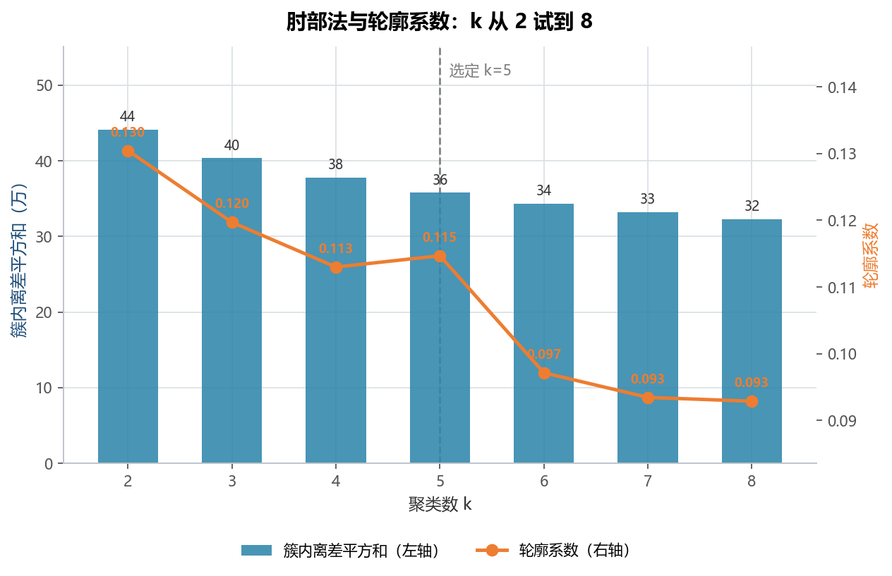
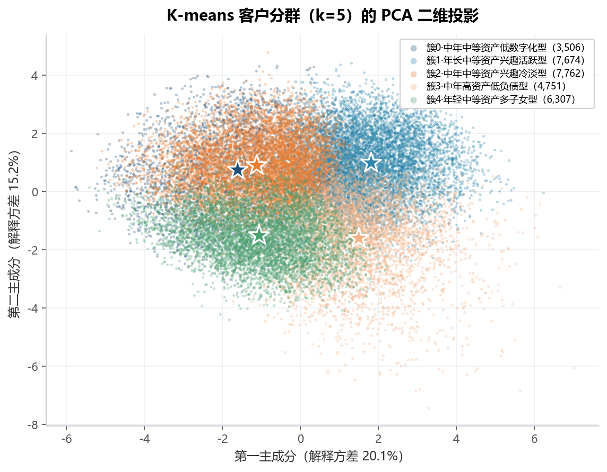
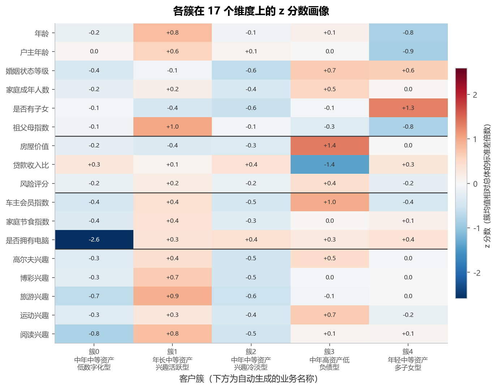
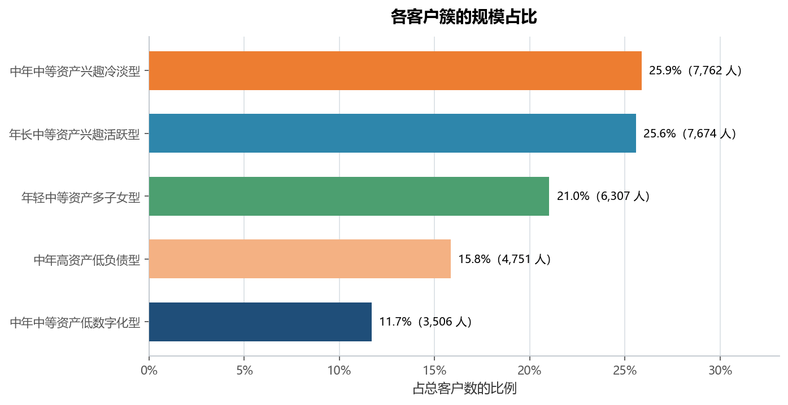
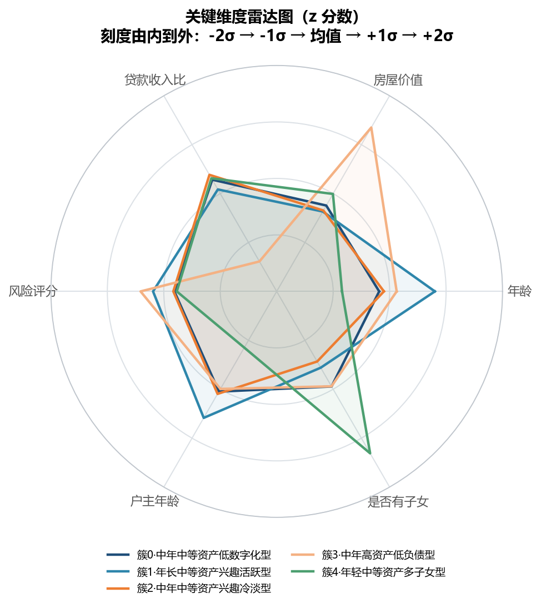

# 实验 12 · 多维客户细分：从 notebook 的 K-means 分群到可解释的业务画像

> **教材**：《金融数据分析和数据挖掘案例实战》第 3 章 多维特征的客户细分
> **原始素材**：`data_clust.csv`（167,177 行 × 17 列，美国某银行客户多维特征宽表）
> **迁移方向**：Jupyter Notebook（缺失处理 → 因子分析 → 两套 K-means → 决策树解释）→ **单脚本流水线 + 可复现的选 k 规则**
> **对应脚本**：[`lab12_customer_segmentation.py`](./lab12_customer_segmentation.py)

---

## 1. 教材在做什么（项目内涵）

这个案例要解决的是银行最经典的一个问题：**手里有 16 万客户、17 个维度的画像数据，怎么把他们分成几类、每类人该怎么运营。**

教材的 notebook 走了一条"先降维、再聚类、后解释"的路线：

1. **体检**：逐列看有没有缺失（`bank[col].hasnans`），发现 4 个字段缺失；
2. **清洗**：`interested_travel / computer_owner / HH_adults_num` 用众数填，
   `HH_has_children` 的 Y/N 转 0/1、缺失按 0 处理，`interested_reading` 里的 `'.'` 当 0；
3. **降维**：把 17 个字段按业务含义拆成 `household`（家庭与资产，8 个）和
   `hobby`（兴趣与消费，4 个）两组，各自做因子分析，抽出 4 个"人生阶段因子"和 3 个"兴趣因子"；
4. **分群**：对两组因子得分分别跑 K-means，用肘部法 + 轮廓系数选 k（household 取 3 类、hobby 取 2 类）；
5. **解释**：用 `max_depth=2` 的决策树反推每一类的判定规则，再用 household × hobby 交叉透视，
   得到一张「人生阶段 × 兴趣」的二维客群矩阵。

> 这套思路的价值在于"**先理解数据维度，再让算法分群**"——先按业务把变量分成两组，
> 降维之后每一类都还能翻译回业务语言。notebook 的问题在于：`fa_kit` 早已停止维护、
> 决策树解释要额外装 `pydotplus`、选 k 靠肉眼看图，换个数据集整段就得重写。
>
> 本实验保留"分群 + 画像 + 命名"的主线，把中间件换成 sklearn 原生组件，
> 并补上 notebook 没有的两件事：**共线性检查**（决定要不要剔字段）和**可复现的选 k 规则**。

---

## 2. 数据说明

| 字段 | 含义 | 类型 | 缺失率 | 取值范围 |
|---|---|---|---|---|
| `age` | 年龄 | 整数 | 0 | 18—99 |
| `HH_head_age` | 户主年龄 | 整数 | 0 | 18—99 |
| `marital` | 婚姻状态等级 | 整数 | 0 | 1—10（越大越可能已婚） |
| `HH_adults_num` | 家庭成年人数 | 浮点 | **12.71%** | 0—6 |
| `HH_has_children` | 是否有子女 | 文本 Y/N | **4.24%** | Y/N |
| `HH_grandparent` | 祖父母指数 | 整数 | 0 | 0—980 |
| `home_value` | 房屋价值（美元） | 整数 | 0 | 4.9 万—100 万 |
| `loan_ratio` | 贷款收入比 | 整数 | 0 | 0—100 |
| `risk_score` | 风险评分 | 整数 | 0 | 1—1000 |
| `auto_member` | 车主会员指数 | 整数 | 0 | 49—878 |
| `HH_dieting` | 家庭节食指数 | 整数 | 0 | 47—633 |
| `computer_owner` | 是否拥有电脑 | 0/1 | **10.14%** | 0/1 |
| `interested_golf` | 高尔夫兴趣 | 0/1 | 0 | 0/1 |
| `interested_gambling` | 博彩兴趣 | 0/1 | 0 | 0/1 |
| `interested_travel` | 旅游兴趣 | 0/1 | **10.14%** | 0/1 |
| `interested_sport` | 运动兴趣 | 整数 | 0 | 60—920 |
| `interested_reading` | 阅读兴趣 | 文本 | 0（含 146 个 `'.'` 脏值） | 0—3、`'.'` |

**抽样规则**（重要）：全量 167,177 行、9.2 MB，超出仓库单文件体积预算，因此入库的是

```python
df.sample(n=30_000, random_state=42)      # 确定性抽样，占全量 17.95%，约 1.7 MB
```

- 随机种子固定为 42，任何人重跑都得到同一批 30,000 行；
- 脚本的读取逻辑是**"先找全量、找不到才用抽样"**：
  `data/data_clust.csv` 存在 → 用全量；否则用 `data/data_clust_sample.csv`；
- 因此把原始文件丢进 `data/` 就能跑全量，不需要改代码；
- 本 README 里的所有数字都来自这份 30,000 行抽样。

---

## 3. notebook 步骤 ↔ 重构后函数对照

| notebook 里的操作（cell） | 原写法 | 重构后的函数 | 差异与注意点 |
|---|---|---|---|
| cell 4 读入数据 | `pd.read_csv(..., skipinitialspace=True)` | `load_data()` | 增加"全量/抽样"自动选择；`skipinitialspace` 必须保留，否则数值列被判成 object |
| cell 7 找缺失列 | 循环 `bank[col].hasnans` 打印列名 | `audit_quality()` | 把缺失率、取值分布、处理策略落盘成 `table01`，可复查 |
| cell 9 众数填充 | `bank[col].mode()[0]` | `clean_data()` | 保留众数策略，并补上"为什么用众数/中位数"的注释 |
| cell 11 Y/N → 0/1 | `.replace({'N':0,'Y':1,np.NaN:0})` | `clean_data()` | 改为先众数填充再映射，避免 `NaN` 直接当 0 的语义丢失 |
| cell 12 `'.'` 转 0 | `.replace({'.':'0'}).astype('int')` | `clean_data()` | 改为 `pd.to_numeric(errors="coerce")` 把 `'.'` 视为缺失再补，处理更通用 |
| cell 16 阅读兴趣二值化 | `Binarizer(threshold=1.5)` | `clean_data()` | 等价写法 `(x >= 2).astype(int)`，少一个类依赖 |
| cell 14-15 离散变量卡方检验 | 两两 `chi2_contingency` 打印 p 值 | `build_matrix()` 的相关性检查 | 卡方看"是否独立"，这里看"是否线性相关"，两者都服务于"要不要剔字段" |
| cell 20 分位数正态化 | `QuantileTransformer` | `build_matrix()` 用 `StandardScaler` | 见下方"关键点"，这是与教材最大的差异 |
| cell 23-30 因子分析降维 | `fa_kit.FactorAnalysis` + varimax | **省略** | `fa_kit` 已停止维护；改用 17 维原始特征直接聚类，簇画像能直接落到业务字段上 |
| cell 32 选 k | `cluster_plot()` 画两张图肉眼选 | `choose_k()` + `select_k()` | 结果落盘成 `table02`，选 k 变成一条可复核的规则 |
| cell 34 取定 k 的模型 | `models_hh[3]` / `models_hb[2]` | `fit_kmeans()` | 用 `n_init=20` 重训，保证最终模型是收敛的 |
| cell 36-37 决策树解释簇 | `DecisionTreeClassifier` + `pydotplus` | `profile_clusters()` | 用 z 分数（簇均值 vs 总体）代替决策树：不用画图、不用装 `pydotplus`，且能一次看完 17 维 |
| cell 38 交叉透视 | `pivot_table(index='hh', columns='hb')` | `plot_cluster_share()` + `table03` | 单层 k=5 分群后用"规模占比"替代二维矩阵 |
| —（notebook 没有） | — | `name_clusters()` | 用 z 分数自动生成业务名称，换数据重跑名字会跟着变 |

---

## 4. 代码结构与关键点

```
lab12_customer_segmentation.py
├── load_data()            # 读数据（全量优先 / 抽样兜底）
├── audit_quality()        # 缺失体检 → table01
├── clean_data()           # Y/N 编码、'.' 清洗、缺失填充、异常截断
├── build_matrix()         # StandardScaler + 相关性/共线性检查
├── choose_k()             # 肘部法 + 轮廓系数（k=2..8）→ table02
├── select_k()             # 选 k 规则：近似最优带内取最大 k
├── fit_kmeans()           # 用选定的 k 重训最终模型
├── profile_clusters()     # 簇均值 + z 分数 + 标志性特征 → table03
├── name_clusters()        # 按 z 分数自动生成业务名称
├── plot_elbow()           # fig01 肘部法 + 轮廓系数双轴图
├── plot_pca_scatter()     # fig02 PCA 二维散点
├── plot_zscore_heatmap()  # fig03 17 维 z 分数热力图
├── plot_cluster_share()   # fig04 簇规模占比
├── plot_radar()           # fig05 关键维度雷达图
└── main()                 # 串起全流程 + 打印业务结论
```

三个值得记住的写法：

1. **`StandardScaler` 是 K-means 的前提，不是可选项**。K-means 用欧氏距离，
   房屋价值（6 位数）和是否有子女（0/1）放一起，距离会被房屋价值完全主导。
   教材用 `QuantileTransformer` 做正态化，本实验用 `StandardScaler`——两者都解决量纲问题，
   区别是前者还能压长尾；改用标准化的代价是长尾字段（`home_value`）的极端值影响更大。
2. **共线性检查决定"要不要剔字段"**。17 个字段里 `age ↔ HH_head_age` 的相关系数达 **0.643**，
   `HH_head_age ↔ HH_grandparent` 0.568，`home_value ↔ loan_ratio` −0.539；
   标准化矩阵的条件数 **13.16**（<30，可接受），因此没有删字段。
   如果不检查，等于默认给"年龄"这个维度加了 2—3 倍权重。
3. **选 k 要有规则，不能只靠眼睛**。`select_k()` 的做法：先找轮廓系数最优值（k=2，0.1304），
   再取"不低于最优值 85%"的近似最优带（k=2/3/4/5），在带内选**最大**的 k。
   理由：k=2 分离度只比 k=5 高 0.016，但两类客户无法支撑分层运营；
   在分离度不明显变差的前提下，客群颗粒度越细越能落地。

> 与教材的另一处差异：教材先做因子分析再聚类，本实验直接在 17 维上聚类。
> 代价是轮廓系数偏低（0.115），好处是**每一个簇都能直接用业务字段解释**，
> 不需要在"因子得分"和"业务含义"之间来回翻译。

---

## 5. 运行结果与解读

### 5.1 选 k：肘部没有明显拐点，靠轮廓系数定规则



| k | inertia | 相对降幅 | 轮廓系数 |
|---|---|---|---|
| 2 | 441,245 | — | **0.1304** |
| 3 | 403,509 | 8.6% | 0.1197 |
| 4 | 377,656 | 6.4% | 0.1130 |
| 5 | 357,928 | 5.2% | 0.1147 |
| 6 | 343,271 | 4.1% | 0.0971 |
| 7 | 332,407 | 3.2% | 0.0934 |
| 8 | 322,938 | 2.8% | 0.0929 |

- inertia 一路平滑下降，**没有教科书式的"肘部"**，只能看"边际收益"：
  k 从 4 加到 5，inertia 只降 5.2%，再加到 6 就只剩 4.1%；
- 轮廓系数在 k=2 最高（0.130），k=5 是 0.115，**差距只有 0.016**；
- 按"近似最优带（≥85%×最优）+ 取最大 k"的规则，最终 **k=5**。

> 坦白说 0.13 的轮廓系数偏低，说明这批客户在 17 维空间里是"连续过渡"而非"天然断层"。
> 这不是代码问题，而是数据本身的性质——后面 PCA 散点也能看到簇与簇之间大量交叠。

### 5.2 聚类结果：PCA 二维投影能看到大致分区



- 前两个主成分分别解释 **20.1% / 15.2%** 的方差，合计 **35.3%**——二维图只能反映三分之一的信息，
  所以**看这张图只能判断"有没有明显分区"，不能据此下结论**；
- 五个簇在图上大致分成"左上 / 右上 / 下方 / 中心"几团，但交界处大量重叠，
  与 0.115 的轮廓系数一致；
- ★ 是各簇中心在 PCA 空间的投影，位置分布说明簇之间是"平移"关系而不是"嵌套"关系。

### 5.3 簇画像：17 维 z 分数热力图



这张图是全实验的核心，读法：**同一列里最红/最蓝的格子，就是这个簇区别于大盘的地方**。

| 簇 | 规模 | 占比 | 标志性特征（z 值 Top3） | 业务命名 |
|---|---|---|---|---|
| 簇0 | 3,506 | 11.7% | 拥有电脑(−2.59)、阅读兴趣(−0.83)、旅游兴趣(−0.66) | 中年中等资产低数字化型 |
| 簇1 | 7,674 | 25.6% | 祖父母指数(+0.99)、旅游兴趣(+0.91)、年龄(+0.80) | 年长中等资产兴趣活跃型 |
| 簇2 | 7,762 | 25.9% | 婚姻等级(−0.65)、有子女(−0.57)、旅游兴趣(−0.55) | 中年中等资产兴趣冷淡型 |
| 簇3 | 4,751 | 15.8% | 贷款收入比(−1.39)、房屋价值(+1.35)、车主指数(+0.97) | 中年高资产低负债型 |
| 簇4 | 6,307 | 21.0% | 有子女(+1.31)、户主年龄(−0.85)、年龄(−0.84) | 年轻中等资产多子女型 |

几个可以读出来的"形状"：

- **簇1（年长兴趣活跃）**：平均年龄 70.97 岁（全样本 59.53），祖父母指数 625.6（全样本 378.0），
  旅游/博彩/高尔夫兴趣全面高于均值——退休、有钱、爱玩，是理财与旅行产品的天然客群；
- **簇3（高资产低负债）**：房屋价值 35.5 万（全样本 20.8 万），贷款收入比只有 53.1（全样本 66.7），
  风险评分 884.9（全样本 816.5）——**资产厚、负债轻、信用好**，是最该提额的客户；
- **簇4（年轻多子女）**：平均 47.5 岁、户主 45.3 岁，89.0% 有子女（全样本 30.7%），
  教育金、车贷、家庭保险是标准配置；
- **簇0（低数字化）**：`computer_owner` 全为 0，所有兴趣维度都低——不是"没有需求"，
  而是"没有留下数字痕迹"，线上触达效率最差，适合线下网点或电话。

### 5.4 结构：最大的客群占了四分之一



- 占比从高到低：簇2（25.9%）、簇1（25.6%）、簇4（21.0%）、簇3（15.8%）、簇0（11.7%）；
- 五个簇规模都在 11%—26% 之间，**没有出现"一个簇吃掉 80%"的退化解**，
  说明 k=5 确实把人群切开了，而不是只切出一个异常组；
- 最大的簇2 是"兴趣冷淡"型——人数最多但互动最少，这本身就是一条业务结论：
  **触达资源要先解决"无感"问题，而不是继续给高意向客户加码**。

### 5.5 关键维度：雷达图看"形状差异"



- 由内到外依次是 −2σ / −1σ / 均值 / +1σ / +2σ，**越靠外该维度越高**；
- 簇3 在"房屋价值"上冲到 +2σ，同时在"贷款收入比"上掉到 −1.4σ，形状像一把"张开的大口"——
  这正是"高资产低负债"的几何表达；
- 簇4 在"是否有子女"上接近 +2σ，其余维度都在均值附近，是典型的"单维度突出"客群；
- 簇1 在"户主年龄""年龄"两个维度同时外扩，簇0 则整体收缩在均值以内——一张图就能看出
  "谁是被某个维度定义的，谁是各方面都平庸的"。

---

## 6. 复现方式

```bash
cd 12_四级教材_第03章_多维客户细分
python lab12_customer_segmentation.py
```

- 依赖：`pandas`、`numpy`、`scikit-learn`、`matplotlib`（见仓库根 `requirements.txt`）；
- 输入：`data/data_clust_sample.csv`（30,000 行抽样）；若放入 `data/data_clust.csv` 则自动跑全量；
- 输出：
  - `outputs/` 下 5 张 PNG：`fig01` 肘部与轮廓、`fig02` PCA 散点、`fig03` z 分数热力图、`fig04` 簇规模、`fig05` 雷达图；
  - 3 张 CSV：`table01` 数据质量与处理策略、`table02` k 值评估、`table03` 簇画像与业务命名；
- 全流程固定 `random_state=42`，重复运行的图、表、数字完全一致。

---

## 7. 小结与思考

1. **聚类不是"算出 k 个组"就完事**，真正的产出是"每个组的业务画像 + 名字 + 该对它做什么"。
   没有名字的簇编号（簇0/簇1）在业务会上是没法讨论的。
2. **选 k 是判断题，不是计算题**。轮廓系数最大往往意味着 k=2（分得最开但也最没用），
   工程上要加业务约束：先设"分离度可接受"的下限，再在这个带里追求颗粒度。
3. **标准化方式会改变结论**。同一份数据，用 `StandardScaler` 的轮廓系数是 0.13，
   换成教材的 `QuantileTransformer`，同样的 k=2 上能到 0.250（本实验离线对比过，未写进脚本输出）——
   预处理不是无脑步骤，它直接决定"能不能分出群"。
4. **一个反直觉的发现**：簇0 的 3,506 人**全部**是 `computer_owner = 0` 的客户
   （该字段为 0 的客户共 3,897 人，另外 391 人分散在其他簇里）。原因是二值字段标准化后
   标准差只有 0.34 左右，在 17 维欧氏距离里"0/1 之差"要乘上 1/0.34≈3 倍才折算成距离，
   份额被放大了。这提醒我们：**二值特征多的数据集，要么降权、要么先做因子分析**——
   这也正是教材选择先降维的原因。

> 思考题：如果把 `computer_owner` 从特征里去掉重跑，k=5 的画像会变成什么样？
> 提示：只改 `FEATURES` 的构造，观察 `table03` 的"标志性特征"列——
> 看看哪个字段会顶替"是否拥有电脑"成为簇0 的定义性特征。
