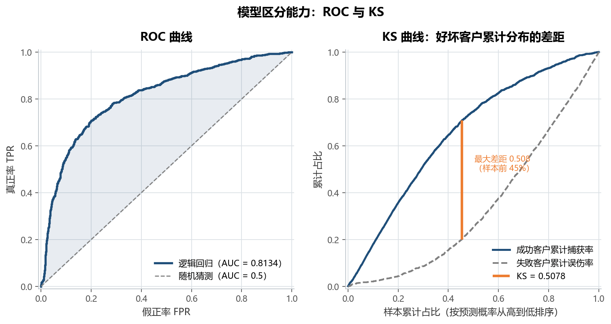
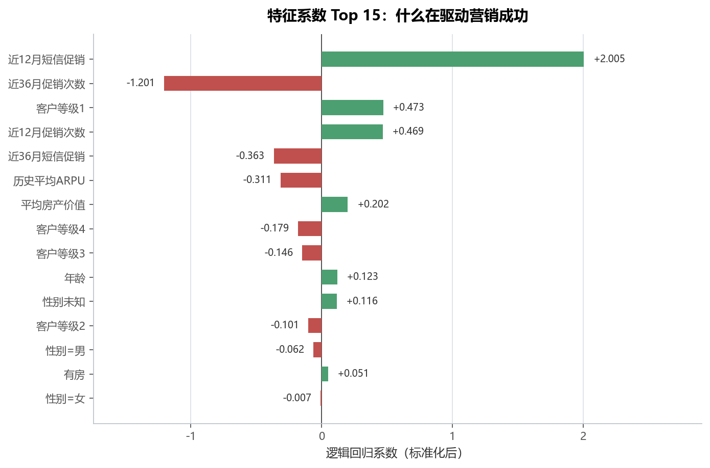
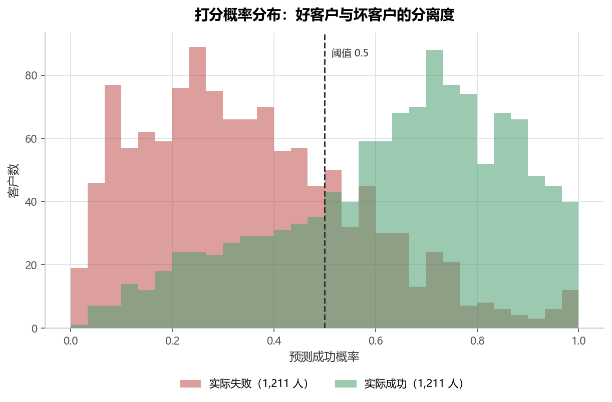
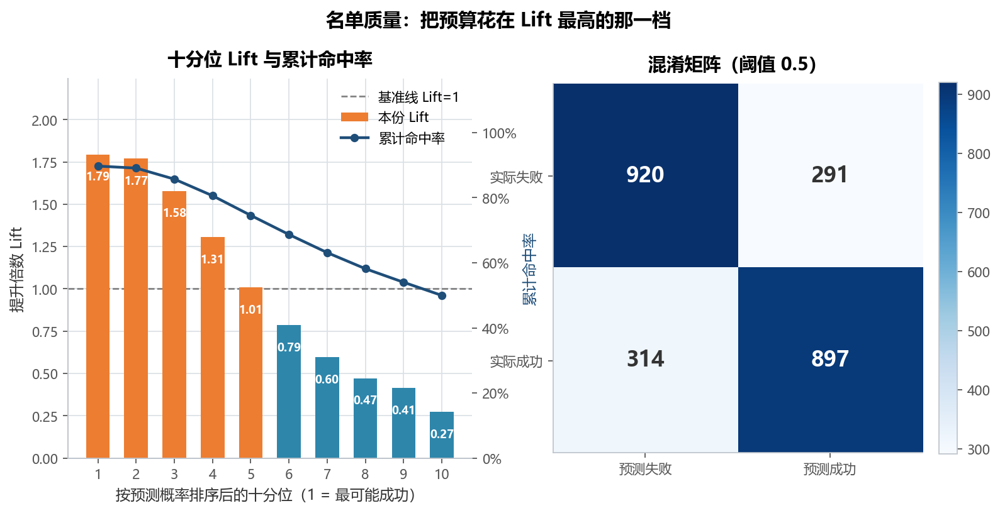

# 实验 13 · 算法工程化：从「能跑通」到「能交付」的营销响应模型

> **教材**：《金融数据分析和数据挖掘案例实战》第 9 章 算法工程化
> **原始素材**：`teleco_camp.csv`（9,686 行 × 14 列，电信套餐外呼营销的成功/失败样本）
> **迁移方向**：Notebook 里零散的「自定义 Transformer + 性能小贴士」→ **可持久化、可批量打分的 Pipeline 交付物**
> **对应脚本**：[`lab13_model_engineering.py`](./lab13_model_engineering.py)

---

## 1. 教材在做什么（项目内涵）

第 9 章讲的不是某个算法，而是**一个数据科学项目怎么才能被别人接手**。notebook 分两节：

**9.1 构建合理的项目工程结构**

- 9.1.1 为什么：代码写得太"灵活"会导致工程失控；数据分析往往只看结果、不看代码质量；
- 9.1.2 应该有怎样的目录：`data/raw`（原始不可变）、`data/processed`（可直接建模）、
  `models/`（序列化后的模型）、`notebooks/`、`reports/`、`Makefile`、`README.md`……

**9.2 如何编写规范的数据工程代码**

- 9.2.1 可读性：框架没提供的特征处理器，用 `TransformerMixin` 自己写——
  教材给了三个例子：`CustomTimeTransformer`（拆年月日/周/季度）、
  `CustomTimeBooleanTransformer`（是否月初/季末/节假日）、`CustomTimeSeriesTransformer`（滞后/滑窗/自相关）；
- 9.2.2 性能：用 HDF/Feather 加速读盘、用 `itertuples`/`apply` 代替 `iterrows`、优化字段类型。

> **教材停在了"怎么写"，没走到"怎么交付"。** 三个自定义 Transformer 写完就 `print` 了一下 `head()`，
> 既没进流水线，也没保存，更没有"新数据来了怎么打分"的环节。
>
> 本实验补的正是这一段：把自定义 Transformer **挂进 Pipeline**，
> 连同填补/编码/标准化/分类器一起 `joblib.dump`，再**从磁盘重新加载**去给测试集打分、排序、输出营销名单。
> 换句话说，交付物不是"一个模型文件"，而是"一条别人拿到手就能用的打分链路"。

这个案例里还藏着一个**教材没有点破的坑**：`ARPU`（当月收入）这一列缺失 4,843 行，
而这 4,843 行恰好就是全部营销失败的样本。它是"营销成功之后才产生"的**事后变量**，
放进模型等于把答案抄进特征——本实验的第一件事就是把它揪出来（见 5.1）。

---

## 2. 数据说明

| 字段 | 含义 | 类型 | 空值/异常 | 业务角色 |
|---|---|---|---|---|
| `ID` | 客户编号 | 整数 | 无 | 标识（不进模型） |
| `Suc_flag` | 营销是否成功（1=成功） | 整数 | 无（4,843 : 4,843 平衡） | **标签** |
| `ARPU` | 当月 ARPU（收入） | 文本 | **4,843 行空（50.0%）** | **事后产生 → 泄露，剔除** |
| `PromCnt12` | 近 12 月促销接触次数 | 浮点 | 无 | 事前已知 |
| `PromCnt36` | 近 36 月促销接触次数 | 浮点 | 无 | 事前已知 |
| `PromCntMsg12` | 近 12 月短信促销次数 | 浮点 | 无 | 事前已知 |
| `PromCntMsg36` | 近 36 月短信促销次数 | 浮点 | 无 | 事前已知 |
| `Class` | 客户等级（1—4） | 整数 | 无 | 事前已知（当类别处理） |
| `Age` | 年龄 | 文本 | **2,407 行空（24.9%）** | 事前已知 |
| `Gender` | 性别 F/M/U | 文本 | 无 | 事前已知 |
| `HomeOwner` | 是否业主 H/U | 文本 | 无 | 事前已知 |
| `AvgARPU` | 历史平均 ARPU | 浮点 | 无 | 事前已知 |
| `AvgHomeValue` | 平均房产价值 | 整数 | 103 行为 0（疑似未登记） | 事前已知 |
| `AvgIncome` | 平均收入 | 整数 | 2,357 行为 0（疑似未登记） | 事前已知 |

- 数据规模小（约 570 KB），**全量入库**，不做抽样；
- 正负样本严格 1:1（各 4,843），所以不需要重采样，也不该用准确率当主指标；
- `ARPU`/`Age` 是 object 列，值里既有空格字符串 `" "` 也有 `nan`，必须 `pd.to_numeric(errors="coerce")`；
- 数据源为教材配套素材，仅用于课程实验。

---

## 3. notebook 步骤 ↔ 重构后函数对照

| notebook 里的内容 | 原写法 | 重构后的函数 | 差异与注意点 |
|---|---|---|---|
| 9.1.2 项目目录约定 | 文档里列目录树 | 脚本里的 `DATA` / `OUT` / `MODEL_PATH` 常量 | 原始数据只读、模型与报告统一落 `outputs/` |
| 9.2.1 自定义 Transformer | `CustomTimeTransformer(TransformerMixin)` | `CampaignFeatureBuilder` | 同样的套路（继承 `BaseEstimator, TransformerMixin`），但**进了 Pipeline**，训练/打分自动复用 |
| 9.2.1 多个处理器"并行开发" | 三个类各自 `transform` 后 `print` | `build_pipeline()` 的 `ColumnTransformer` | 数值列/类别列两条支路并行，最后拼成一个矩阵 |
| 9.2.2 类型优化 | 文字建议 | `clean_data()` | `pd.to_numeric` 把 object 转成 float，后续计算全部走数值类型 |
| —（notebook 没有建模） | — | `train_and_evaluate()` | 分层切分 + 5 折交叉验证 + 测试集评估 |
| —（notebook 没有评估） | — | `evaluate_metrics()`、`ks_statistic()` | AUC / KS / 混淆矩阵 / 命中率 / Lift 一次算全 |
| —（notebook 没有解释） | — | `coefficient_table()` | 从 `get_feature_names_out()` 取特征名，还原成中文系数表 |
| —（notebook 没有持久化） | — | `save_model()` | `joblib.dump` 存的是**整条 Pipeline**，不是单独的模型对象 |
| —（notebook 没有打分） | — | `batch_scoring()` | 从磁盘 `joblib.load` → 打分 → 排序 → Top20% 名单 |
| —（notebook 没有的数据体检） | — | `detect_leakage()` | 用交叉表找"缺失 ⇔ 标签"的泄露字段，落盘 `table01` |

---

## 4. 代码结构与关键点

```
lab13_model_engineering.py
├── load_data()               # 读原始表
├── detect_leakage()          # 逐列体检 + 标签泄露排查 → table01
├── clean_data()              # 文本转数值、0 值当缺失、99 分位截断
├── CampaignFeatureBuilder    # 自定义 Transformer：6 个派生特征（对应 9.2.1）
├── build_pipeline()          # ColumnTransformer + Pipeline（数值/类别两条支路）
├── ks_statistic()            # KS 统计量 + 累计捕获曲线
├── train_and_evaluate()      # 分层切分 + 5 折 CV + 测试集评估
├── evaluate_metrics()        # 指标表 → table02
├── leakage_demo()            # 对照实验：把 ARPU 放回去，AUC 会被拉满
├── coefficient_table()       # 系数还原成中文 → table03
├── save_model() / batch_scoring()   # joblib 持久化 → 重新加载 → 批量打分
├── plot_roc_ks()             # fig01 ROC + KS
├── plot_coefficients()       # fig02 特征系数 Top15
├── plot_score_distribution() # fig03 好坏客户概率分布
├── plot_lift_confusion()     # fig04 Lift + 混淆矩阵
└── main()                    # 串起全流程 + 打印业务结论
```

三个值得记住的写法：

1. **特征工程必须进 Pipeline**。`CampaignFeatureBuilder` 里算的
   `PromTrend / MsgIntensity / PromIntensity / WealthRatio / IncomeMissing / IsSenior`
   六个特征，训练时算一次、打分时自动再算一次，口径永远一致。
   如果写成"训练前手动 `df['PromTrend'] = ...`，上线时忘了加"，模型会静默地打出错分。
2. **缺失值处理要区分"随机缺失"和"有信息的缺失"**。`Age` 缺 24.9% 是随机缺失 → 中位数填补；
   `AvgIncome = 0` 是"没登记" → 先转成缺失，同时保留 `IncomeMissing` 标志位；
   而 `ARPU` 的缺失**本身就是标签** → 不能填补，只能整列剔除。
3. **`joblib.dump` 存 Pipeline 而不是模型**。只存 `LogisticRegression` 的话，
   线上还得自己重写清洗 + 特征 + 编码；存整条 Pipeline，`predict_proba` 一行就能从原始表直接出分。

---

## 5. 运行结果与解读

### 5.1 数据体检：先发现"答案被抄进特征"

`table01` 逐列记录了数据类型、空值与业务角色，最关键的发现是：

| 字段 | 问题 | 判定 |
|---|---|---|
| `ARPU` | 空值 4,843 行（50.0%），**缺失与标签 100% 重合** | 事后变量，标签泄露 |
| `Age` | 空值 2,407 行（24.9%） | 随机缺失，中位数填补 |
| `AvgIncome` | 0 值 2,357 行 | 未登记，转缺失 + 标志位 |
| `AvgHomeValue` | 0 值 103 行 | 未登记，转缺失 |

交叉表一看就明白：`ARPU` 为空的 4,843 行全部是 `Suc_flag = 0`，不为空的 4,843 行全部是 `Suc_flag = 1`。
**脚本里做了对照实验**：同一套流水线、同一份切分，只把 `ARPU` 加回特征（缺失用中位数填补并保留缺失指示列），
测试集 AUC 从 **0.8134 直接变成 1.0000**。这就是泄露的典型特征——指标好得不真实。

> 业务解释：ARPU 是"当月收入"，客户营销成功、开了套餐才有收入；失败客户压根没有这笔收入，
> 所以 ARPU 为空。把它当特征，等于用"结果"预测"结果"。

### 5.2 区分能力：AUC 0.813，KS 0.508



- **测试集 AUC = 0.8134**，5 折交叉验证 AUC = **0.8304 ± 0.0084**（各折 0.8138 / 0.8322 / 0.8354 / 0.8362 / 0.8342），
  两者相差 0.017，**没有明显过拟合**；
- **KS = 0.5078**，出现在样本前 45.4% 的切点上——意味着在这个阈值上，
  成功客户的累计捕获率比失败客户高出 50.8 个百分点。风控/营销里 KS > 0.3 就算可用，0.5 已属优秀；
- 左图 ROC 曲线在 FPR 很低的区间就快速抬升，说明**高分段很"干净"**——这正是营销名单最看重的部分。

### 5.3 什么在驱动成功：短信促销密度最重要



| 特征 | 系数 | 优势比 | 方向 |
|---|---|---|---|
| 近12月短信促销 | **+2.005** | 7.43 | 越高越容易成功 |
| 近36月促销次数 | **−1.201** | 0.30 | 越高越容易失败 |
| 客户等级1 | +0.473 | 1.60 | 越高越容易成功 |
| 近12月促销次数 | +0.469 | 1.60 | 越高越容易成功 |
| 近36月短信促销 | −0.363 | 0.70 | 越高越容易失败 |
| 历史平均ARPU | −0.311 | 0.73 | 越高越容易失败 |
| 平均房产价值 | +0.202 | 1.22 | 越高越容易成功 |

- **近 12 月短信促销次数每增加 1 个标准差，成功的几率变成 7.4 倍**，是最强的正向因子；
- 但同一张表里「近 36 月促销次数」是 −1.20，两者方向相反——这不是业务上"促销越多越差"，
  而是**共线性造成的镜像**：两个字段都描述促销强度，模型把"近期密度"和"历史总量"拆开分配了正负号。
  解读这类系数时一定要成对看，不能单独说"促销越多越糟"；
- `AvgIncome` 的系数只有 −0.0015，几乎为 0——**收入高低对是否成功没有解释力**，
  真正起作用的是"最近有没有被打扰过、打扰得对不对"。

### 5.4 打分分布：好坏客户能分开，但仍有重叠



- 失败客户集中在 0.0—0.5，成功客户集中在 0.5—1.0，两条分布在 0.5 附近交叉；
- 交叉区正是模型的"不确定地带"，也是实际业务里最需要人工判断的部分；
- 阈值 0.5 下的混淆矩阵：**TP 897 / FP 291 / FN 314 / TN 920**，
  准确率 75.0%、精确率 75.5%、召回率 74.1%、F1 0.748。

### 5.5 名单质量：前 20% 命中率 89%，是基准的 1.78 倍



- 按预测概率排序切成十份：第 1 份 Lift **1.79**，第 2 份 1.77，第 3 份 1.58，
  到第 5 份就掉到 1.01（等于随机），第 6 份开始低于 1；
- 取 **Top 20%（484 人）**，命中率 **89.05%**，而全量基准是 50.0% → **Lift 1.78**；
  取 Top 10%（242 人），命中率 **89.67%**，Lift 1.79；
- 业务含义：**同样一次外呼预算，打模型挑出来的 484 人，能命中 431 个成功客户；
  随机打 484 人只能命中 242 个**——效率差不多翻倍，而且这还没算上"少打扰 1,938 个客户"的体验收益。

> Lift 曲线在第 2 份之后快速衰减，说明模型的区分力集中在头部，
> 这也解释了为什么 Top10% 和 Top20% 的 Lift 几乎一样（1.79 vs 1.78）：
> 真正的增量在第 1—3 份，再往后加人就是浪费预算。

---

## 6. 复现方式

```bash
cd 13_四级教材_第09章_算法工程化
python lab13_model_engineering.py
```

- 依赖：`pandas`、`numpy`、`scikit-learn`、`joblib`、`matplotlib`（见仓库根 `requirements.txt`）；
- 输入：`data/teleco_camp.csv`；
- 输出：
  - 4 张图：`fig01` ROC 与 KS、`fig02` 特征系数、`fig03` 概率分布、`fig04` Lift 与混淆矩阵；
  - 3 张表：`table01` 数据质量与泄露排查、`table02` 模型评估指标、`table03` 特征系数；
  - **交付物**：`outputs/model_pipeline.joblib`（6 KB，含特征工程 + 填补 + 编码 + 标准化 + 分类器）
    和 `outputs/marketing_list_top20.csv`（484 人名单，含排名、客户 ID、成功概率、概率分箱）；
- 复现一致性：`random_state=42` 固定切分与 CV 折叠，重跑结果逐位相同。

加载模型给"新数据"打分的写法（就是脚本里 `batch_scoring()` 做的事）：

```python
import joblib, pandas as pd

model = joblib.load("outputs/model_pipeline.joblib")   # 整条 Pipeline，不是单个模型
new_df = pd.read_csv("data/teleco_camp.csv").drop(columns=["ID", "Suc_flag"])
prob = model.predict_proba(new_df)[:, 1]               # 原始表直接进，无需手工清洗
```

---

## 7. 小结与思考

1. **工程化的第一道关卡不是代码风格，而是"特征能不能在业务动作之前拿到"**。
   本实验最值钱的产出不是 0.81 的 AUC，而是发现了 ARPU 这个事后变量——
   如果不查，模型 AUC=1.0 上线后必然全线崩盘，而且没人知道为什么。
2. **Pipeline 是"训练-打分一致性"的唯一可靠保障**。自定义 Transformer 只有进了 Pipeline 才有意义，
   否则它只是把手工代码换了个写法，该忘的还是会忘。
3. **指标要选业务能用的**。AUC 说明排序能力，KS 说明最优切点的区分度，
   Lift 说明"名单前 10% 到底值多少钱"——三者一起看，才能回答"这次营销该投多少人"。
4. **名单不是越短越好，也不是越长越好**。Top10% 和 Top20% 的命中率只差 0.6 个百分点，
   但人数差一倍：预算紧张就取 10%，预算充足就取到第 3 份（Lift 仍在 1.5 以上），第 5 份之后基本是白花钱。

> 思考题：如果把阈值从 0.5 改成"按预算反推"（比如只打 300 人），
> 精确率和召回率会怎么变？提示：改 `evaluate_metrics()` 里的 `pred` 计算方式，
> 用 `prob >= np.quantile(prob, 1 - 300/len(prob))` 代替固定阈值，
> 再对比 `table02` 里的精确率/召回率——这就是业务上常说的"定额名单"模式。
