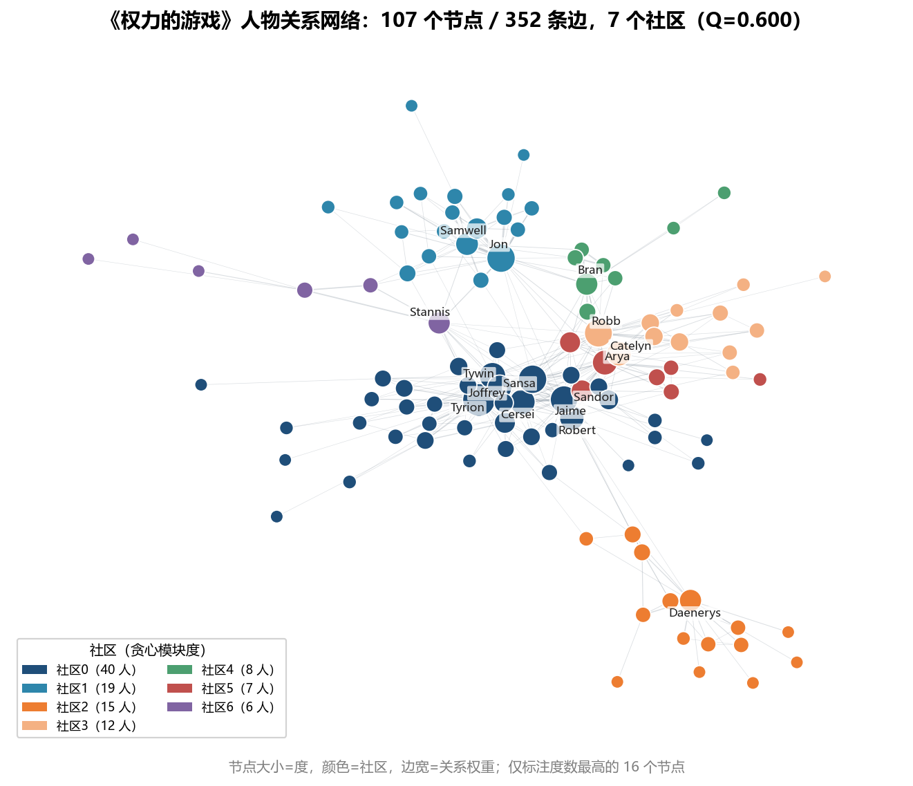
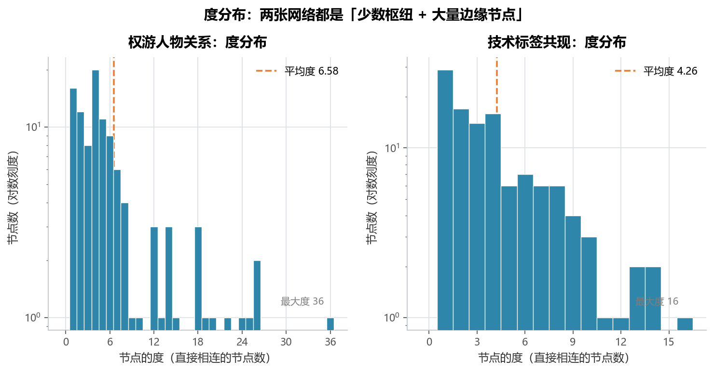
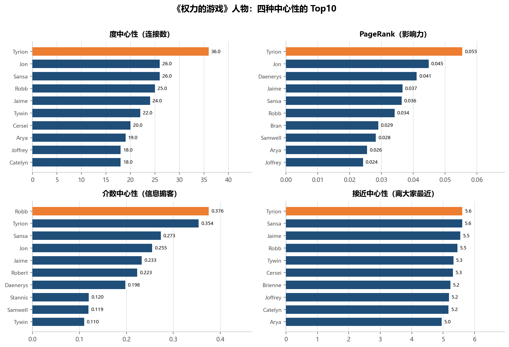
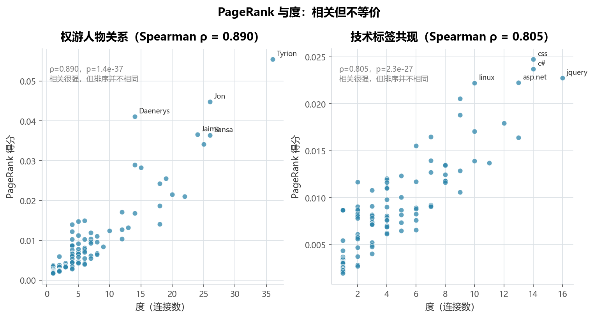
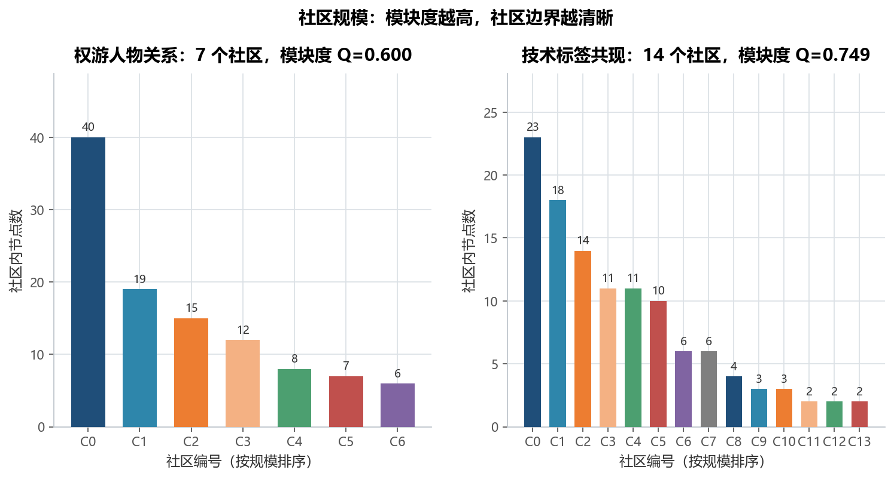

# 实验 14 · 社交网络分析：中心性、PageRank 与社区发现

> **教材**：《金融数据分析和数据挖掘案例实战》· 补充专题「社交网络」
> **原始素材**：`stormofswords.csv`（352 条边）、《权力的游戏》人物关系；
> `stack_network_links.csv`（490 行，去重后 245 条无向边）+ `stack_network_nodes.csv`（115 个技术标签，官方 14 个分组）
> **迁移方向**：4 个 notebook（图论基础 / PageRank 手推矩阵 / `nx.draw` 一张图 / python-louvain 社区发现）→ **一条从建图到业务解释的完整链路**
> **对应脚本**：[`lab14_social_network.py`](./lab14_social_network.py)

---

## 1. 教材在做什么（项目内涵）

社交网络这一章不是讲"怎么画关系图"，而是讲**怎么用图结构回答"谁重要、谁和谁一伙"**。

教材用 4 个 notebook 铺开：

1. **02-基本理论**：图怎么表示（邻接矩阵）、度、路径、连通性——这是后面所有指标的定义基础；
2. **03-3-PageRank 实现**：不调用任何库，用 numpy 手写"列随机矩阵 + 幂迭代"：
   `M` 每一列是某个节点的出链概率，`R ← M·R` 迭代 300 次，直到 `‖R_new − R‖ < 1e-6`；
   还自己造了随机图 `PR_Gdata(N, alpha=0.8)` 验证收敛；
3. **04-小案例**：`nx.from_pandas_edgelist` 读《权力的游戏》人物关系表，
   `nx.draw` 画一张图——注意教材用的是 `nx.DiGraph()`（有向图）；
4. **05-银行交易圈实践**：把银行"交易对手明细"当边表，用 `community.best_partition`
   （python-louvain）做社区发现，再用 `spring_layout` 按社区着色，
   这一步的业务目标是**从转账关系里找出"团伙"**。

> 教材的四个文件是"四个知识点"，不是"一条分析链"：PageRank 用来演示公式、
> 社区发现用来演示调包，两者没有接上。而真实业务里，这两个问题是连着问的：
> **先找关键节点（谁重要），再看团伙结构（谁和谁一伙），最后才是怎么干预。**
>
> 本实验把这条链接起来，并补上教材没有的三件事：
> ① 中心性的"权重语义"坑（介数/接近中心性里权重是距离，PageRank 里权重是票数）；
> ② 用 ARI 客观评价社区发现质量（技术标签数据自带官方分组，正好当标准答案）；
> ③ 两个网络的横向对比（人物关系 vs 技术标签），说明同一套指标怎么用在不同场景。

---

## 2. 数据说明

| 文件 | 规模 | 字段 | 说明 |
|---|---|---|---|
| `stormofswords.csv` | 352 行 × 3 列 | `Source` / `Target` / `Weight` | 《权力的游戏》人物共现关系，`Weight` = 共现强度（4—96） |
| `stack_network_links.csv` | 490 行 × 3 列 | `source` / `target` / `value` | Stack Overflow 技术标签共现 |
| `stack_network_nodes.csv` | 115 行 × 3 列 | `name` / `group` / `nodesize` | 技术标签节点表，`group` 是官方给的 14 个分组 |

两个关键的数据事实（脚本里都打印了）：

- **技术标签表 490 行 ≠ 245 条边**：每条关系都存了双向两遍（`a→b` 和 `b→a`），
  建成无向图后合并成一条。所以脚本在 `build_graph()` 里先把端点排序、再 `groupby` 取**权重均值**，
  否则权重会被重复计算；
- **权重含义不同**：权游的 `Weight` 是"两人共同出现的次数"，技术标签的 `value` 是"两个标签的关联强度"，
  数值范围差了一个量级（平均加权度 80.8 vs 149.0），所以**跨网络的加权指标不能直接比大小**。

节点数与边数的对照：

| | 权游人物关系 | 技术标签共现 |
|---|---|---|
| 节点数 | 107 | 115 |
| 边数（去重后） | 352 | 245 |
| 连通分量 | 1 | 6（最大分量占 88.7%） |

---

## 3. notebook 步骤 ↔ 重构后函数对照

| notebook 里的操作 | 原写法 | 重构后的函数 | 差异与注意点 |
|---|---|---|---|
| 02 基本理论：度、路径、连通性 | 手工构造邻接矩阵逐个算 | `graph_metrics()` | 一次算完密度、平均度、聚类系数、直径、平均最短路，落盘 `table01` |
| 03-3 PageRank 手推 | `M`、`v`、`PR_Gdata`、`PageRank(M, N, T=300, eps=1e-6)` | `verify_pagerank()` | 保留"手写矩阵迭代"作为**校验**，主流程用 `nx.pagerank`；并补上阻尼系数 d=0.85 |
| 04 小案例建图 | `nx.from_pandas_edgelist(..., create_using=nx.DiGraph())` | `build_graph()` | 改成 `nx.Graph()`（人物/共现都是对称关系），并处理双向重复边 |
| 04 画图 | `nx.draw(...)` 一行出图，无布局、无社区 | `plot_network()` | `spring_layout(seed=42)` 固定布局、按社区着色、节点大小=度、边宽=权重、只标 Top16 |
| 05 社区发现 | `community.best_partition`（python-louvain） | `detect_communities()` | 换成 networkx 自带的 `greedy_modularity_communities`，并与 `louvain_communities` 对照 |
| 05 按社区着色 | `cm.get_cmap('viridis')` 随机配色 | `plot_network()` | 社区按规模排序后固定取 `common/style.py` 的调色板，颜色跨图一致 |
| 05 银行交易圈 | 用真实交易明细（涉敏，未入库） | 用两张公开边表替代 | 把"资金网络"的方法论迁移到"技术标签网络"，`table03` 里的社区即"团伙"雏形 |
| —（notebook 没有） | — | `community_table()` | 每个社区给规模、占比、代表人物，落盘 `table03` |
| —（notebook 没有） | — | `adjusted_rand_score` 校验 | 用官方 14 个分组当标准答案，量化社区发现的准确度 |

---

## 4. 代码结构与关键点

```
lab14_social_network.py
├── load_data()                 # 读两张边表 + 一张节点表，报"490 行 → 245 边"的原因
├── build_graph()               # 端点排序 + 权重均值 → 无向加权图
├── graph_metrics()             # 规模/密度/度/连通性/聚类/直径 → table01
├── centrality_table()          # 度、加权度、介数、接近、PageRank → table02
├── verify_pagerank()           # 手写矩阵迭代复核 nx.pagerank（对应 notebook 03-3）
├── detect_communities()        # 贪心模块度 + Louvain，报模块度 Q
├── community_table()           # 每社区规模/占比/代表人物 → table03
├── plot_network()              # fig01 网络图（社区着色）
├── plot_degree_distribution()  # fig02 度分布（对数纵轴）
├── plot_centrality_top()       # fig03 四种中心性 Top10
├── plot_pagerank_vs_degree()   # fig04 PageRank vs 度 散点
├── plot_community_sizes()      # fig05 社区规模
└── main()                      # 串起全流程 + ARI 校验 + 业务结论
```

三个值得记住的写法：

1. **不同中心性对"权重"的解释是相反的**。
   `nx.betweenness_centrality(weight=...)` 和 `nx.closeness_centrality(distance=...)` 里，
   权重被当作**路径长度**——权重越大反而算越"近"；而 `nx.pagerank(weight=...)` 里，
   权重是**票数**，越大越重要。所以脚本先造一份 `dist = 1/权重` 的图副本再算介数和接近中心性，
   否则会把"关系最强的人"算成"最不重要的人"。
2. **手写 PageRank 要加阻尼系数**。notebook 的 `R ← M·R` 是"无阻尼随机游走"，
   遇到悬挂节点会把概率吸走；networkx 的定义是 `R = (1−d)/N + d·M·R`。
   脚本补上 d=0.85 之后，两种算法最大绝对误差 **1.42e-11**，可以认为完全一致——
   这也说明教材的公式原理没错，只是省略了工程细节。
3. **社区发现要"报 Q + 交叉验证"**。光看"分出几个社区"没有意义，
   模块度 Q 才是质量指标；再用第二种算法（Louvain）和外部标签（官方分组）对照，
   才知道这个划分是数据本身的结构，还是算法的随机性。

---

## 5. 运行结果与解读

### 5.1 整体指标：一个是"小世界"，一个是"多个孤岛"

| 指标 | 权游人物关系 | 技术标签共现 |
|---|---|---|
| 节点数 | 107 | 115 |
| 边数（去重后） | 352 | 245 |
| 密度 | 0.0621 | 0.0374 |
| 平均度 | 6.58 | 4.26 |
| 最大度 | 36 | 16 |
| 平均加权度 | 80.82 | 148.99 |
| 连通分量数 | 1 | **6** |
| 最大连通分量占比 | 100% | 88.7% |
| 平均聚类系数 | **0.5514** | 0.4602 |
| 直径（最大分量） | **6** | 10 |
| 平均最短路径（最大分量） | **2.90** | 4.51 |
| 社区数（贪心模块度） | 7 | 14 |
| 模块度 Q（贪心 / Louvain） | 0.5999 / 0.5999 | 0.7493 / 0.7514 |
| 与官方分组的一致性 ARI | — | **0.9709** |

- **权游网络是典型的小世界网络**：平均聚类系数 0.55（朋友的朋友也认识），
  但平均最短路径只有 2.90 步、直径 6——"圈子很密，但六步之内能认识所有人"，
  这正是"冰与火"故事里各家族既抱团又互相牵连的结构；
- **技术标签网络是 6 个孤岛**：最大分量只占 88.7%，说明有 13 个标签和主体完全不相连
  （比如只跟彼此共现的小众技术），平均路径也拉长到 4.51；
- 两个网络的模块度 Q 分别是 0.600 和 0.749，**都远高于 0.3 的"有明显社区结构"门槛**，
  说明分群不是硬凑出来的。

### 5.2 网络图：社区基本对应原著阵营



- 节点大小 = 度（连接数），颜色 = 社区，边宽 = 共现强度；只标注度数最高的 16 个节点；
- 7 个社区、Q=0.600，形状上能直接对上原著线索：

| 社区 | 规模 | 代表人物 | 对应剧情线 |
|---|---|---|---|
| C0 | 40 | Tyrion、Sansa、Jaime | 君临城（兰尼斯特 + 史塔克在都城） |
| C1 | 19 | Jon、Samwell、Mance | 长城与守夜人 |
| C2 | 15 | Daenerys、Rhaegar、Jorah | 龙母的东方线 |
| C3 | 12 | Robb、Catelyn、Walder | 北境与河间地 |
| C4 | 8 | Bran、Rickon、Meera | 布兰的北境线 |
| C5 | 7 | Arya、Sandor、Eddard | 艾莉亚的流浪线 |
| C6 | 6 | Stannis、Davos、Melisandre | 龙石岛 |

> 注意 C0 有 40 人、占了 37.4%——因为君临城是各路人物交汇的地方，
> 社区发现算法会把"跨界人物"归到连接最密的那个社区里，这是模块度优化的必然结果。

### 5.3 度分布：少数枢纽 + 大量边缘节点



- 权游：平均度 6.58、最大度 36（Tyrion），大多数角色的度在 2—8 之间，
  右边拖着一条长尾——**典型的"少数枢纽 + 大量边缘"结构**；
- 技术标签：平均度 4.26、最大度 16（jquery），长尾更短，因为标签共现是"谁和谁一起出现"，
  不像人物关系那样有绝对主角；
- 纵轴用对数刻度，否则长尾部分（度为 1 的节点）会被压成 0 高度，看不出分布形状。

### 5.4 中心性：四个"重要"不是同一批人



| 排名 | 节点 | 度 | 加权度 | PageRank | 介数中心性 | 接近中心性 | 社区 |
|---|---|---|---|---|---|---|---|
| 1 | Tyrion | **36** | 551 | **0.0554** | 0.3538 | **5.6094** | 0 |
| 2 | Jon | 26 | 442 | 0.0448 | 0.2550 | 4.5637 | 1 |
| 3 | Daenerys | 14 | 232 | 0.0411 | 0.1977 | 2.7695 | 2 |
| 4 | Jaime | 24 | 372 | 0.0366 | 0.2329 | 5.5478 | 0 |
| 5 | Sansa | 26 | 383 | 0.0364 | 0.2733 | 5.6036 | 0 |
| 6 | Robb | 25 | 342 | 0.0341 | **0.3756** | 5.4506 | 3 |
| 7 | Bran | 14 | 344 | 0.0290 | 0.0987 | 4.7615 | 4 |
| 8 | Samwell | 15 | 282 | 0.0283 | 0.1195 | 4.3261 | 1 |
| 9 | Arya | 19 | 269 | 0.0255 | 0.1040 | 4.9523 | 5 |
| 10 | Joffrey | 18 | 255 | 0.0242 | 0.0273 | 5.1859 | 0 |

- **度中心性 Top1 是 Tyrion（36 个关系）**，PageRank 也是他（0.0554）——两种指标在他身上一致；
- **介数中心性 Top1 却是 Robb（0.3756）**：他的连接数只有 25，但处在北境、河间地、君临三条线的
  必经之路上，是典型的**信息掮客**。这类节点在银行网络里就是"资金过桥账户"，
  度数不高但一旦被切断，整条链路就断了；
- **Daenerys 的度只有 14，PageRank 却排第 3**：她的邻居（Rhaegar、Jorah、Drogo…）本身连接紧密，
  "邻居质量"补上了"连接数量"的不足——这正是 PageRank 比度中心性多出来的信息；
- 接近中心性的数值大于 1（5.61），因为脚本用的是 `dist = 1/权重`，
  强关系的距离小于 1，**它不是概率，不需要归一化到 [0,1]**。

### 5.5 PageRank 与度：相关但不等价



- 权游网络 Spearman ρ = **0.890**，技术标签网络 ρ = **0.805**，都是强正相关
  （p 值分别 1.4e-37 和 2.3e-27）；
- 但散点明显不是一条直线：权游里 Daenerys（度 14，PageRank 0.041）远高于同度数的其他节点，
  说明"她的圈子更值钱"；技术标签里 jquery 度最高（16），PageRank 却排在 css、c# 之后；
- 这张图的作用是提醒：**如果只看度，会把"社交达人"和"关键节点"混为一谈**。
  在营销场景里，前者适合做传播，后者适合做转介绍。

### 5.6 社区发现：模块度 Q=0.60 / 0.75，与官方分组 ARI=0.971



- 权游：7 个社区，Q=0.600，贪心模块度与 Louvain **完全一致**（社区数、Q 都相同），
  说明这个划分是数据里稳定存在的结构，不是算法偶然；
- 技术标签：贪心模块度给出 14 个社区（Q=0.7493），Louvain 给出 12 个（Q=0.7514），
  两者 Q 只差 0.002——**社区数不同但质量相当，说明有几个小社区本来就处在"可分可不分"的边界上**；
- 与官方 14 个分组的 **ARI = 0.9709**（1 表示完全一致），说明算法从纯结构出发，
  几乎完全复现了人工标注的领域分类。技术标签的社区代表人物也很"像话"：

| 社区 | 规模 | 代表标签 | 领域 |
|---|---|---|---|
| C0 | 23 | jquery、css、angularjs | 前端 |
| C1 | 18 | c#、asp.net、sql-server | .NET 生态 |
| C2 | 14 | spring、hibernate、java | Java 后端 |
| C3 | 11 | linux、git、bash | 系统与工具 |
| C4 | 11 | mongodb、reactjs、node.js | 全栈 JS |
| C5 | 10 | python、c++、c | 通用语言 |
| C6 | 6 | jenkins、docker、amazon-web-services | DevOps |
| C7 | 6 | ios、objective-c、xcode | 移动端 |
| C8 | 4 | scala、apache-spark、hadoop | 大数据 |
| C9—C13 | 2—3 | typescript、excel、tdd、regex、testing | 零散小组 |

> 银行场景迁移：把"客户—客户转账"看成边，`介数中心性`高的是资金过桥节点（重点监控），
> `社区发现`给出的每个社区就是一笔"团伙"候选（同一社区内资金高频互转），
> `模块度 Q` 用来判断这次划分靠不靠谱——Q 太低说明这个圈子本来就很松散，不宜直接定性。

---

## 6. 复现方式

```bash
cd 14_四级教材_补充_社交网络分析
python lab14_social_network.py
```

- 依赖：`pandas`、`numpy`、`networkx`（本实验用 3.4.2，社区发现用 networkx 自带实现）、
  `scipy`、`scikit-learn`（只用到 `adjusted_rand_score`）、`matplotlib`；
   **不需要** `python-louvain` / `community` 这两个已停止维护的包；
- 输入：`data/stormofswords.csv`、`data/stack_network_links.csv`、`data/stack_network_nodes.csv`；
- 输出：
  - 5 张图：`fig01` 网络图、`fig02` 度分布、`fig03` 中心性 Top10、`fig04` PageRank 与度散点、`fig05` 社区规模；
  - 3 张表：`table01` 网络整体指标对比、`table02` 中心性 Top10、`table03` 社区划分明细；
- 所有布局固定 `seed=42`，重跑的图与数字完全一致。

---

## 7. 小结与思考

1. **图分析的三个问题是递进的**：规模与密度（这网络长什么样）→ 中心性（谁重要）→
   社区（谁和谁一伙）。跳过第一步直接算中心性，很容易在"6 个孤岛的图"上得出错误结论。
2. **"重要"有四种定义，结论可能完全不同**。Tyrion 是最"社交"的人，Robb 却是最"关键"的人；
   业务上要什么，就先想清楚该用哪个指标——找传播种子用度/PageRank，找风险节点用介数。
3. **权重语义是最容易翻车的地方**。同一个 `weight` 参数，在 PageRank 里是票数、在介数里是距离，
   搞反了会把最重要的人排到最后。写代码前先问一句："这个数字越大，代表更近还是更强？"
4. **社区发现要给"可信度"，不能只给"结果"**。本实验用三种方式交叉验证：
   两种算法互相对照（Q 相差 0.002）、外部标签对照（ARI=0.971）、社区规模分布（没有出现单一巨型社区）。
   这三条都过了，才敢说"这个划分可以拿去做业务"。

> 思考题：如果把权游网络的边权全部改成 1（退化成无权图），社区数、模块度 Q、
> 以及 Tyrion / Robb 的中心性排名会怎么变？提示：把 `build_graph()` 里的 `weight` 列
> 全部赋成 1 再跑一遍，对比 `table01` 的 Q 和 `table02` 的排名——
> 这能直观看出"关系强度"到底给网络贡献了多少信息。
